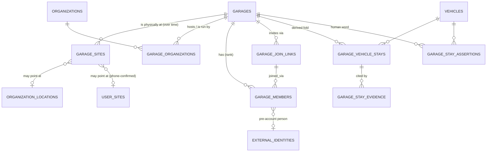

# The garage model — one place, many cars, many people, a timeline

See also: [`JOIN_LINK.md`](JOIN_LINK.md) — the join link end to end (mint, preview, redeem, approve; iOS and server drafts).

Status: **DRAFT SPEC, nothing applied.** Companion files: `supabase/drafts/garage-model/migrations/20261112100000_garage_core.sql`
(draft DDL, not applied), `supabase/drafts/garage-model/README.md`, `supabase/sql/test_garage_core.sql` (about 85 assertions, passes).
Written 2026-11-12 by the SPEC lane against `origin/main` `69db0229a` and the live project `qkgaybvrernstplzjaam`
(read-only; catalog snapshot 2026-11-12 ~10:50 AM AST, row reads the same day, AST = UTC-4).

**How to read the labels.** `[live]` = I read it from production on 2026-11-12. `[catalog]` = from the catalog snapshot (policy
text, column lists; row counts there are planner estimates, marked est). `[study]` = taken from the prior photo-truth study
(`MODEL.md`, `presence.json`, same day), not re-run by me. `[repo]` = repo file only, not checked live. `[inferred]` = my reading.
Counts without a label do not appear in this document. People other than Skylar are never named: ids, roles and counts only.

---

## 1. The concept, in one paragraph

The garage is a **shared physical place**. Skylar's holds roughly 40–80 cars right now and has a **timeline back to about
2017**. His relationship to each car differs wildly (owned, Viva Las Vegas Autos inventory, customer work, storage,
consignment, passing through), and **ownership is only one of those relations; contribution is not ownership**. Other people
(technicians, staff, customers) add data to the same place. That data is **relevant to him and affiliated to him through his
high rank in the garage, but it does not originate from him**: the person who *made* the evidence and the garage it *belongs
to* stay two separate facts. The hard part is navigating all that evidence to say accurately **what is in the garage now, and
whether that answer is up to date**, and the same thing **as of any date** back to 2017. The north star: he sends a link to his
technicians and data begins to flow and exchange. Today it is all in a bunch of random places; this model is the *rassemblement*
that brings them together. The screen expresses the model: no invented numbers, and unknown is shown as unknown.

---

## 2. The place, and how it relates to organizations

### 2.1 Decision: `garages` is a new, thin table. It is not a role on `organizations` or `organization_locations`.

The CONTRACT names are kept (`garages`, `garage_sites`, `garage_members`, ...). The backing is new for these reasons, each
checked live:

1. **An organization is not a place.** `organizations` is a public-by-default registry `[live: 8,560 est rows in the catalog;
   Skylar's own seven memberships include a dealer, a marketplace, three "collection" orgs, a restoration shop and a garage-typed
   org that is inactive]`. Dealers, auction houses and scrapers' sources all live there. One org can run several places and one
   place can host several orgs (below). A role on the org row cannot say "this org's cars sit in that org's building".
2. **`organization_locations` is public.** `[catalog]` its SELECT policy is `true` ("Anyone views org locations"), 4,571 rows
   `[live]`. A garage's coordinates must not be public. `garage_sites` is private to members of rank ≥ 50 and *points at* an
   organization location (nullable) rather than being one.
3. **`organization_contributors` cannot carry rank.** It is 10 rows `[live]` and is readable by anyone: `[catalog]` its SELECT policy is
   `true`. Its roles include `board_member`, `moderator`, `historian`, `contractor`, `contributor` (no ladder), every row is
   `self_claimed`, and **no code path creates a row from an invite** `[study]`. Rank and an approval trail cannot be bolted onto that.
4. **The repo already says "extend, don't mint" for the user's *collection* garage** (`docs/design/GARAGE_EVIDENCE_MODEL.md` `[repo]`).
   That document is about a different thing: the owner's list of cars and his role on each (see §2.4). The *place* has no home
   anywhere (`garages` is not a table, a view or a function `[live: 404 through the proxy; absent from the catalog]`), so nothing is
   duplicated by creating it.

Where I deviate from CONTRACT.md I say so explicitly:

| Contract says | Draft does | Why |
|---|---|---|
| `garages.operator_organization_id` only | **plus** `garage_organizations(garage_id, organization_id, kind operator/hosted/tenant, valid_from/to)` | Hosted orgs (Viva) are many-to-many and dated. A single FK cannot hold them. The operator FK stays as the contract has it. |
| `garage_vehicle_stays` has `relationship` | **plus** nullable `organization_id` | "dealer_inventory" is meaningless without *whose*. Nullable, additive. |
| `garage_stay_evidence` has no id / second clock | **plus** `id`, `recorded_at` | AGENTS.md: two clocks on every datum (event vs knowledge). `observed_at` is the event clock; `recorded_at` is when the garage model learned it. |
| `garage_timeline` returns 5 columns | **plus** `basis jsonb` | CONTRACT says "counts carry their basis". A column is how that is enforced. |

### 2.2 The shapes (Mermaid)

### 2.3 Scenarios the shape must hold (each one is a row-level fact, none is a special case)

| Scenario | How it is held |
|---|---|
| **His shop (operator org runs it)** | `garages.operator_organization_id` = that org; one `garage_organizations(kind='operator')` row; sites from `garage_sites`. |
| **Viva inventory in the same building** | `garage_organizations(kind='hosted')` for Viva (`c433d27e-…`); a stay's `relationship='dealer_inventory'`, `organization_id` = Viva. Viva's members are *not* garage members unless invited (§3). |
| **Another business works out of the same place** | The prior place classifier `[live: garage_derivation_evidence kind='place_match' matched photos to three different orgs' places, in the first 1,000 unsuperseded rows I read: 242 to the upholstery org, 175 to the marketplace org, 96 to Viva, 416 'neither']` says one building can be several orgs' "place". That is `kind='tenant'`/`hosted`, one garage, several orgs. It is also an open question (Q2). |
| **The shop moved** | Several `garage_sites` rows with `valid_from/valid_to`. A stay is evaluated against the site valid *on the sighting's date*. Nothing about the garage identity changes. |
| **One org, several places** | Several `garages` pointing at the same org via `garage_organizations`. |
| **A place with no org at all (a barn, a storage unit)** | `operator_organization_id` NULL. Allowed. |
| **A garage closes** | `status='closed'`; sites, stays, evidence stay readable by members for the history; no new stays derive. |

### 2.4 Naming collision to know about

In the repo and live DB, "garage" already means **a user's own collection of vehicles with his relationship to each**:
`get_user_garage`, `get_my_garage_owner_corrections`, `record_garage_owner_correction`, `revoke_garage_membership(vehicle)`,
`garage_derivation_evidence`, the `garage_relationship` registry key, many `backup_2026110*_garage_*` tables `[catalog]`. None of
those names collides with the new objects (checked against the live function and table lists), but the word is overloaded. The
CONTRACT binds `garages`; I keep it and recommend the UI say **"the shop" or the garage's own name** for the place, and keep
"garage" for the personal collection until Skylar picks (Q10).

---

## 3. Membership, rank, and what it replaces

### 3.1 Rank

`garage_role_rank(role)`: owner 100, manager 80, technician 50, staff 40, photographer 30, customer 20, viewer 10, anything else 0.
It is one IMMUTABLE function and it is the only place the ladder is written down. Contract test proves the ordering.

A membership row is `(garage, person, role, status)` where *person* is `user_id` (has an account) **or** `external_identity_id`
(an observed identity with no account; a CHECK requires at least one). Status: `pending → active → suspended / left / revoked`.
Two partial unique indexes allow **one live (pending/active/suspended) row per person per garage**; `left` and `revoked` rows
stay as history, so a person can come back through a new row and the old one is evidence, not overwritten (AGENTS invariant 2).
`status='active'` requires `approved_at` and `started_at`; it can only be reached by a SECURITY DEFINER writer, never by a client.

Who may do what (writers, all SECURITY DEFINER, none of them direct table writes):

| Action | Rank needed | Where |
|---|---|---|
| Start a garage (becomes owner, active) | any signed-in user | `create_garage` (real in the draft) |
| Mint a join link for role R | ≥ manager and ≥ R's rank; never `owner` (table CHECK) | JOIN lane |
| Redeem link → `pending` row (or `active` if `requires_approval=false`) | signed-in | JOIN lane |
| Approve / change role | ≥ manager, and not above own rank | JOIN lane `decide_garage_membership` |
| Say a car **is here / is not here** | ≥ 50 | `garage_record_assertion` (real) |
| Say a car **left on a date** / set its **relationship** | ≥ 80 | same |

### 3.2 What happens to every existing people-table

Verified row counts are `[live]` unless marked. "Replaces" means *new writes go to the garage model*; **no row is deleted** (liveness
rule 1: only the owner declares things dead; these are *frozen*, not removed).

| Today | Rows | What it really is | Fate |
|---|---|---|---|
| `organization_contributors` | 10; roles: technician 3, owner 1, board_member 1, moderator 1, photographer 1, contributor 1 (no user), historian 1, contractor 1; all `active`, all `self_claimed` | A claimed business role on an org. Public read. | **Stays** as the org-identity roster. It is **not** the garage roster and is never written by garage flows. A one-off *proposal* list of its 3 technician rows can seed `pending` garage_members for Skylar to approve (never auto-promote a self-claim to rank). |
| `vehicle_contributors` | 132; photographer 122 (119 active + 3 inactive), owner 4, mechanic 4, consigner 1, sales_agent 1 | Vehicle-level credit: who contributed to *this car*. | **Stays.** Read as a *relationship signal* for stays. Contribution ≠ membership. |
| `vehicle_contributor_roles` | 554 est `[catalog]` | Older per-vehicle role history; `shop_id` points at the archived shop model. | **Stays, frozen.** Read-only signal. |
| `vehicle_user_permissions` | 116: contributor 74 active/12 revoked/2 inactive, owner 1 active/17 revoked, previously_owned 7, consigned 3 | Edit access to a vehicle ("membership, not proof of title"). | **Stays.** Relationship signal only; never presence. |
| `technicians` | 12 (FK `shop_id` → archived shops table) | Old technician profile, many null. | **Frozen.** New technician = `garage_members(role='technician')`. Profile facts (specialties, pace) keep reading it until a separate decision. |
| `technician_phone_links` | 3 | Phone-onboarded technician with payout fields, `assigned_vehicles[]`. | **Frozen.** Each row is a pre-account person; migrate as `external_identity_id` members (pending) only when Skylar names them. |
| `telegram_technicians` | 1 | Telegram-era signup. | **Frozen.** |
| `business_invite_codes` + `generate_invite_code` / `use_invite_code` | 1 | Invite code that redeems into `telegram_technicians`, *never* into a membership. | **Superseded** by `garage_join_links` (hashed token, rank-capped). Old functions stay callable but nothing links to them. |
| `contributors` (249) / `external_identities` (~958k est) | | The pre-account identity graph (`contributors.user_id` / `external_identity_id`). | **Used, not replaced.** A pre-account person is an `external_identity_id` on a membership; when they sign up and the existing claim flow (`account_link_claims`) binds the identity, a SECURITY DEFINER function sets `user_id` on the same membership row. Garage code never mints identities (AGENTS: "never re-mint"). |
| `vehicle_contributor_invites` / `create_contributor_invite` / `contributor-intake` | 1 invite | The per-vehicle link: a person with no account opens it, answers questions and uploads photos pinned to **that one car**. | **Stays and is first-class** (§6). It is the narrow door; `garage_join_links` is the wide one. The upload is evidence *originated by* the contributor and *affiliated to* any garage where that car has an open stay. |
| `location_collaborations` | 2 `[live read; catalog est 3]` | Org-to-org place-sharing grants with `can_view_vehicles / can_add_work / can_view_work_history / can_upload_images`. | **Stays.** It is the only existing table that already says "another org may act in this org's place". Read it to *propose* `garage_organizations(kind='tenant')` rows and a default permission set. |

---

## 4. Vehicle stays: presence as intervals

### 4.1 Grain

One **stay** = one vehicle in one garage for one continuous interval, with **one relationship**. `garage_vehicle_stays` is a
**derived fold**: recomputable from evidence, versioned (`derivation_version`, `derived_at`), no write grant to any client,
and never hand-edited. Its citations are `garage_stay_evidence`. Humans speak through `garage_stay_assertions`, which the fold
reads but never overwrites.

The relationship set is the CONTRACT's: `owned, dealer_inventory, consignment, customer_work, storage, passing_through, unknown`.
`unknown` is a legitimate answer; the fold uses it whenever the evidence does not support one (AGENTS invariant 1).
Relationship can change during a stay (customer buys the car): that closes the stay with `departure_basis='relationship_change'`
and opens the next one on the same day. A stay carries one relationship so every count and every visibility rule is unambiguous.

**A returning car becomes a second stay.** Constraints in the draft: at most one *open* stay per `(garage, vehicle)` (partial
unique index), unique `(garage, vehicle, arrived_at)`. A stay closes (`departed_at` + `departure_basis`) on (a) an exit signal
(sale, listing, a ≥80 member's "left on <date>", record deleted or merged), or (b) an **unseen gap** followed by a new sighting
(§4.3). A later sighting after a close opens a new stay. History is therefore a list of intervals, never one flag.

### 4.2 Signals, classed by what they can prove

| Class | Signals (CONTRACT's `signal` values) | Can establish presence? | Can start a stay? |
|---|---|---|---|
| **A: location-proving** | `site_photo` (any member's or contributor's photo whose GPS falls inside a `garage_sites` circle valid on the photo's date; non-superseded, gate-approved or ungated, terminal vehicle), `member_assertion` ("here") | **Yes** | Yes |
| **B: supporting** | `work_session`, `org_link`, `receipt`, `contributor_link_upload` (no GPS) | **No, alone.** They can set relationship and raise confidence | Yes, as state `never_seen_here` (related, not seen) until a Class A arrives |
| **C: exit** | `sale_event`, `listing`, `member_assertion` ("left"), `record_deleted_or_merged` | n/a | closes a stay when dated *after* the last Class A sighting |

This is the owner's rule from `[study]` §7 made precise: org-link status and work sessions are "only supporting signals; on
their own they never decide 'here'". A work session is also derived and double-counts (1,925 rows, **0 with `place_id`**, **1 with
`technician_id`** `[live]`), so it cannot be Class A.

### 4.3 Computed state, thresholds, freshness

State is **computed at read time from the evidence as of a date, never stored** (CONTRACT). Rules, evaluated in this order:

| # | Condition (as of `p_as_of`, evidence with `observed_at ≤ p_as_of`) | State |
|---|---|---|
| 1 | The member assertion "here" is current and newer than the last Class A / exit | `here` (basis `member_assertion`, outranks everything below) |
| 2 | The member assertion "left" is current and newer than the last Class A sighting | `left` (basis `member_assertion`) |
| 3 | Vehicle record deleted or merged (follow `merged_into_vehicle_id` to terminal; a merge *moves* the stay onto the terminal record, a delete or an unresolvable merge makes it) | `gone` |
| 4 | An exit signal dated after the last Class A sighting | `left`, with `departure_basis` (`sale_event`, `listing`, ...) |
| 5 | Last Class A sighting ≤ **90 d** before `p_as_of`, no exit after it | `here` |
| 6 | 91–**365 d**, no exit | `probably_here` |
| 7 | > 365 d, no exit | `stale` (the UI asks, it does not guess) |
| 8 | Related to the garage (any Class B evidence) but **no** Class A ever | `never_seen_here` |

Every state returns `last_seen_at` (its freshness) and the evidence row that proves it (`proving_evidence jsonb`). 90 and 365
are the thresholds from `[study]` §7 and are **parameters of `derivation_version`**, not literals in a reader, so changing them
is a new version and an old as-of read can be reproduced under the old one.

**Unseen-gap split.** If two consecutive Class A sightings of one car are more than **180 d** apart, the earlier stay closes
(`departed_at = its last_seen_at`, `departure_basis='unseen_gap'`; that is the earliest it could have left, not a claim about
when) and the later sighting opens a new stay. 180 d is `[study]` §8's proposal; it is a parameter too. A car whose latest
sighting is 200 days old and has *not* been re-sighted is still one open stay in state `probably_here`; the split happens only
when new evidence arrives.

**Listing is a weak exit.** `[study]`: 109 of the 130 vehicles Skylar relates to have *some* listing event, so a listing is not
proof the car left. Rule 4 keeps the CONTRACT's behavior (a listing dated after the last sighting → `left`) but always carries
`departure_basis='listing'` so the UI says "listed 2026-03-02, not seen since" and not "left". A sighting after the listing
reopens (new stay), and an assertion overrides it. Open question Q4 asks whether a listing-only exit should read `left?`.

### 4.4 Human assertions outrank derivation

`garage_stay_assertions(kind: here | left | not_here | relationship, value jsonb)`. A new assertion supersedes the current one of the
same kind for the same car **only if the new speaker's rank ≥ the previous speaker's current rank**; otherwise the writer
refuses (a technician cannot overwrite the owner; tested). Superseded rows stay (AGENTS invariant 2). The fold may *agree* with an
assertion, flag a *conflict* (a sighting dated after "left on X": surfaced as a conflict item, never silently resolved), but never
rewrites it. Constraints: `left` needs `value.on`; `relationship` needs `value.relationship`.

### 4.5 As-of reads back to 2017

`garage_now(p_garage, p_as_of)` recomputes §4.3 from evidence with `observed_at ≤ p_as_of`, using the `garage_sites` row valid on
each sighting's date. That reproduces any past day without a stored snapshot. Limits to state in the UI, not hide:

* **Event clock only.** The draft stores `recorded_at` so a later version can add `p_known_at` ("what did we know then"). The
  CONTRACT signature has only `p_as_of`; adding a second argument later is additive.
* **Garage sites before 2024 are unknown.** `user_sites` has 5 rows for 3 users, created 2026-06-11/12, **none** linked to an
  organization location `[live]`. Skylar's own 3 include one with radius 1,771 m, which is too wide to auto-trust (§10 Q7). The
  earliest site photo among his related cars is 2017 `[study]`; where the shop *was* in 2017–2023 is not in the database.
  Until he confirms older sites, pre-site-history sightings return `probably`-grade evidence labeled `site unknown`, not `here`.
* **No-GPS photos fall out of Class A.** 1,766 of 14,156 photos on his 130 related vehicles carry no GPS `[study]`.
* **Duplicate vehicle records split one car's history** (three 1966 Mustang records, two K20 records `[study]`). Stays are keyed on
  the *terminal* vehicle (merge chain followed); unmerged duplicates stay a data-quality item, not something the garage hides.
* `[study]` upper bound (first-to-last site photo, no gap split yet) of **vehicles present at some point**: 2017: 6, 2018: 11,
  2019: 5, 2020: 6, 2021: 10, 2022: 11, 2023: 18, 2024: 42, 2025: 38, 2026: 25. That is the acceptance baseline for the PRESENCE
  derivation, not a number to show as truth.

### 4.6 Baseline today (so every future claim has a before)

`[study]` (computed on `presence.json`, 130 vehicles Skylar relates to, 2026-11-12): **14 here · 10 probably here · 11 stale · 41
left · 5 gone · 49 never seen at a confirmed site**. So the honest "here or probably here" count from the database today is **24**
against his statement of 40–80. The gap is explained, not hidden: no-GPS photos, sites he has not confirmed, and a backend that
only knows cars he photographed. This model's job is to *close that gap with evidence*, and the garage screen must show "24 of ?"
until it has closed.

---

## 5. Originator vs place-affiliation vs rank

Every piece of evidence has up to three separate facts. They live in different places on purpose, and none can be inferred from
another.

| Fact | Meaning | Stored as | Example |
|---|---|---|---|
| **Originator** | Who produced the evidence | `originator_user_id` **xor** `originator_external_identity_id` on `garage_stay_evidence`; for raw sources, the source's own author column (`vehicle_images.user_id`, `work_sessions.user_id`, the contributor row of an invite) | A technician's photo |
| **Place affiliation** | Which garage the evidence belongs to | The stay's `garage_id` (evidence cites a stay); for evidence *not yet placed*, derived at read time from "GPS inside a site" or "the car has an open stay there" and returned as `affiliation_garage_id` | The photo's GPS is inside Skylar's shop circle → belongs to that garage |
| **Reach (rank)** | How it gets to Skylar | **Not stored.** It is `garage_member_rank(garage, viewer)` at read time | He is rank 100 in that garage, so he sees it |

Consequences that the schema enforces or the readers must keep:

* **Capture credit never moves.** The technician stays the originator of his photo whether or not it belongs to Skylar's garage or to
  one of his cars. `garage_stay_evidence_read` returns ids only (originator + affiliation).
* **Affiliation ≠ ownership.** A photo affiliated to the garage is not a photo of Skylar's car and not Skylar's photo.
* **Originators always see their own contributions** (the evidence read policy has an `originator_user_id = auth.uid()` arm).
* A photo from a member's *own* vehicle roster can still land in the shop by GPS; placement to a *vehicle* stays a proposal
  (owner or the vehicle's permission holder confirms), per `[study]` §9.3 and the evidence-store design in AGENTS.md (that store is
  **not live**: its tables exist with 0 rows and none of its writer functions exist `[study]`).

---

## 6. Source-by-source feed table

Every source I found, live row counts read 2026-11-12 (AST) unless marked. **Trust** is how much a row can be believed *for the
garage question*, not in general. "Signal" uses §4.2's classes. Nothing here has been changed.

### 6.1 The sources the task named

| Source | Contributes | Trust | Gaps | Rows |
|---|---|---|---|---|
| `vehicle_images` `latitude/longitude/taken_at` + `user_sites` | **Presence (class A)**: a photo inside a confirmed site circle on its date | **Highest.** Photographer-device GPS + EXIF time. The phone-side door only uploads GPS-at-a-confirmed-site photos | `taken_at` is set on 99.9% of his rows but which came from EXIF vs a fallback is not recorded `[study]`; capture-time correction table is empty; ~12% of his related-car photos have no GPS `[study]`; `user_sites` has 5 rows total / 3 users `[live]`, so almost no site is known; duplicate vehicle records | ~64M est `[catalog]`; 29,749 are Skylar's `[study]`; 10,453 of 14,156 on his 130 related cars are inside a site `[study]` |
| `organization_vehicles` role=`owner` status active | **Relationship**: org holds the car (Viva: `dealer_inventory`). Not presence | Medium: bulk-linked from `vehicle_events` by trigger | 57 Viva `owner/active`; no dated interval | Viva c433d27e: 243 rows `[live]`: owner active 57 / sold 1; sold_by active 38 / past 36 / sold 2; work_location pending 53 / active 26; consigner active 20 / sold 3; service_provider active 7 |
| `organization_vehicles` `consigner` | **Relationship** `consignment` | Medium | Does not say the car is physically here | 20 active + 3 sold at Viva; 38 active at a "collection" org `[live]` |
| `organization_vehicles` `work_location` | Relationship `customer_work` or `storage` (ambiguous) | **Low**: 53 of Viva's 79 are `pending` (bulk), `auto_tagged` | Cannot tell customer work from storage; pending = unreviewed | Marketplace org f32ea08c: 45 active / 17 pending; upholstery org e796ca48: 11 active / 59 pending `[live]` |
| `organization_vehicles` `service_provider` | Relationship `customer_work` | Medium | Not presence | Viva 7; upholstery org 10 `[live]` |
| `organization_vehicles` `sold_by` | **Exit (class C)**: the org sold it (status `sold`/`past`) | Medium | `end_date`/`sale_date` often null | Viva 76 (38 active, 36 past, 2 sold) `[live]` |
| `organization_vehicles` `location_on_lot`, `location_id`, `days_on_lot`, `listing_status` | Possible bay/lot position and dwell time | Unknown | Columns exist `[catalog]`; **how many rows populate them: not measured** | n/a |
| `vehicle_ownerships` | **Exit/relationship**: owner periods; `basis` is only `auction_sale`, `owner_profile_id` almost always null (owners are external identities) | High for sale dates, none for presence | Does not cover private deals or the owner's own cars | ~350,630 est `[catalog]` |
| `vehicle_user_permissions` | **Relationship** (owner / previously_owned / consigned / contributor) | Low for ownership ("membership, not proof of title"); 17 of 18 owner grants are revoked | Says nothing about presence | 116 `[live]` |
| `vehicle_contributors` | **Relationship + originator credit** | Medium | Needs `user_id` NOT NULL, so a person with no account cannot be a row `[study]` | 132 `[live]` |
| `ownership_verifications` | Strongest ownership proof (approved title doc) | High when `approved` and unexpired | Tiny | **6** `[live]` (2 approved title docs, 3 expired, 1 approved no category). The catalog estimate said 55; the exact count is 6 |
| `organization_contributors` | **Membership claim** (not rank) | Low (all `self_claimed`) | No invite path writes it; public read | 10 `[live]` |
| `work_sessions` | **Supporting (class B)**: work happened on a day | Low–medium: mostly auto-derived from photo bursts (`capture_derived` 377+205, `auto_detected` 282 in his first 1,000) | `place_id` set on **0**; `technician_id` on **1**; `owner_confirmed_at` on 4 of his 1,914 `[study]`; placeholder dates 1978/1985; double counts | 1,925 `[live]` |
| `work_orders` / `work_order_assignments` | Signed jobs → **supporting + membership signal** (who was assigned) | High when signed | Viva's jobs have no assignments (audit 2026-11-07); assignments have **no SELECT policy** | work_orders 28, assignments 9 `[live]` |
| `technician_work_evidence` | **Supporting**: a model's reading that a technician performed an operation on a car at a time | Low–medium: AI-read from photos (`source_model`, `confidence`) | Not a physical presence proof | 73 `[live]` (the prior study saw 33 earlier: this table moves) |
| `receipts` / `receipt_items` | Supporting (a parts/labor purchase for a car); money, private | Medium | Dates often null on clean lines; says nothing about location | 2,509 `[live]` |
| `vehicle_events` / `auction_events` / `marketplace_listings` | **Exit (class C)**: sale outcome, listing | Sale: high. Listing: **weak** (109 of 130 related cars have one) | Listing ≠ departure | vehicle_events ~910k est, auction_events ~616k est `[catalog]` |
| `create_contributor_invite` + `contributor-intake` (per-vehicle link) | **Class B presence + originator**; `contributor_intake_file` writes straight into `vehicle_images` for that car with device attribution and visit logging | Medium–high for *who*; no GPS guarantee | One car per link; **1 invite ever** `[live]`; no link to a garage | `vehicle_contributor_invites` 1 `[live]` |
| `get_user_garage`'s seven routes (1 owner, 2 previously owned, 3 consigned, 4 documenting, 5 contributor, 6 profile record, 7 relationship review) | The **owner's collection** and his role per car | Medium: a relationship *projection*, not presence | "Documenting" = own photos in last 60 days (`created_at`, not `taken_at`); returns 2 owner rows for him while his own statements say 3 `[repo: PLAN.md]` | function, STABLE `[catalog]` |
| `facility_reservations` / `facility_asset_occupancy` | A time-range occupancy model, built for **equipment**, not vehicles | n/a | Both empty | **0** / est 0 `[live]` |
| `equipment`, `tool_inventory`, `assets`, `photo_asset_fold` | **Tools in the place** (not vehicles) | Low: `photo_asset_fold` is noisy (toys, gas pumps as "in_transaction") `[study]` | Free-text titles act as identity keys; iOS/web do not call the fold; `equipment` has RLS on and no SELECT policy | equipment 20; tool_inventory est 31; assets ~347,799 `[live]/[catalog]` |
| `vehicle_location_fold` / `vehicle_location_observations` | **Coarse place** (county/city) from photo GPS and listing text | Medium for "which county", none for "which building" | Public vehicles only; county-grain; cannot see a shop | observations ~804,946 est `[catalog]` |

### 6.2 More sources I found (the rassemblement)

| Source | Contributes | Trust | Gaps | Rows |
|---|---|---|---|---|
| **`garage_derivation_evidence`** (`kind`: `place_match`, `scene_label`, `place_exemplar`, `relationship_role`, `duplicate_judgment`; written by `scripts/garage/match-places.mjs`, `derivation-evidence.mjs`) | An **existing place classifier**: which org's place a photo matches (`conclusion` = an org id or `neither`), shop/dealer-lot scene labels, relationship roles | **Model judgment**, `producer_version = unversioned-import`, confidence 0.88–0.90 | Not derived by a versioned fold; writer script is unversioned; `superseded_at` supported but unused in my sample | 5,921 `[live]`; in the first 1,000 unsuperseded: `place_match` 929 (242 / 175 / 96 / 416 as in §2.3), `scene_label` 27 (13 `shop_interior`, 4 `paint_body`, 4 `outdoor_street`, 2 `dealer_lot`, 3 `other`, 1 `upholstery_work`), `relationship_role` 5, `duplicate_judgment` 24 |
| `location_collaborations` | Org-to-org place sharing with explicit abilities (§3.2) | High (explicit grants) | 2 rows; org-level, not person-level | 2 `[live]` |
| `org_site_photos(org, user, from, to, radius)` (STABLE fn) | **Existing GPS-to-place reader**, with a `shared_with` count for overlapping orgs and `vehicle_linked` | Same as GPS | Uses `organization_locations` (public) not a private site; capped at 5,000 photos | function `[catalog]` |
| `auto_tag_organization_from_gps`, `auto_link_gps_organizations`, `find_organizations_near_location(_v2)` | Writers/readers that *created* many `organization_vehicles` links from GPS (`auto_tagged`, `gps_match_confidence`) | Low–medium | Explains the bulk `pending` links | functions `[catalog]` |
| `user_sites` + iOS `SiteStore` / `IgnitionEngine` ("That's my shop") | The **phone-confirmed site** and the first admission door | High when confirmed | 5 rows / 3 users; one radius is 1,771 m `[live]` | 5 `[live]` |
| `organization_locations` (+ `geocode-organization-locations` cron) | Business addresses, geocoded | Medium | Public; many are scraped businesses, not places that hold cars | 4,571 `[live]` |
| `shop_locations`, `shops_archived_20260129`, `shop_licenses` | Archived shop model: 1 location, 2 archived shops | Low | `technicians.shop_id` and `vehicle_contributor_roles.shop_id` point here | 1 / 2 / 1 `[catalog]` |
| `dealer_inventory` | A dealer-inventory table with acquisition, asking, sale dates and consignment % | Unknown | **0 rows for Viva** (filtered exact count `*/0`); 3,092 rows total are other dealers. Viva's inventory is in `organization_vehicles`, not here | 3,092 `[live]` |
| `device_locations` | Phone location pings (device, lat, lon, time) | Unknown | Whose device and what they are linked to is not in the table; potentially *people's* arrival at the site, not cars | ~8,034 est `[catalog]` |
| `user_presence` | Who is viewing a vehicle page (`vehicle_id`, `user_id`, `last_seen_at`) | n/a | **Not a car-presence signal**: a name collision to avoid | ~34,717 est `[catalog]` |
| `timeline_events` (`organization_id`, `primary_technician`) | Documented work with an attributed performer | Medium | Viva: 60 org-linked maintenance events on 4 vehicles, none with a performer or work order (audit 2026-11-07) | audit, not re-read |
| `bat_seller_locations`, `fb_marketplace_locations` | A listing's stated location: a hint that a car is *elsewhere* | Low | A seller's city is not the car's bay | 335k / 582 est `[catalog]` |
| `vehicle_part_locations` | **Nothing**: positions of parts on a body | n/a | Name collision | 10 `[catalog]` |
| `organization_inventory_sync_queue` | **Nothing**: scraper queue for org websites | n/a | | 4,050 est `[catalog]` |
| `vehicle_images.exif_data.uuid` / `capture_landing_sets` / `capture_set_links` | **Provenance of placement** (why a photo is on a car) | High (cited legs) | 8,598 of 8,891 sets held for review `[study]` | `[study]` |

### 6.3 What cannot be known from any source today

Which building a no-GPS photo was taken in; where the shop was before the earliest known site; who physically carried a car in or out;
and whether a *listed* car was still on the lot. Each is shown as unknown, and each has a collection door in §10 (member
assertions, a confirmed site history, the join link).

---

## 7. What this replaces, deprecates, and must not touch

### 7.1 Replaces or deprecates (migration path)

| Object | Verdict | Path |
|---|---|---|
| `generate_invite_code`, `use_invite_code`, `business_invite_codes`, `telegram_technicians` | **Superseded** | JOIN lane ships `create_garage_join_link`; stop linking the old paths; freeze (no deletion). |
| `create_or_get_technician_link`, `technician_phone_links`, `technicians.shop_id` | **Frozen** | One-time proposal to attach named pre-account people as `external_identity_id` members. Archived-shop FKs are not repaired (separate decision). |
| `organization_contributors` as the way to be "in the shop" | **Not used for garage membership** | New joins never write it. Existing 10 rows stay as org roster. |
| The Garage tab reading *only* `get_user_garage` | **Extended** | It keeps the collection read and adds `garage_now` for the place. |
| Per-surface presence guesses (e.g. "documenting last 60 days") | **Reclassified** as a relationship label, not presence | No code removed. |

### 7.2 Must not touch (this work adds beside these; none is altered)

`vehicle_images` and its triggers/policies; `vehicles`; `vehicle_observations` and the sanctioned writers (`ingest-observation`,
`correct_vehicle_*`); the capture pipeline and vision gate; `organization_vehicles` and its sync trigger; `get_user_garage` and
`garage_derivation_evidence`; `vehicle_location_*`; auction and listing tables; the evidence store (not live); `user_sites`
(read, linked, never written by the garage model). Any **narrowing of a policy on a table the public site reads**
(`vehicle_images`, `vehicles`, `vehicle_events`) is a separate, individually gated change (AGENTS "Grants, policies and public
reads"): consumer grep first, `node scripts/ci/logged-out-live.mjs` after, and it is **not part of this SPEC's migration**.

### 7.3 Existing writer rules the new writers must respect

`create_garage` and `garage_record_assertion` are new SECURITY DEFINER writers. AGENTS.md lists sanctioned row writers; they need
adding to that list on merge. A human assertion is testimony. Step 8 of §10 also lands it in the observation log through
`ingest-observation` with a registered key (schema proposal, not a new prompt vocabulary), so the log, not just a convenience
table, holds it.

---

## 8. The read functions the app calls

All SECURITY DEFINER, `search_path = public, pg_temp`, gated by an *active* membership, `EXECUTE` revoked from `PUBLIC` and `anon`
(`authenticated` and `service_role` only). Signatures are the CONTRACT's; bodies marked **STUB** raise `0A000` in the draft so
nothing mistakes an unfilled body for an empty garage.

| Function | Returns | Surface that reads it | Draft |
|---|---|---|---|
| `garage_my_garages()` | `garage_id, name, garage_status, member_id, role, rank, member_status, started_at` (pending shows, so "waiting for approval" is real) | Garage tab header, garage switcher | **real** |
| `garage_now(p_garage uuid, p_as_of timestamptz default now())` | `vehicle_id, state, relationship, last_seen_at, arrived_at, departed_at, evidence_count, proving_evidence jsonb, my_visibility` — one row per vehicle | **Garage tab "In the shop"**, vehicle card chip, as-of scrubber | STUB (PRESENCE) |
| `garage_timeline(p_garage uuid, p_from date, p_to date, p_bucket text default 'month')` | `bucket, here_count, arrivals, departures, unknown_count, basis jsonb` | **Timeline strip 2017→now** | STUB (PRESENCE) |
| `garage_stay_evidence_read(p_stay uuid)` | `signal, source_table, source_id, observed_at, recorded_at, originator_user_id, originator_external_identity_id, weight, affiliation_garage_id` | **Evidence drawer** ("why is this car here") | STUB (PRESENCE) |
| `garage_members_read(p_garage uuid)` | `member_id, user_id, external_identity_id, role, rank, status, started_at, joined_via_link` (ids and roles only; rank ≥ 30 reads; non-active rows only for ≥ 80) | **Member roster** | **real** |
| `garage_inbound_feed(p_garage uuid, p_since timestamptz)` | `source_table, source_id, vehicle_id, observed_at, recorded_at, originator_user_id, originator_external_identity_id, affiliation_garage_id, placement_state, needs_decision` | **Inbound feed** ("what members added") | STUB (PRESENCE) |
| `garage_member_rank(p_garage, p_user default auth.uid())` | int (0 unless active) | every policy and function | **real** (policies need it; VISIBILITY keeps the signature) |
| `can_see_vehicle_via_garage(p_vehicle, p_user default auth.uid())` | boolean | `garage_now`, media readers | STUB, **fails closed** (false) |
| writers `create_garage(name, operator_org)`, `garage_record_assertion(garage, vehicle, kind, value)` | uuid | Garage setup; "here / left / relationship" actions | **real** |

Return values for `garage_now` fill `my_visibility` with one of `full | summary | none` (VISIBILITY's call): `summary` means "you may
know the car is here, not see its media or money".

### 8.1 What the Garage screen can honestly show

| Stage | Shows | Must say "unknown" for |
|---|---|---|
| **Today** (no garage tables; `get_user_garage` only) | His cars by *relationship* (owner / previously owned / consigned / documenting / contributor / profile record / review) with last-activity date. **No presence claims** | Everything about "in the shop now", its count and the timeline. A "documenting" row is not a presence claim |
| **After step 1** (core applied, his garage + confirmed site exist) | Garage name, operator and hosted orgs, member list (1 owner), the confirmed site(s) | Cars present: "—, not derived yet" |
| **After step 2** (PRESENCE derivation) | One line per car with state, relationship, `last_seen_at` and the proving photo. Counts as **"N here, M probably here, K stale, L left, P never seen here, G gone"**, each with `n` and the as-of date. Baseline to beat: 14/10/11/41/5/49 of 130 `[study]` | The number he said (40–80) is not displayed until evidence supports it. The screen shows the *gap* ("related cars not yet located: 49") not a total he did not earn |
| **After step 3** (timeline) | Monthly strip back to 2017: here_count / arrivals / departures / **unknown_count**, each with its basis; pre-site-history months labelled `site unknown` | Months before any confirmed site |
| **After step 4** (join + roster) | Roster with ranks, pending approvals, the link | Anyone's *presence* (a roster role, an upload or a session is not physical presence: `[audit INTEGRATION.md]`) |
| **After step 5** (inbound feed) | "Added by others" feed with originator (id → display name resolved by the app under its own visibility), the car it's affiliated to, `needs_decision` | Which vehicle a no-GPS upload is of |

---

## 9. RLS and visibility: role × relationship

### 9.1 What the draft DDL already enforces (tested)

* RLS **enabled** on all 8 garage tables. **No INSERT/UPDATE/DELETE policy and no write grant** for `anon`/`authenticated`; every write is a SECURITY DEFINER function (or the service role, which bypasses RLS).
* Reads: garage row and hosted orgs → any active member; `garage_sites` (coordinates) → rank ≥ 50; join-link rows (hashes only) → ≥ 80;
  `garage_members` → your own rows (incl. pending) or ≥ 80 sees all; stays, citations, assertions → ≥ 80, plus an originator sees their
  own citation and an asserter their own assertion. Ranks 10–70 reach stays only through `garage_now` / `garage_stay_evidence_read`, which
  apply `can_see_vehicle_via_garage`.
* A non-member, a pending applicant and `anon` read nothing (tested for every table and function). The visibility helper is a stub
  returning `false`, so by default **no one below manager sees a car through a garage** until VISIBILITY fills it.

### 9.2 Visibility matrix (policy intent; VISIBILITY lane writes the bodies)

R = rule of thumb from CONTRACT.md. "Here" = state `here` or `probably_here`. "Grant" = an explicit per-vehicle grant or assignment.

| Viewer ↓ / Stay relationship → | owned | dealer_inventory | consignment (incl. pre-auction) | customer_work | storage | passing_through | unknown / never_seen |
|---|---|---|---|---|---|---|---|
| **owner 100** | all | all | all | all | all | all | all |
| **manager 80** | all | all | all | all | all | all | all |
| **technician 50** | here only; media if here | **no**, unless grant | **no**, unless grant | here only, + all assigned | here only | here only | assigned only |
| **staff 40** | as technician for reads; no work writes | no | no | here only | here only | here only | no |
| **photographer 30** | cars they were invited for / assigned + own uploads | no | no | invited/assigned only | no | no | no |
| **customer 20** | **their own cars only** (matched by vehicle permission / ownership), own receipts and work | never | never | own cars only | own cars only | own only | own only |
| **viewer 10** | name and counts only; no vehicle media | | | | | | |
| **originator (any)** | always their own contributions, whatever the rank | | | | | | |

| Thing | Who sees it |
|---|---|
| **Media** (photos of a stay) | per matrix above; **never** raw image URLs through a garage function without the existing vision-gate/redaction path |
| **Roster** | active members rank ≥ 30; pending/left/revoked rows ≥ 80 |
| **Money** (cost basis, asking, receipts, books, labor rates) | **owner only by default**. A manager's operational view (work orders, quotes) is a decision (Q5); the books docket's own owner-only rules are unchanged |
| **Consignment / pre-auction** | managers and above, plus the consigning customer for their own car. Technicians never by default (Viva's Porsche 356 / Corvette / Chevelle are pre-auction inventory, not personal holdings, per Skylar `[audit INTEGRATION.md]`) |
| **Site coordinates** | rank ≥ 50 |
| **Join links** | rank ≥ 80 (hashes; the raw token is shown once at creation) |

### 9.3 The holes in the current system, re-verified today, and how the model closes each

All policy text read from the catalog snapshot 2026-11-12 ~10:50 AM AST.

| # | Hole (`[catalog]` policy text) | Effect today | How the model closes it |
|---|---|---|---|
| H1 | `vehicle_images` "**Organization members can view org vehicle images**": any `organization_contributors` row with `status='active'` for an org linked via `organization_vehicles` sees *every* image of *every* linked vehicle | Role-blind and relationship-blind: a technician sees pre-auction consignments. Hundreds of vehicles are linked across his orgs `[study]` | **New access never rides this.** Garage membership lives in `garage_members`, not `organization_contributors`, so a joined technician gains nothing through H1. Narrowing H1 itself is a separate gated change (consumer grep + `logged-out-live`), step 7 |
| H2 | `organization_contributors_select` is `true` | Anyone can read any org's roster (user ids, roles) | Garage rosters are not public (`garage_members_read`, rank ≥ 30). H2 itself is outside this change and is listed for step 7 |
| H3 | Three `vehicle_images` INSERT policies, including "Authenticated users can upload images to any vehicle" (with `user_id = auth.uid()`) | A signed-in user can attach a photo to any vehicle | Evidence from a member reaches a garage only through GPS-in-site or a link bound to a car; unplaced uploads show in the inbound feed as `needs_decision`, so an attached photo is a *claim of placement*, not placement |
| H4 | `vehicle_images` owner UPDATE/DELETE policies ("Allow vehicle owners to update/delete images", `vehicles.user_id/uploaded_by`) reach images **other people uploaded** to the owner's cars | The shop owner can alter or delete a technician's evidence | The garage model never deletes: stays/citations are derived, assertions are superseded. Stopping the delete path on `vehicle_images` is a separate gated change; until then the citation rows survive as `record_deleted_or_merged`-style evidence only if the *source* row disappears (the fold records that, it does not hide it) |
| H5 | `work_sessions` select policies recognize `user_id`, `vehicles.owner_id/user_id` and `vehicle_user_permissions`, **not** org or garage membership | A shop owner cannot see a technician's session on a customer car unless he owns the car or has a permission | The garage inbound feed reads sessions through a SECURITY DEFINER path gated by `garage_member_rank ≥ 80`; no change to the `work_sessions` policies |
| H6 | `work_order_assignments`: policies absent (no row in the policy snapshot), so default-deny for clients | Assigned technicians cannot read their own assignments from the app | A garage read function exposes *own* assignments (rank ≥ 50); the table keeps default-deny |
| H7 | `organization_locations` "Anyone views org locations" (`true`) | A building's coordinates are public | `garage_sites` is private and only *points at* a location; the garage never writes a coordinate into the public table |

---

## 10. Build order and open questions

### 10.1 Smallest real steps

Each step is one migration or one function per commit (AGENTS: CI applies only the last commit's new migration files), verified live
after, with before/after numbers.

| # | Step | Acceptance (what proves it) |
|---|---|---|
| 0 | **This PR**: SPEC + draft DDL + contract test. Nothing applied | `PG_BINDIR=… bash scripts/ci/run-db-contracts.sh test_garage_core.sql` passes |
| 1 | Move the core migration into `supabase/migrations/` **only on Skylar's approval**; push alone; verify. Then **he** (signed in) calls `create_garage` for the shop; a data step adds his *confirmed* `user_sites` as `garage_sites` (radius reviewed, Q7) and hosted orgs (Viva) | live catalog shows 8 tables, RLS on; `garage_my_garages()` returns 1 row for him; `scripts/ci/logged-out-live.mjs` clean (no public-read table changed) |
| 2 | **PRESENCE**: a versioned derivation `garage_derive_stays(garage, version)` writing stays + evidence from class A/B/C (§4.2) over the sources in §6; bodies for `garage_now`, `garage_stay_evidence_read`. Run by hand first, then one cron if it earns one | Reproduces the study baseline (14/10/11/41/5/49 of 130) or explains each difference; a 2024-12-31 as-of read is consistent with the 2024 upper bound (42); every `here` row cites a photo id; re-running the same version yields identical rows |
| 3 | `garage_timeline` body; iOS Garage tab reads `garage_now` + timeline | Screen shows only counts with `n`, as-of date, basis; unknown shown as unknown |
| 4 | **JOIN**: `create/preview/redeem/revoke_garage_join_link`, `decide_garage_membership`; iOS universal link `/join/:token`; roster UI | A second account joins from a link as `pending`, is approved, appears in the roster at the right rank; old invite paths unreferenced |
| 5 | Inbound feed + member contributions: GPS-in-site photos from members become class A evidence with originator ≠ Skylar; unplaced ones wait as `needs_decision`; the "here / left / relationship" assertion actions | A technician's photo shows in Skylar's feed with originator and affiliation separate, and the car's `last_seen_at` moves; the originator can still see it |
| 6 | **VISIBILITY**: real `can_see_vehicle_via_garage` and `my_visibility`; role × relationship matrix tested with seeded users | Matrix §9.2 is a test; a technician cannot see a consignment car's media through the garage |
| 7 | Separate, individually gated policy narrowing for H1–H4 (consumer grep, `logged-out-live`), one PR each | Each PR: grep of consumers, live probe before/after |
| 8 | Mirror assertions into the observation log via `ingest-observation` with a registered key (`schema_proposals`, not a new vocabulary); connect to the evidence store when it deploys; freeze old invite/technician paths | Assertions appear as observations with source and clocks |

### 10.2 Open questions for Skylar (decision-shaped)

1. **Which org operates the shop's garage?** Options: the marketplace org he owns (`f32ea08c`), Viva (he is `board_member`), or none (operator NULL, every org hosted). My default: the org that actually does the work in the building. I need his word.
2. **Is the upholstery shop's "place" the same building as his?** The classifier matched 242 / 175 / 96 of the first 1,000 photos to three different orgs' places. If it is one building, it is one garage hosting several orgs; if two, two garages. Default: one garage, three orgs, and he confirms.
3. **Are Viva's staff garage members, or only org members?** Default: only if invited; a Viva `board_member` role does not grant garage rank.
4. **A listing with no later sighting: show `left` or `left?`** Default: show `left` with the basis printed ("listed <date>, not seen since"); 109 of his 130 related cars have some listing.
5. **Does a manager see money** (cost basis, quotes, receipts), or owner-only? Default: owner-only for cost basis, books and receipts; managers see work orders and quotes.
6. **May a technician (rank 50) state "here / not here"?** Default yes for here/not-here, no for "left" and relationship (≥ 80). Their statement can be superseded by a higher rank but never the reverse.
7. **Sites: which are real, and where was the shop before 2024?** His 3 confirmed `user_sites` include a 1,771 m radius that is too wide to trust. Default: auto-accept ≤ 300 m, ask about the rest, and list per-year GPS clusters for him to name older locations. Until then 2017–2023 sightings return as `site unknown`.
8. **Do no-GPS photos and contributor-link uploads count as "seen"?** Default: no for `here`; they are supporting evidence and move a car from `never_seen_here` to "related, location unconfirmed".
9. **Should customers be garage members at all**, or only get the per-vehicle contributor link? Default: members at rank 20 see only their own cars, but the per-vehicle link stays the primary customer door.
10. **Name.** Keep `garages` (CONTRACT-binding) while "garage" also means his personal collection? Default: keep the table name, call the place "the shop" or its own name in the UI.
11. **Should assertions also be written as observations now** (step 8 early), or after presence ships? Default: after, so the first ship stays small.
12. **Gap split (180 d), freshness (90/365 d):** keep the study's numbers as v1 parameters? Default yes, and revisit with his as-of replays.

### 10.3 Disagreements with the contract (do not rename silently)

Additive only, none breaks a CONTRACT name: `garage_organizations` (new), `garage_vehicle_stays.organization_id`,
`garage_stay_evidence.id` + `recorded_at`, `garage_timeline.basis`, `garage_my_garages` returning extra columns, and join links
forbidding the `owner` role at table level. If the orchestrator disagrees with any, the draft can drop the addition without
touching the rest.

---

## Appendix A. Live reads behind the numbers (2026-11-12, AST; all GET through the read proxy)

`user_sites` 5 rows (3 users; Skylar 3, all `source=ignition`; `organization_location_id` null on all). `organization_locations`
4,571. `organization_contributors` 10. `organization_vehicles` for Viva 243 rows, for his six other orgs 180 rows (below the 1,000-row
cap, so complete). `vehicle_user_permissions` 116. `vehicle_contributors` 132. `ownership_verifications` 6. `work_sessions` 1,925 (`place_id`
not null: 0; `technician_id` not null: 1). `work_orders` 28. `work_order_assignments` 9. `technician_work_evidence` 73. `technicians` 12.
`technician_phone_links` 3. `telegram_technicians` 1. `business_invite_codes` 1. `vehicle_contributor_invites` 1. `contributors` 249.
`receipts` 2,509. `dealer_inventory` 3,092 (Viva: 0). `equipment` 20. `facility_reservations` 0. `garage_derivation_evidence` 5,921.
`location_collaborations` 2. `garages` and any `garage_*` place table: not found.

**Drift noted** (live wins): `ownership_verifications` catalog estimate 55 vs exact 6; `technician_work_evidence` 33 in the prior study vs 73 now;
`technicians` 12 now vs 3 in the catalog estimate; `organization_contributors` 11 est vs 10 exact; `garage_derivation_evidence` 5,716 (catalog) vs 5,921.
Row counts for vehicle_images, vehicle_events and similar big tables are planner estimates and are labelled so.
