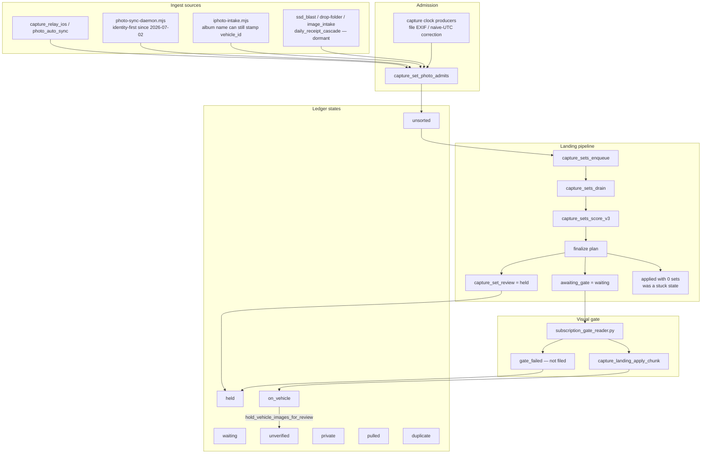

# Photo-sorting and ingestion pipeline

Technical documentation of how Nuke's photo library is ingested, admitted, scored, gated, held, and repaired. Written 10 November 2026 for Skylar Williams after he asked that the continuous sorting work be documented technically.

Times in this document are **America/St_Barthelemy (AST, UTC−4)** unless a timestamp says otherwise. Capture-set **days** and the ledger RPC are computed in **America/Los_Angeles**, because that is the timezone the landing planner uses for shop and library days. Those two clocks must not be mixed.

This document is grounded in `/workspace/sortrun` operators' notes and scripts, the `sss97133/nuke` repository (migrations, producers, `docs/receipt-work-contract.md`, and the named pull requests), and a live read-only ledger query. Anything not independently re-verified in this writing is marked as such. No secrets are included.

## 1. Purpose and how to read this

The job is not finished until every photo in the library is sorted. Success is the **unsorted** ledger count reaching zero — not the number of review holds, and not the number of photos already sitting on a vehicle.

Two kinds of work run side by side:

- **Filing work** moves unsorted photos into a later ledger state (usually `held` or `waiting`, and only onto a vehicle after a visual gate pass). This is what shrinks the backlog.
- **Gallery hygiene** takes already-filed photos that do not belong on a vehicle off the public gallery, through a reversible review hold. That work does not reduce unsorted, but it keeps confirmed sets from poisoning later visual tests.

Repairs are always a versioned producer or a sanctioned RPC, never a hand-patched row. Each write is signed by a run id (and, for producers, a commit). Every write has a documented revert.

## 2. Success metric and operating stance

Skylar is nontechnical. The operator decides with checks and rollback rather than asking him to choose a SQL path. Releases that pass CI and the contract tests are pre-approved to apply. Work happens in verified batches of about 50 photos. Nothing is deleted without an explicit yes. Vehicles are never deleted. Personal and private photos are skipped. The 276 live privacy-hold rows are left untouched and are excluded from every analysis share; the local 449/452-id privacy backup union is a superset of them and is the exclusion list used when the live hold set is not re-queried.

Skylar's labels, when they exist, are a held-out answer key, never model inputs. No paid API keys are used. Visual judgments use his existing Claude subscription (Claude Code on the Mac, or `claude -p` on the box with OAuth). Codex image analysis, when used, is the same rule: signed, revertible, no paid key.

## 3. Architecture and data flow



A photo enters `vehicle_images`. If it is admitted (library source plus a real camera clock in `exif_data`), the landing planner can put it in a **capture set** for a calendar day. The drain runs the official scorer. Finalize either:

- marks a **clear** set and leaves the chunk `awaiting_gate` (ledger: `waiting`),
- writes an open `capture_set_review` row (ledger: `held`),
- or, historically, could mark the plan `applied` with zero sets, which left eligible photos unsorted until `capture_sets_arm_empty_applied` made those days re-armable.

Only the visual gate may file a clear set onto a vehicle. The gate reader builds a contact sheet (reference photos on top, samples below), records `correct` / `wrong` / `unclear` verdicts, and calls the official gate check. A pass applies the chunk (`on_vehicle`). A fail leaves the photos unfiled (`held` or still unsorted leftovers). Sensitive and personal samples cause the reader to skip the chunk untouched.

Already-filed public photos that do not belong on a vehicle are not deleted and are not hand-updated. They go through `hold_vehicle_images_for_review`, which sets `vision_gate_status = review_needed`. The ledger maps that to **`unverified`**, not `held`. `held` means an open capture-set review, not a vision-gate hold.

## 4. Ledger states

`capture_ledger_states(p_uid, p_tz, p_from, p_to)` is the official counter. The operator script is `/workspace/sortrun/ledger_now.py`. The live body after PR #3299 (migration `20261115180000`, applied 10 Nov ~13:11 AST) assigns one state per `vehicle_images` row for the user. A copy's own `rejected_*` or filed state still wins over `duplicate`.

| State | Meaning |
|---|---|
| `private` | `vision_gate_status = rejected_personal` |
| `pulled` | `vision_gate_status = rejected_misattributed` |
| `on_vehicle` | `vehicle_id` is set and `vision_gate_status = approved` |
| `unverified` | `vehicle_id` is set but the gate is not `approved` (including `review_needed` holds) |
| `failed` | `capture_upload_status.stage = failed` (rare in these counts) |
| `duplicate` | unfiled `is_duplicate` whose original is filed, held (open `capture_set_review`), `rejected_personal`, or `rejected_misattributed`. A missing original does not count. Reasons: `copy_of_filed`, `copy_of_held`, `copy_of_private`, `copy_of_pulled` |
| `waiting` | photo sits on a **clear** set whose chunk is `awaiting_gate` |
| `held` | photo sits on an **open** `capture_set_review` row |
| `unsorted` | none of the above (reason is usually `not_scored`) |

There is no ledger state for "document / typ=other / non-vehicle." `typ` lives at `ai_scan_metadata#>>'{classification,image_type}'` and is used by planning (typ `other` / `receipt_document` stay out of clear sets) but does not terminate a row by itself.

`privacy_promote_v1` (PR #3300, migration `20261115181000`, applied 10 Nov ~13:10 AST) moved already-classified `is_sensitive` unfiled rows to `rejected_personal`, so they now count as `private`. It does not make new judgments, does not touch photo content, and hard-skips empty `image_url` (the 276 privacy-hold class) plus IDs in `capture_privacy_promote_exclude` (the 452-id local backup union, loaded at run time, not committed in the repo). Revert a run with `capture_privacy_promote_revert_v1('<user>', '<run>')`.

Days are `(COALESCE(taken_at, created_at) AT TIME ZONE p_tz)::date` with `p_tz = America/Los_Angeles`.

## 5. Ingest sources

| Source | What it is | Identity at ingest | Status as of 10 Nov 2026 |
|---|---|---|---|
| `photo-sync-daemon.mjs` / `photo_auto_sync` | Live library sync. LaunchAgent `ag.nuke.photo-sync` every 15 minutes. | **Identity-first** since 2026-07-02: `vehicle_id` omitted; `ingest_image_identity_first`; the server pipeline files later | Default live path |
| `capture_relay_ios` | Phone / app relay, including some metadata-only rows | Varies; empty `image_url` rows include the privacy-hold class | Live uploads; last phone photo observed 4 Nov 2026 02:20 AST (warn Skylar if newer photos have not landed) |
| `iphoto` / `iphoto-intake.mjs` | Photos-library album dump | **Still able to stamp `vehicle_id` from the album name / `--vehicle-id`**, with no visual identity. Storage path `%/iphoto/%` (excluding daemon `users/.../photo-sync/`) | Rarely used but still live. Last non-daemon stamp observed 2026-10-30. `iphoto-overnight.sh` crontab is commented out. Draft PR #3280 routes new inserts through identity-first ingest (script only, nothing to apply in Postgres) |
| `ssd_blast` | Bulk SSD ingest | Stamped `vehicle_id` at ingest | Last write 2026-04-11; not scheduled |
| `drop-folder` | Folder intake | Stamped `vehicle_id` at ingest. `derive-image-exif` historically stored naive DateTimeOriginal as UTC (7–8 hours early vs Los Angeles) | Last write 2026-03-27; not scheduled. Clock correction shipped in migration `20261114120000` |
| `image_intake` | Older intake | Some stamps; 4 residual rows had a real file DateTimeOriginal but no Make — admitted 10 Nov by #3298 (DTO stamped, `taken_at` unchanged) | Last write 2026-05-30; not scheduled |
| `daily_receipt` / `daily_receipt_cascade` | `process-photo.mjs` / cascade, sometimes with `--vehicle-id` | Could auto-bless (`vision_gate_status=approved`). After the 2026-05-30 privacy incident, current `process-photo.mjs` sets `review_needed` and does not auto-bless | Last cascade write 2026-05-29; 0 daily_receipt rows created on or after 2026-05-30 |
| `direct_pull_2026_05_23` | One-off pull | 4 unadmitted rows, outside the clock-apply `SOURCES` list | Dormant; needs a separate admission policy |
| `user_upload` | Uploads that are not in the library-admission source list unless they have DateTimeOriginal | 242 still unadmitted (no file camera clock / no DTO in `exif_data`) | Still present in the unsorted leftover |

**Gallery pollution from stamped ingest.** A read-only audit on 10 Nov 2026 (~07:09–07:15 AST) counted approved, non-sensitive, non-superseded photos whose `vehicle_id` was stamped at ingest and `user_confirmed_vehicle` is false:

| Source | Approved stamped | Without capture-set or user confirm |
|---| ---:|---|
| iphoto-intake (album path) | 9,410 | 9,273 (137 have unreverted `capture_set_links`) |
| ssd_blast | 3,220 | capture-set join not finished (query timed out into the 07:15 outage) |
| drop-folder | 299 | capture-set join not finished |
| image_intake | 5 | vehicle grouping not finished |
| daily_receipt_cascade | 2 | vehicle grouping not finished |
| **five-source total** | **12,936** | |

Top iphoto-album vehicles included the 1973 Charger 318 (2,025), 1983 K2500 (1,276), 1977 Blazer (946), and 1966 Mustang 10A (812). This is the class `visual_identity_recheck_v1` is designed to re-check. That producer is **proposed, not shipped**. Do not use other stamped-at-ingest approved photos as the gold set for a vehicle.

Post-July daemon rows are not this class: 1,494 daemon iphoto rows were counted, 1,103 still null/`pending`, 391 approved with a vehicle, and no approved post-July daemon rows carried Bathroom/Toilet/Restroom Apple labels.

## 6. Admission, clocks, and the landing pipeline

### 6.1 Admission

`capture_set_photo_admits` is false until the photo is an admitted source **and** carries a DateTimeOriginal in `exif_data`. A `taken_at` value alone is not enough. Inventing a DateTimeOriginal from `taken_at` when the file has no camera clock is forbidden.

### 6.2 Clock producers (versioned, signed, revertible)

**`capture_clock_from_file` / `capture_clock_backfill_apply`** (migration `20261113121000`, PR #3245, applied live 9 Nov ~23:58 AST). Recovers DateTimeOriginal from the stored file. Writable only for camera originals (`source = file_exif` **and**, in the live apply body, Make present). XMP dates are not written (screenshots and edited graphics). Personal / sensitive / already-filed rows are skipped. Runs were signed `c10c0000-2026-4b09-a000-000000000001` … `0005` (218 rows, 27 `taken_at` fixes). Revert a run with `capture_clock_backfill_revert(run, false)`, then the migration revert SQL if rolling back the function.

**`capture_clock_backfill_apply` without Make** (migration `20261115121000`, PR #3298 against main, applied 10 Nov ~12:59 AST after db-contracts was green). Admits a file-EXIF DateTimeOriginal even when Make is absent. Still requires `source=file_exif`, still rejects XMP / guessed clocks, still skips personal / sensitive / already-filed / already-clocked. Signed run `b1c72d54-501f-4747-832e-a22f0155c007` wrote the 4 `image_intake` rows with `p_set_taken_at=false`; all four now admit, `taken_at` unchanged. Revert: `select capture_clock_backfill_revert('b1c72d54-501f-4747-832e-a22f0155c007', false);` then `supabase/sql/revert_20261115121000_capture_clock_backfill_exif_dto_without_make.sql`. The 238 with no camera clock in the file, 14 XMP, and 4 `direct_pull` were not stamped and still need a separate policy. Never invent a DTO from `taken_at` or from a neighbouring file.

Those two days (2024-06-22 and 2024-06-25, America/Los_Angeles) were re-armed at 13:16 AST on 10 Nov via the sanctioned `capture_sets_enqueue` onto `capture_set_rescore_queue` with reason `clock_admit=b1c72d54-…`. `capture-sets-drain` picked both up at 13:26:36 AST. Both days planned review-only (0 clear sets), so they applied without a visual gate: chunk `f1c93461` (run `d9dcb078-…`, 2024-06-22, 1 review / 3 photos) and chunk `3c8669d0` (run `29d918fc-…`, 2024-06-25, 6 reviews / 24 photos), all `no_clear_lead`. The two 2024-06-25 stamp rows (`243e9645`, `7e6010f5`, typ `vehicle_exterior`) entered an open review and are now held. The two 2024-06-22 stamp rows (`712c2f3a`, `b9439280`, typ `other`) were not placed in any set — typ coverage kept them out of clear and they were also left out of the day's review set (the 3 review photos were the admitted `engine_bay` frames). Of the 27 review photos, 25 were already on an open review; only the two 06-25 stamp rows are newly held. Nothing was filed.

**`capture_clock_naive_utc_apply` / `_revert`** (migration `20261114120000`, PR #3263, applied live 10 Nov ~01:57 AST after db-contracts was green). Corrects drop-folder rows whose naive DateTimeOriginal was stored as UTC. `derive-image-exif` now reads `OffsetTimeOriginal`, falling back to America/Los_Angeles, never UTC. 136 eligible rows were rewritten in signed runs `c14c0000-2026-4114-8000-000000000001`…`0003`. Sample 6/6 matched (118 PDT −07:00, 18 PST −08:00). Producer sha `c8157bff8`. Revert: `select capture_clock_naive_utc_revert('<run>', false);` then `supabase/sql/revert_20261114120001_capture_clock_naive_utc.sql`.

### 6.3 Landing: enqueue, drain, score, finalize

Official entry point for a day is `capture_sets_enqueue(p_user, p_day, p_reason)`. The drain loop (`/workspace/sortrun/drain_loop.py`) calls `capture_sets_drain({p_max: 3})`. It is intentionally **proposals and gate samples only — it does not file**. `capture_sets_drain` waits until `requested_at < now() - 10 minutes`, so a just-enqueued wave looks idle for about ten minutes. That delay is expected, not a hang.

Scoring is `capture_sets_score_v3`. It already excludes `is_sensitive`. A set may be **clear** (candidate for the gate) or **review** (reasons such as `no_clear_lead`, `score_below_threshold`, `priors_only`). Finalize writes `capture_set_review` for review sets and leaves clear sets in an `awaiting_gate` chunk.

A historical bug: finalize could mark a plan `applied` when `n_clear = 0` even if `sets = 0`. `arm_new` only fires on new arrivals, so those days never re-armed. On 10 Nov this was 1,153 photos / 361 days (eligible pool after privacy/dup/empty-url filters: **915 photos / 341 days**). Migration `20261114120100` (`capture_sets_arm_empty_applied`, PR #3264) made empty-applied days re-armable, with an epoch table so the same day does not loop. Applied live 10 Nov ~01:57 AST. Rollback: `supabase/sql/revert_20261114120100_capture_replan_empty_applied.sql`.

Related earlier landing fixes, also live-applied (some still draft / unmerged):

- `20261113120600` / #3236 — rearm-since function
- `20261113120700` / #3237 — admit predicate / tick / unfiled_exists / arm_new
- `20261113120800` / #3240 — `replan_state` ignores dry chunks
- `20261113120900` / #3243 — unseen admitted photos since a refused run count as new evidence (loop-proof via `capture_set_admission_epochs`)

The hourly cron `capture-review-sweep` (`17 * * * *`, migration `20261111140000`) can enqueue days with reason `new_anchors` after a gate pass. On 10 Nov at 03:17 AST it enqueued 141 days after the Mustang filings. That was a one-shot re-score, not the empty-applied auto-arm looping. 139 days went back to review (0 new links); 2 went `awaiting_gate` and the gate then refused both (look-alike R3500, and a Mustang sheet with error_rate 0.67).

**All-unclear gates** (PR #3296, migration `20261115170000`, applied 10 Nov ~12:58 AST): `capture_landing_gate_extend_v1` queues unused clear-set photos for another reader pass (never shrinks `required_n`); `capture_landing_gate_expire_all_unclear_v1` moves a fully sampled all-unclear chunk to review (`gate_undecided`), never to file. Extend run `7dbe86ed-…` queued 13 samples on chunk `ae2816b8`. Expire run `2db98281-…` expired 18 chunks (21 open reviews). The live reader then marked the 13 (11 correct / 2 unclear); the gate passed and apply filed 0 (`sets_refused=1`). Revert: `capture_landing_gate_extend_revert_v1` / `capture_landing_gate_expire_all_unclear_revert_v1`. Do not call `capture_landing_gate_check` as a dry-run (it writes and can halt landing).

Apply of a passed chunk is `capture_landing_apply_chunk`. Revert a filed chunk with `capture_sets_revert('<chunk_run>', '<user_id>')`.

## 7. The gate reader

Code: `/workspace/sortrun/gate_reader.py` (unattended). The live tuned reader lives on draft PR #3246 (`feat/gate-reader-tuning`, sha `46476d0ad` when re-enabled). Contract path: `capture_landing_finalize_plan` → `auto_filing_audit_queue(pre_gate)` → `filing_gate_eval` / `gate_check` → apply.

The reader uses the owner's Claude subscription (`claude -p`, OAuth). It does not set `ANTHROPIC_API_KEY`. It builds a contact sheet: green `REFn` tiles are approved references of the target vehicle; orange `Sn` tiles are samples. For each sample it must answer `correct`, `wrong`, or `unclear`. A different color, body style, or make is `wrong`. Chunks with any sensitive or personal sample are skipped untouched.

**Calibration bar (must pass on a held-out set labeled before the reader runs):** agreement ≥ 85% and false accepts (reader `correct` where the hand label is `wrong`) ≤ 2%. Skylar's labels are not used as inputs. The first calibration set (`a4055d31`, 170 samples) was an earlier Grok Bot hand audit and was treated as **dev**, not official.

| Set | n | Result | Consequence |
|---|---|---|---|
| gate2 (labels frozen before the pass) | 124 | agreement 0.911, FA 4/62 = 6.5% — **FAIL** | Four FAs were same-generation red crew-cab trucks treated as a "mark". Post-hoc relabel was rejected. Reader stayed off. |
| gate3 (new held-out, excluded all gate2 images, frozen 02:02 AST 10 Nov, before any pass) | 94 | agreement 81/94 = 0.862, FA 1/54 = 0.0185 — **PASS** | Official score after remapping hand "same" → contract "correct" on the same reads. The one FA is qid 2016 (gold door-jamb plate; hand wrong / reader correct). |

After gate3 passed, the live reader was started 02:18 AST 10 Nov (`--state-dir /workspace/sortrun/gate3`, not `--calibrate-only`, pid 2452903). Tightened mark rule: competing same-generation-and-colour owned vehicles are shown as LOOKALIKE tiles; generation/colour/body/make text alone is parsed as unclear.

**Live filings:** 87 photos, all onto 1966 Ford Mustang `83f6f033` (the black 10A), in two applied runs:

- `2b9e499d-a3a8-4008-8b7a-c66fd47feb29` (2026-08-31, 85 photos)
- `edacb1c2-13b2-478b-bfed-4d3df8ad83df` (2026-08-20, 2 photos)

First official spot-check at 87 filings (seed 20261110, random 10 of the 87, plus the two 2026-08-20 frames): **10/10 correct**, no wrong-vehicle filing. Next official spot-check was planned at ~137 filings (every ~50). No further filings occurred, so that second check was never reached. Later ticks either saw no new chunks or failed look-alike / high-error sheets (R3500 10/10 wrong; 2026-08-30 Mustang error_rate 0.67).

If a later sample is wrong: stop the reader, then `select capture_sets_revert('<chunk_run>', '0b9f107a-d124-49de-9ded-94698f63c1c4');` for the bad run. #3246 remains draft / unmerged. A supervisor (`supervise.sh`) restarts the reader unless a `halt` event is logged.

Computed pass rule used in the 10:08 AST dry characterization (without calling the writing RPCs): `(correct+wrong+unclear) >= required_n AND (correct+wrong) > 0 AND error_rate <= 0.05`. `capture_landing_gate_check` and `filing_gate_eval` both write, so they were not invoked in that dry pass.

## 8. The empty-applied sorter and drain

`/workspace/sortrun/emptyplan/build_pool.py` builds the eligible pool from the unsorted breakdown, skipping sensitive, rejected, duplicate/superseded, empty `image_url` (privacy-hold class), already-filed, and undated rows. Batches of about 50 photos are in `batches.json`, keeping a single large day in its own batch.

`run_batch.py` records ledger states for the batch's days, enqueues each day with reason `empty_applied_retry`, waits until every queue row has `done_at` (40-minute cap), then measures `unsorted_moved`. Exit 3 (wave stop) if `moved == 0` or `max_plan_s > 180`. `--measure-only` re-measures a drained batch; do not treat its `unsorted_moved` formula as proof of a new filing (it once reported movement on already-empty days).

`drive.sh` runs waves of four batches. Resume from the failed wave if a wave stops.

**Result, 10 Nov 2026:** batches 0–19 (915 eligible photos / 341 days). Batches 1–19 planned 879 and **moved 798**. Wave 0 moved 30 of 36 earlier the same morning. After batch 19 there are **no more batches** in `batches.json`. Do not rebuild and re-arm the same 341 days: they now have review sets and have left the empty-applied pool. Leftover unsorted on those days stays unsorted until a scorer or another producer can form a set.

## 9. Sanctioned review holds

The only sanctioned path to take a public gallery photo off a vehicle without deleting it is:

```text
backup vehicle_images rows
→ hold_vehicle_images_for_review(..., p_apply => false)   -- dry-run
→ hold_vehicle_images_for_review(..., p_apply => true)    -- signed run, cap 50 in operating procedure
→ verify vision_gate_status = review_needed and the count moved
```

Function contract: migration `20261020001000_vehicle_image_review_holds.sql`, test `supabase/sql/test_vehicle_image_review_holds.sql`.

- Service-role only. `p_items = [{image_id, signals}]`. Method, reason, and run are required.
- Moves named images of **that** vehicle that are currently public (`approved` or null) to `review_needed`. Owner and uploader still see them; the public read policy hides them.
- Not a final verdict. File hash, URL, vehicle, and other columns are unchanged. The cover is recomputed so a held frame is never the cover.
- Images of other vehicles, already hidden images, and unknown ids are skipped and counted.
- Audit rows go to `vehicle_image_gate_changes` (run, method, reason, actor, before/after, signals).
- Revert: `select revert_vehicle_image_review_hold('<run>', null, true);` (dry-run if the third argument is `false`). Restores the recorded before status, reasoning, and clock, marks the audit rows reverted, and recomputes covers.
- Operating cap is **50 per signed run** (the SQL function allows up to 2,000 items; the operator cap is 50).
- Skip `is_sensitive`, rejected_personal / misattributed, and the 276 / 452 privacy sets. Do not mark personal frames private from this path; log them for a later privacy pass. Never delete.

Draft PR #3206 (`image_cover_rank`) is a **view-type ranker, not an identity gate**. It reorders already-eligible covers (exterior first). It does not check whether the frame is the right vehicle, and it does not fix a gallery whose remaining approved frames are all wrong-vehicle or non-exterior close-ups (the 1979 C10 Ford-crank / oil-pan hero is the worked example).

## 10. Image-analysis stack and measured limits

No fingerprint or visual-gate producer was shipped from this stack. The ship bar used for auto-filing identity was **98% precision at a useful recall** on an honest **day-held-out** split (same-day siblings held out of the gallery, so the score is image data alone). That bar was not met.

### 10.1 Local CLIP pass — `local_image_analysis_v1`

Draft PR #3224, script `scripts/photo-pipeline/local_image_analysis.py`. Free local CPU: OpenCLIP ViT-B-32-quickgelu/openai embeddings (512-d, L2-normalized) plus ViT-L/14 zero-shot view labels. Writes one signed `image_observations` row per photo (`observed_by = local_image_analysis_v1`; `confidence_basis` carries agent, commit, models, run_id). `vehicle_id` stays null — no vehicle claim. Sensitive and privacy-hold rows are skipped before download. Revert: `python scripts/photo-pipeline/local_image_analysis.py --revert <run_id>` (deactivates rows, deletes nothing). Also `revert_codex_image_analysis_batch` for the Codex ingest path.

Run `192ec5d8-e570-4ca6-80dd-9559ce71adc7` finished 9 Nov 17:39 AST: **14,556** active observations. Operator box job: `/workspace/sortrun/analysis_supervise.sh`.

A first CLIP kNN fingerprint (k=5 mean cosine, seed 20261110, privacy excluded, no DB writes) on high-trust embeddings:

- Leaky photo split (same-day siblings still in the gallery): argmax acc 0.675. Margin ≥ 0.06: precision 1.000, recall 0.190. This is not a clean identity result (466/499 probes still had a same-day sibling).
- Honest day-held-out split: argmax acc 0.389. Precision 0.98 was only hit at a margin that barely recalls anything (margin ≥ 0.12: P=1.000, R=0.019). R3500 acc 0.0 on 4 probes. Held dry-run at the honest margin proposed only 2 photos, both disagreeing with the current review candidate.

CLIP ViT-B/32 global similarity is too coarse for look-alike trucks. No producer, no PR, no live fingerprint writes.

### 10.2 DINOv2 embed job

`/workspace/sortrun/fingerprint/embed_job.py`, local Facebook `dinov2-base` ViT-B/14 (768-d CLS + mean; 3×3 and 4×4 pooled patches; full 256 patch tokens kept only for focus vehicles). Also fills missing CLIP B/32 vectors and view labels. No DB writes. Privacy: 1,593 rows excluded, never downloaded. Self-stops if free disk drops below 10.5 GB. Checkpoint: `done_ids.txt` + `shard_*.npz`.

Manifest: 16,080 photos (16,075 confirmed filed + 5 held-missing with a usable storage object). Finished 10 Nov 09:49:17 AST (patched after the outage; see §16). Shard-backed embeddings 16,052. 28 ids are intended permanent skips (20 HTTP 400, 7 `UnidentifiedImageError`, 1 leftover `842cd16c` marked done during a process kill and not retried). Fetch timeouts / 5xx / 522 are retried and **never** marked done. 400/415/422 and 401/403/404/410 are permanent skips.

### 10.3 LightGlue re-ranker

CPU SuperPoint + LightGlue + RANSAC, local weights, no DB writes. Fused score `0.4*dino_cls + 0.3*clip + 0.3*log1p(inliers)/log1p(50)`. Artifact: `/workspace/sortrun/fingerprint/rerank_cal.json`. On the comparable 117-probe day-held-out split (3-vehicle mix, including two 1966 Mustangs), 98% precision appeared only at recall ≤ 0.068. 10A ↔ other-66 confusion stayed high (other-66 DINO acc 0.20). A later 580-probe split looked numerically better because it was 10A-dominated (other-66 acc 0.00–0.10). That is an imbalance artifact, not a look-alike result.

### 10.4 Look-alike calibration (fair split)

`/workspace/sortrun/fingerprint/calibrate_lookalike.py` and `lookalike_cal.json`. Honest day-held-out, cap 40 probes per vehicle so 10A cannot dominate, 10A neighbors restricted to the same paint era (`mustang_10a_eras.json`), held work-truck excluded. 821 probes / 7,898 gallery / 36 vehicles. DINO only in this run.

**Argmax accuracy 0.231–0.238.** No threshold hits 98% at a useful recall (`dino_mean_era` reaches P=1.0 only at threshold 0.2 with recall 0.017). Per-vehicle argmax (`dino_cls_era`): 10A 0.925, 1977 Blazer Cheyenne 0.875, 1983 K2500 Sierra Classic 0.775, 1983 K1500 0.40, R3500 0.325, 1974 K5 0.125, 1987 Suburban 0.075, 1985 Suburban 0.03, other 1966 Mustang 0.0. Top confusion is other trucks (and the 1974 K5) predicted as the 1983 K2500. Investment in the global DINO look-alike scorer stopped here.

Turquoise 10A frames are the **same car before its repaint**, not pollution. Era file: pre-repaint turquoise through 2022-09 (plus forced `1af03015`); bodywork/primer 2022-10-01–2023-06-16; post-repaint black from 2023-06-17. The other 1966 Mustang `67127bcb` is a different VIN and a gold car with a black vinyl roof; do not merge.

### 10.5 Local Claude Code visual pilot

40 day-held-out probes on the Mac (`/Users/skylar/lookalike40`, `ask_match.py`, owner's Claude subscription, no paid key). Vehicles A–H with G (1979 C10) dropped before asking because its confirmed set was heavily polluted. Artifact: `/workspace/sortrun/lookalike_pilot/score_final.json`.

| Slice | Precision when Claude commits | Coverage |
|---|---|---|
| Raw | 23/33 = **69.7%** | 33/40 = 82.5% |
| Exclude 3 mislabeled F golds (p11–p13) | 23/30 = 76.7% | 81.1% |
| Also exclude 3 more viewed gold-pollution frames | 23/27 = **85.2%** | 79.4% |

7 `cannot_tell`, 0 parse failures. Clue types on the 23 correct commits (a probe can have several): paint/color 23, body/trim 21, year/body-style 20, emblem/badge 17, mods/equipment 12, same-shop context 11, interior 7, rust/condition 6, wheels/tires 4.

A simulated next-pilot design (±30-day candidate window, two concrete identity clues required, shop-floor context alone does not count) would have lifted the honest slice from 23/27 = 85.2% to **23/25 = 92.0%**, coverage 25/34 = 73.5%. The two remaining misses are the red/cream 1985 Chevy vs 1987 GMC Suburbans that share the window. **92% is not a ship bar.** No producer was proposed.

### 10.6 Same-scene monopile dry-run (not shipped)

`/workspace/sortrun/held/same_scene_dryrun.py`. On days where every already-filed approved photo sits on exactly one vehicle, a naive tight-time / session / GPS rule would have proposed 150 held photos, almost all on the look-alike truck fleet. After a look-alike veto (1966 Mustangs and same-gen GM trucks/SUVs cannot be proposed from time/GPS/session alone) plus excluding reviews that already point at a different vehicle, documents, and `other_vehicle`: **would_propose = 0**. `monopile_same_scene_v1` was not shipped. A same-day monopile is often a mixed shop day where only one vehicle has been filed so far.

### 10.7 Codex batch (incidental observations)

Run `f0cd17b9-ce11-4ac4-9597-5b28fff5e3a7` (PR #3250, merged). 50 `image_observations`, `observed_by=codex_image_analysis_v1`, role incidental, `vehicle_id` null, signed in `layer_version` and `confidence_basis`. Overlap with the 276 privacy holds and the 452-id union: 0. Revert: `select * from revert_codex_image_analysis_batch('<run>', null);`.

## 11. Gross-mismatch ranker

Local, free, no writes until a confirmed hold. Scripts and artifacts: `/workspace/sortrun/garage/gross_mismatch_v1/` (`rank.py`, `rerank_isolation.py`, `fetch_review_sheets.py`, `ranked.jsonl`, review sheets, confirmations, backups).

**Method (isolation-first v2):** CLIP and DINO CLS embeddings. Same-vehicle 5th-nearest CLIP neighbor isolation `isol = 1 - nn5`, so engine and detail close-ups that have same-vehicle neighbors are not treated as mismatches. Plus other-vehicle centroid pull, CLIP text probes (bathroom, screenshot, document, packaging, person, wrong body), and observations where present. Singleton vehicles are not given a fake isolation score. A first centroid-distance pass was dominated by close-ups and noisy category labels and was not used.

Universe scored: 13,866 locally embedded filed/on_vehicle rows from the embed-job manifest (privacy already excluded). The exact 12,936 ingest-stamped unconfirmed ids were not persisted and could not be re-queried during the outage.

Uncalibrated candidate counts (before viewing):

| Set | n scored | score ≥ 0.8 | score ≥ 1.0 |
|---| ---:| ---:| ---:|
| Charger / K2500 / Blazer / Mustang 10A | 7,428 | 210 | 83 |
| All filed+embedded | 13,866 | 856 | 340 |

**Viewed precision (10 Nov, no writes from the view itself):**

- Top 30 (score band that starts at 1.12–1.64 per vehicle): **30/30 (100%)** gross (catalogs, screenshots, packaging, invoices, wrong vehicles, non-vehicle scenes). 19 of 30 were still approved gold.
- Random 30 on the four priority vehicles only: **2/30 = 6.7%** (Wilson 95% CI ~2–21%). That sample is not the full 13,866.
- Mid-band `0.8 ≤ score < 1.0`, top 30 on the four: 18/28 approved confirmed gross with a concrete clue; 10/28 host-like. Band yield 64% — **not** an automatic-hold band.

**Operating rule:** walk the per-vehicle ranked list from the top. Hold only with a concrete clue (document, screenshot, packaging, non-vehicle scene, or wrong make/body) after a second look. Stop if confirmation precision of holds drops below ~95% or a batch moves nothing. Do not auto-hold the 0.8–1.0 band.

**Holds applied 10 Nov 2026** (all `method = visual_identity_gate:grok-bot`, backups on disk, revertible):

| Wave | When (AST) | Held | Notes |
|---|---| ---:|---|
| 1979 C10 leftovers | 09:13 | 7 | Run `grok-garage-g1979c10-leftovers-202611100715` (after the earlier 50-hold `grok-garage-g1979c10-202611100703` at 07:03). New cover was an oil-drain pan — still a poor hero; not changed. |
| Four priority vehicles, score ≥ 1.0 | 09:22–09:23 | 62 | Charger 15, K2500 23, Blazer 3, Mustang 10A 21. 2 personal/minor Mustang frames skipped, not held, not deleted. Confirmation of holds 62/62 after a 64/64 approved second look (the two skips were the only approved leftovers in the band). |
| Remaining vehicles, score ≥ 1.0 | 09:55–09:56 | 54 | 23 signed runs. 145 approved second-looked; 86 left host-like; 5 personal skipped. Hold confirmation 54/54. Band yield 54/145 = 37% (isolated host details score high against an exterior-heavy centroid; yield did not trigger a stop). |
| Four vehicles, 0.8–1.0 confirmed-gross from the top-30 sample | 10:02–10:03 | 18 | Runs `…-k2500-20261110b` (10), `…-mustang10a-20261110b` (2), `…-charger-20261110b` (6). Backups exist under `/workspace/sortrun/garage/backups/`. This documentation session verified the audit rows, backups, and the ledger delta (−18 `on_vehicle` / +18 `unverified` vs 09:58). It did not repeat the contact-sheet second look (that look is recorded in the 09:50 session as 18/18). |

Earlier same-day holds also include the 10A work-truck `grok-10a-other-vehicle-20261110a01` (1 frame) and the 1979 C10 cap-50 hold of 50 frames. Combined with the 7 leftovers, those 57 C10 holds are the 06:54 → 09:15 `on_vehicle` −57 / `unverified` +57.

Two covers still look off after the remaining-vehicle wave (report only, not changed): quarantine Sierra Classic `14447ecd` cover is a silver hot rod (wrong vehicle); 1967 Porsche 912 cover is a badge close-up (`4f457c85`).

## 12. Receipt-work judgments and eligibility

Contract: [`docs/receipt-work-contract.md`](./receipt-work-contract.md). Producer: `scripts/receipt-work/reconcile-receipt-work.mjs`. Department PR #3168 (feat, still draft; the reconciliation migration was applied live earlier). The producer makes no model call; it reads and writes the database over the service-role API.

Three separate concepts, never collapsed into ownership or installation proof:

1. **Proposed context** — `evidence.relationship` (`status: proposed`, `kind: receipt_time_context`). A receipt line and photos share a time window. Explicitly `not_asserted` as corroboration, installation, payment, or an owner Sign.
2. **Document testimony** — what the paper prints (`line_date`, `hours`, `performer`), attributed to the document.
3. **Source custody / lineage** — who holds the receipt and where it came from.

Frame eligibility (`receipt_work_frame_eligible`): EXIF-dated, `vision_gate_status = approved`, not sensitive, `redaction_level` none, not duplicate, not superseded, not paperwork, and scene not `product_screenshot`, `cross_reference`, `receipt_document`, or `hand_drawn_diagram`. Privacy-hold and personal frames are never cited.

A question's `question_context` is stored in `params.context` and is part of `question_hash`. Claims and answers recompute it and compare. `evidence_judgment_ineligibility` must be empty or the claim/answer is refused. A real context change invalidates a receipt-work claim — there is no “close enough” tolerance, except the one shipped change below.

**#3279** (draft, **applied live** 10 Nov 06:47 AST after the contract test and CI were green): `candidate_image_ids` are compared as a sorted unique **set**. Array order alone is not `context_changed`. Membership changes still invalidate. `zone_photos_total` and every other key stay exact (no ±1 tolerance). Rollback SQL is in the PR. Live backup note: `/workspace/sortrun/receipt_order_fix/LIVE_BACKUP_20261110_063846AST.md`.

Lifecycle (each transition is appended to `lifecycle`): raise → `pending` → `claimed` (`claim_evidence_judgments`; a claim older than the stale window is re-claimable) → `answered` (`answer_evidence_judgment`, holder only, schema-checked, frames still eligible). Producer retire / reopen / rollback functions are documented in the contract. Undo answers: `reopen_evidence_judgment_answers` for that `answer_version`. Undo a producer run: `rollback_garage_derivation_run` and `rollback_evidence_judgment_run`.

**Firebird worked example (1973 Firebird `20d21fb0`, kind `receipt_part_visible`):**

- 9 Nov write `f1b0d000-2026-4b09-a000-000000000047` (producer `1f01f76a6b45:scripts/receipt-work/reconcile-receipt-work.mjs`) left 47 pending questions. By morning they were all ineligible (`context_changed`), mostly `zone_photos_total` and candidate membership/order — caused by later `vehicle_images` / zone restamps, not a receipt or link change. No answers were submitted against ineligible questions.
- 10 Nov 06:07 write `f1b0d000-2026-4b10-a000-000000000047` (same producer): 115 pending, all eligible at write time. Claimed as `injestion/claude-code-20261110`.
- Answers were produced on the Mac by `python3 -u ask.py` (Claude Code 2.1.289, claude.ai Max, no `ANTHROPIC_API_KEY`), then submitted only while still eligible, as `answer_version receipt_part_visible/claude-code/20261110a`, agent `injestion/claude-code`, model `claude-code-cli`, bboxes nulled.
- All **115/115 submitted**, 0 refused. A mid-morning rate-limit stopped the Mac loop; it was resumed after the limit cleared and Postgres returned. Spot-check of three yes/yes frames (Shaker hood, rear bumper, Trans Am decal) agreed.

## 13. Ownership rules

Standing invariants: **never delete vehicles**; **`granted_by` must be non-null**; **the owner role requires title verification**; do not merge duplicate vehicles (profiles dissolve on their own when no independent evidence supports them — draft PR #3221, not applied live). Ownership testimony, photo contribution, and receipt custody stay separate. Receipt-work does not touch vehicle ownership or roles.

Producer: `rederive_vehicle_ownership_roles` (migration `20261109070000`, script `scripts/ownership/rederive-ownership-roles.mjs`). Dry-run unless `--apply`. Signed with `<git sha12>:scripts/ownership/rederive-ownership-roles.mjs`. Rollback: `rollback_ownership_role_rederivation(run_id, reason, dry_run)`.

Admission rule (shared predicate `current_title_verification_ids`): a current approved `ownership_verifications` row with `verification_category = title_document`, an `https://` title document URL, and no expired clock.

- `vehicle_user_permissions` rows with role `owner` / `co_owner` and no current title are demoted to **`contributor`** if the account photographed the vehicle, otherwise **retracted** (`is_active=false`). **`granted_by` is kept.**
- `vehicle_ownerships` periods that claim `legal_title` without a current title verification, a proof event, or a completed transfer become **`claimed_unverified`**. The period and its dates stay; only the title claim is withdrawn. Nothing deletes a row or a vehicle.

Draft PR #3221 (`vehicle_support_run`) would mark a profile `derived_status = dissolved` when 100% of its support is exact copies of evidence that backs a stronger same-car profile. Dry-run by default, cap 50, signed, revertible, never deletes. Site-wide dry replay with the identity check: 11 would dissolve, 0 in the owner garage. **Not applied live.** A related cleanup item, also not touched: 12 misfiled listing events on stronger profiles.

Look-alikes must remain separable by hard image clues (body lines, trim, rust, dents, wear, paint). Time, GPS, or a shared shop floor is not enough.

## 14. Safety invariants

- **Backup before every write.** Keep the backup on disk. Do not apply if the backup select fails or times out (the 1979 C10 leftover hold was stopped at 07:15 for this reason, then applied at 09:13 after a successful backup).
- **Dry-run first.** Official RPCs take `p_apply` / `p_dry_run`. Would-hold / would-write must match the intended set.
- **Cap 50** per signed operator run (even when the SQL function allows more).
- **Signed runs.** A run id, and for producers a commit (`producer_version = <sha>:<script>`). Rows carry that signature.
- **Revert functions**, not inverse hand patches. Prefer the official revert RPC, then a migration revert if the function itself must go back.
- **No hand-patched rows.** Data problems are ingestion problems: fix the producer, then re-run or revert.
- **No deletes** without Skylar's explicit yes. Review holds are not deletes. Vehicles are never deleted.
- **Privacy exclusions** on every analysis share and every hold: `is_sensitive`, `rejected_personal`, empty-url privacy-hold rows, the live 276, and the 449/452-id local union. “Held photos” are not authorization to include excluded rows.
- **Labels are a held-out answer key**, never inputs. A new held-out set is required after fitting to a previous set's false accepts (gate3, not reused gate2).
- **No paid API keys.** Use existing Claude / Codex subscriptions.
- **Tune code, don't hard-code** vehicle ids or one-off clocks into producers.
- **Don't merge** look-alike or duplicate vehicles by hand.
- **Don't send emails.**
- **Never print secrets** (`~/.claude_oauth_token`, `SUPABASE_SECRET_KEY`, `GITHUB_TOKEN_WORKFLOW`).
- **Disk:** do not delete large folders that may belong to other bots. The Hugging Face cache holds the embed-job model. The embed job self-stops below 10.5 GB free.
- **Stop rules:** moved == 0; plan time > 180s; confirmation precision of holds below ~95%; a privacy row about to be touched; an invented clock; a context-changed receipt-work claim.

## 15. Operating procedure (batch-of-50 loop)

1. Measure the live ledger (`capture_ledger_states` / `ledger_now.py`). Record counts, including private and n, so a missing row cannot hide.
2. Define a **versioned** pool (eligible ids, exclusions, reason). Write it to disk.
3. Take a backup of the rows that will change.
4. Dry-run the official RPC. Check `would_hold` / written counts against the plan. Overlap with privacy sets must be 0.
5. Apply at most 50 in one signed run.
6. **Verify the counts moved** — the after-ledger (or after-status) must match the apply result exactly. If it does not, stop and revert.
7. Spot-check a sample when the action files onto a vehicle (gate: every ~50 filings).
8. Record the run id, backup path, and revert command in `/workspace/sortrun/progress.md`.
9. Stop if a stop rule trips. Do not start the next wave until the current wave finishes cleanly.

Empty-applied filing used this loop at day-batch granularity. Review holds use it at photo-batch granularity. Clock backfills used signed runs of 50, compared to a frozen replay (`differ_from_replay = 0`).

## 16. Runbook, including the 10 November 2026 outage

### 16.1 Healthy loop

- Drain supervisor / loop: `/workspace/sortrun/drain_loop.py` (pid was 1198178 this run). Idle on `queue_empty_idle`, poll 600s.
- Gate reader: pid 2452903 this run, 600s sleep when idle, state dir `/workspace/sortrun/gate3`.
- Embed job: only when a new manifest needs vectors; restart from `done_ids.txt` with the **patched** script. Do not `kill -CONT` a process that still has old code in memory.
- Mac Claude loops (Firebird `ask.py`, look-alike `ask_match.py`): one at a time if they share the same subscription; SIGSTOP/SIGCONT rather than killing mid-answer when switching.

### 16.2 When the Data API fails (HTTP 522, statement timeouts, connection timeouts)

This is the recovery that was actually used on 10 Nov 2026.

**Cause (from ClickHouse logs and the health advisor; `pg_stat_activity` could not be read while down):** Postgres itself stopped accepting connections around 07:14–07:26 AST, after a morning of lock contention, slow cron/API statements, PostgREST request timeouts, a :14 cron burst, and Storage connections held for many minutes (the embed job was fetching images). This was **not** a global status.supabase.com incident, and **not** the 06:50 AST schema-cache reload after #3279 (that reload succeeded, ~24 minutes earlier). No single operator query could be identified as the runaway. Other agents' cron backends were not canceled.

**What to do:**

1. Stop adding load. SIGSTOP the drain and the reader (they retry with long HTTP timeouts and can occupy a 50-connection PostgREST pool). SIGSTOP the embed job immediately if fetch failures are being marked done — then **fix `done_ids` before any restart**.
2. Do not hammer REST. Do not change settings, cron, or other agents' queries. Do not `pg_cancel_backend` / `pg_terminate_backend` without `pg_stat_activity`.
3. Do not apply a hold without a backup, even if the plan is already viewed.
4. Do not invent a database restart. Supabase MCP has no restart tool (only pause/restore, which was avoided). A restart is Skylar's call if Postgres stays down.
5. When `select now()` works again: read `pg_stat_activity` first. Cancel (not terminate) only a backend that is clearly ours. Then `kill -CONT` the reader and drain, one at a time, and recheck lock waits / idle-in-transaction.
6. Restart (do not CONT) a patched embed job. Remove any done-without-shard ids first. Confirm a new shard appears before leaving it.
7. Then resume human-queued work in order: pending signed submits, backup+hold plans, review-sheet views, Mac loops if the rate limit has cleared.

**What actually happened this morning:**

- ~07:14 AST: Postgres logs stop. Embed starts skipping on 522s and marking those ids done.
- 07:35 AST: embed SIGSTOP'd. 855 done-without-shard ids later removed from `done_ids` (backup taken). Fetch-retry patch: timeouts/5xx never marked done; 400/415/422 later added as permanent skips.
- 08:07 AST: reader and drain SIGSTOP'd. Still no `pg_stat_activity`.
- ~09:09 AST: Postgres accepted connections again (no restart). 73 backends, 0 idle-in-transaction, 0 lock waits.
- 09:10–09:13 AST: CONT reader and drain; killed the old embed; started the patched job; submitted 10 pending Firebird answers; backed up and applied the 7-frame C10 leftover hold; viewed the 30+30 mismatch sheets (no writes from the view); resumed the Mac Firebird loop.
- 09:49 AST: embed finished. 09:18–09:58 AST: remaining Firebird answers submitted (115/115); 62 + 54 gross-mismatch holds applied. 10:02–10:03 AST: 18 mid-band confirmed-gross holds applied.

## 17. Rollback commands

Replace run ids as needed. Dry-run by passing `false` / omitting apply where the function supports it.

```sql
-- Vision-gate review hold (gallery hygiene)
select revert_vehicle_image_review_hold('<run>', null, true);

-- Filed capture-set chunk
select capture_sets_revert('<chunk_run>', '0b9f107a-d124-49de-9ded-94698f63c1c4');

-- Clock backfill (file EXIF, including the no-Make DTO stamp)
select capture_clock_backfill_revert('<run>', false);

-- Privacy promote (is_sensitive -> rejected_personal)
select capture_privacy_promote_revert_v1('<user>', '<run>');

-- All-unclear gate extend / expire
select capture_landing_gate_extend_revert_v1('<run>');
select capture_landing_gate_expire_all_unclear_revert_v1('<run>');

-- Ledger dupmap (definition only; restores the filed-original-only body)
-- supabase/sql/revert_20261115180000_capture_ledger_copy_of_held.sql

-- Drop-folder naive-UTC clock
select capture_clock_naive_utc_revert('<run>', false);

-- Receipt-work producer run
select * from rollback_garage_derivation_run('<run>', '<reason>', false);
select * from rollback_evidence_judgment_run('<run>', '<reason>', false);

-- Receipt-work answers
-- reopen_evidence_judgment_answers for answer_version
--   'receipt_part_visible/claude-code/20261110a'

-- Ownership rederive
select * from rollback_ownership_role_rederivation('<run>', '<reason>', false);

-- Codex / local analysis observations
select * from revert_codex_image_analysis_batch('<run>', null);
-- or: python scripts/photo-pipeline/local_image_analysis.py --revert <run>
```

Named review-hold runs from 10 Nov 2026 (all `null, true` on revert) include:

- `grok-10a-other-vehicle-20261110a01`
- `grok-garage-g1979c10-202611100703`
- `grok-garage-g1979c10-leftovers-202611100715`
- `grok-gross-mismatch-charger-20261110a` / `…-k2500-20261110a` / `…-blazer-20261110a` / `…-mustang10a-20261110a`
- `grok-gross-mismatch-charger-20261110b` / `…-k2500-20261110b` / `…-mustang10a-20261110b`
- Per-vehicle remaining-vehicle runs `grok-gross-mismatch-<slug>-20261110a` (23 runs; see `progress.md` 09:50 session)

Migration rollbacks live under `supabase/sql/revert_*.sql` and `rollback_*.sql` next to the migration that added the function.

## 18. Current ledger (live)

Read-only `capture_ledger_states` on project `qkgaybvrernstplzjaam`, user `0b9f107a-d124-49de-9ded-94698f63c1c4`, 10 Nov 2026 at **13:12 AST** (America/St_Barthelemy; day grouping for the breakdown uses America/Los_Angeles, the landing convention):

| State | Count |
|---| ---:|
| on_vehicle | 13,973 |
| held | 8,719 |
| unverified | 1,990 |
| pulled | 2,126 |
| private | 1,228 |
| **unsorted** | **926** |
| duplicate | 787 |
| waiting | 0 |
| **n** | **29,749** |

`on_vehicle` is unchanged since the morning — 0 photos filed in the 12:40-13:12 producers. Net from 12:57 AST: waiting -84 / held +84 (18 all-unclear chunks expired to review, then `ae2816b8` gate-passed and applied with 0 filed); private +435 (`privacy_promote_v1`); unsorted -817 (418 privacy + 399 dupmap); duplicate +382 (-17 privacy-promoted copies of filed originals + 399 newly counted copies of held originals).

Fresh unsorted breakdown at 13:13 AST, n = 926 (mutually exclusive `why`, then typ as a cross-cut):

| Why | Count | Notes |
|---| ---:|---|
| empty_url | 275 | All `capture_relay_ios`. The live privacy-hold class is 276 empty-url rows; 275 of them are still unsorted. Left untouched |
| source_not_admitted | 258 | 242 `user_upload` with no file DTO, 12 `image_intake`, 4 `direct_pull_2026_05_23`. The 4 stamp-DTO rows have left this bucket |
| planned_but_left_out | 154 | Including typ `other` 117 and `receipt_document` 16 |
| plan_refused | 124 | Including typ `other` 29 and `receipt_document` 1 |
| duplicate_of_unfiled | 71 | Copies whose original is still unsorted (or missing); the ledger correctly does not count them as `duplicate` |
| superseded | 38 | |
| no_date | 6 | |
| gate_pending_left_out / never_planned | 0 | |

Non-sensitive typ `other` = 180 and typ `receipt_document` = 17 overall (they sit inside the rows above, not a separate why).

## 18.5 Live apply of #3301–#3304 (14:20–15:08 AST)

All four PRs were CI green (validate + db-contracts) before apply. The first #3301 apply (INCLUDE columns on the open-review index) had already rolled back earlier; the INCLUDE-less head `b32fde5d` was applied at 14:19 AST. `capture_ledger_states` then completed in 59.9 s. Immediately after #3301, official states were: on_vehicle 13,973; held 8,721; pulled 2,126; unverified 1,990; private 1,228; unsorted 924; duplicate 787; waiting 0 (n = 29,749).

#3302 (`2131f84a`) was applied next (ledger md5s `379d2ec7` / `5d801d4f`, which keep the #3301 timeout fix and add `non_vehicle`). Second looks were done on the box: the Mac was offline, so frames were viewed directly (HEIC converted; 3 `image_intake` files were unreadable and skipped). 197 eligible unsorted typ `other`/`receipt_document` frames (180 + 17), excluding empty_url, the 452-id union, ledger-duplicates, held, waiting, and sensitive. Verdicts: 127 `non_vehicle`, 26 `vehicle`, 41 `judgment_personal`, 3 skip. Signed cap-50 runs (granted_by = owner): `552870ee` 50, `4cf119c4` 50, `fba83d9c` 27 non_vehicle; `efa52ea2` 26 vehicle (enqueued 2019-09-27, 2026-06-12, 2026-06-13); `00aa930c` 41 judgment_personal (logged, stayed unsorted, not promoted). After those runs: non_vehicle 127, unsorted 797, on_vehicle 13,974 / unverified 1,989 (one unverified photo filed outside these producers), other buckets unchanged. Revert a run with `capture_non_vehicle_review_revert_v1`.

#3303 (`3915d951`) dry-run saw eligible 242. Five signed cap-50 runs admitted all 242 (`d8b42e64`, `359e79d7`, `f1afd224`, `54d29ccc`, `a727a1d8` 42); a sixth (`031b5f7e`) took 0. Samples: `import_session_admit=true`, no DateTimeOriginal written, `taken_at` unchanged. Ledger unchanged until drain. Revert: `capture_import_session_admit_revert_v1`.

#3304 (`345e38c7`) dry-run took 50 photos on 19 leftover days. The producer does not skip already-logged leftovers, so a later loop applied the same 50 photos seven times (`9a9407c8` first, then six duplicates including a half-logged seventh `b4f5764b` at 14:48:28 AST). After the 19 days drained, the six duplicate runs were reverted (`queue_cleared` 0 — the queue rows were already `done_at`); `9a9407c8` is the live run (50 unreverted log rows). A post-drain dry-run still returns 50 rows, 44 of them the same photos, plus 6 new; another signed run was not applied, because it would re-arm the same days (including ones just skipped). A follow-up should skip already-logged unreverted image_ids before further cap-50s.

Landing was enabled and not halted. Cron 717 (`capture_landing_tick`, `*/10`) and 718 (`capture_sets_drain`, `1-59/5`) stayed active and succeeded after the 14:00–14:19 AST outage (718 failed at 14:01 with job startup timeout during the 522 window). Official drain plus the local drain loop (`pid` 1198178) handled the queue. The subscription gate reader (`pid` 2452903, state dir `/workspace/sortrun/gate3`) ticked with 0 awaiting_gate chunks; `9cf5b7a4` is still in `done_chunks` (state mtime 13:05 AST). No visual gate ran: every drained plan was review-only (0 clear) or was skipped.

Gate / drain outcomes (photos filed = 0 on all of these):

| Day | Outcome | Notes |
|---|---|---|
| 2026-06-12 | applied `70e6d7d7`, review-only | 6 review sets / 21 photos, `no_clear_lead`. Unique held did not rise — those frames were already in open review |
| 2026-06-13 | skipped `refused_no_new_evidence` | By design: a previous plan exists and drain saw no new evidence |
| 2019-09-27 | applied `eceb1108` (0 sets), later re-armed and applied `adabab83` (0 sets) | Re-arm was from the duplicate #3304 enqueues |
| 2025-11-07 | applied `c13fcbd3`, review-only | 3 review sets / 3 photos, `no_clear_lead` (import-session admits) |
| 2025-12-07 | applied `71c0401a`, review-only | 1 review set / 234 photos, `no_clear_lead` (import-session admits). held +234, unsorted -234 |
| 2019-05-22 | applied `68f23681`, review-only | 2 sets / 41 photos (`no_clear_lead`, `score_below_threshold`) |
| 2026-02-10 | applied `30ce0124`, review-only | 8 sets / 139 photos, including 1 `identity_conflict` (not filed) |
| 2019-09-24 | applied `e4365eb8`, 0 sets / 0 photos | Reader cursor `9cf5b7a4` left in `done_chunks` |
| 2018-06-11 | applied `8e7c4baf`, review-only | 3 sets / 9 photos |
| 2018-08-28 | applied `b0343fa0`, review-only | 7 sets / 98 photos, `no_clear_lead` |
| 2019-06-02 | applied `72c3e9f5`, review-only | 1 set / 21 photos |
| 2021-01-18 | applied `016d1bb9`, review-only | 1 set / 6 photos |
| 2019-10-03 | applied `dc3ceeab`, 0 sets / 0 photos | |
| 2007-10-10, 2009-02-20, 2012-02-27, 2017-01-07, 2018-08-10, 2019-02-27, 2024-06-30, 2026-02-27, 2026-03-03, 2026-03-12 | skipped `refused_no_new_evidence` | By design. 2024-06-30 finished at 15:01 AST |

Net from the 14:20 AST post-#3301 ledger to 15:08 AST: non_vehicle +127; held +243 (8,721 → 8,964); unsorted -370 (924 → 554); unverified -1; on_vehicle +1 (one unverified photo filed outside these producers). pulled, private, and duplicate unchanged. n stayed 29,749. waiting 0. Photos filed by today's drained plans: 0.

A project-wide authenticated API 522 window (about 14:07–14:18 AST) paused Postgres logging after the 14:00 cron wave; Management API still reported `ACTIVE_HEALTHY`. REST recovered at 14:18:53 AST. No landing halt was set.

## 18.6 #3311 leftovers idempotency, 41-classifier pass, 2025-12-07 report (15:37–15:49 AST)

### #3311 — leftovers producer is now idempotent (applied live ~15:37 AST)

Follow-up PR [#3311](https://github.com/sss97133/nuke/pull/3311) (`feat/capture-replan-leftovers-idempotent`, head `905f7ee4`, feature commit `6ee30a91`, title "feat(capture-sets): skip logged leftovers and refused days"). Validate passed in 3m40s; db-contracts passed in 8m50s (runs 42885329172 / 42885329194). Migration `20261115200000` was applied live at about 15:37 AST. Live `capture_replan_vehicle_leftovers_v1` body is now md5 `a90186df27ba3c05961790eb7c15aa2a` (was `e6dfe87850804df0351c5995561fe161`). The revert helper is unchanged (`c52daacd868d66cf48163d77e4d19fcc`). Contract test: `supabase/sql/test_capture_replan_vehicle_leftovers.sql` (local `TEST_EXIT:0`). The producer now skips `image_id`s already in an unreverted `capture_replan_vehicle_log` row, and skips days whose `capture_day_replan_state` reason is `refused_no_new_evidence` until new evidence arrives. The helper is evaluated once per distinct day so refused days do not consume the cap. It does not skip `plan_pending`. Revert SQL `supabase/sql/revert_20261115200000_capture_replan_vehicle_leftovers_idempotent.sql` refuses while unreverted log rows remain, then restores the 193000 body.

Remaining unlogged, unrefused leftovers at apply time: 81 photos / 4 days (2026-06-11, 2026-06-12, 2026-06-20, 2026-10-28). Five gate_failed days stay skipped (`refused_no_new_evidence`, 23 photos): 2026-03-12 (1), 2026-03-14 (5), 2026-06-13 (13), 2026-07-22 (1), 2026-09-02 (3). Signed runs (granted_by = owner): dry `68fe55a8` took 50 (no enqueue); apply `90848ff6` took 50 at 15:38:20 AST; apply `c5a7280c` took 31 at 15:38:24 AST; apply `76cc8213` took 0 at 15:38:25 AST (idempotent: no log row, no enqueue, no `requested_at` reset). Official in-database ledger after enqueue was unchanged from 15:28 AST (enqueue does not file): on_vehicle 13,974; held 8,945; pulled 2,126; unverified 1,989; private 1,228; duplicate 783; unsorted 577; non_vehicle 127; n 29,749; waiting 0.

Do not revert `90848ff6` or `c5a7280c` while their queue rows were still pending (reasons `@>` those runs would delete the shared row). After drain that constraint lifts only once `done_at` is set; the runs were left unreverted as the canonical log of this pass. Do not start another leftover cap-50 unless new unlogged, unrefused leftovers appear.

The four days drained at 15:48:18–15:48:48 AST (10-minute wait from the 15:38 enqueue). Landing stayed enabled and not halted (`forward_cursor` still 2026-11-03 10:00:00+00, `updated_at` still 2026-11-10 16:20:00+00 / 12:20 AST). Photos filed: 0. No visual gate ran. Replan state on all four days is `last_plan_applied`. Queue empty by 15:49:14 AST.

| Day | Run / chunk | Outcome | Notes |
|---|---|---|---|
| 2026-06-11 | `c27118ce` / `f72bc588` | applied, review-only | 1 set / 2 photos, `no_clear_lead`. The one leftover exterior on this day has no `taken_at` (day is from `created_at`); the live scorer requires admits + `taken_at`, so it was correctly left out of the set. Do not invent a clock |
| 2026-06-12 | `2a0b2193` / `05c3720f` | applied, review-only | 6 sets / 21 photos, all `no_clear_lead`. Those frames were already held; unique held did not rise. Of 37 leftovers, 36 are official ledger `duplicate` (copies of already-held/rejected originals). The one leftover still unsorted is typ `progress_shot` with `is_superseded=true` and is in no set — typ-aware supersede left it unfiled; do not re-arm empty-applied as a class |
| 2026-06-20 | `b0ee6019` / `3e86ab1a` | applied, 0 sets / 0 photos | All 42 leftovers on this day are official ledger `duplicate`. The chunk note still says "no set passed the score threshold; all held as proposals" even with 0 sets (cosmetic) |
| 2026-10-28 | `57e4e14d` / `05842824` | applied, 0 sets / 0 photos | The one leftover exterior is official ledger `duplicate`. Same generic note |

Official ledger after drain was unchanged from the post-promote read (the leftovers were already 79 `duplicate` + 2 unsorted, and the new reviews reused already-held frames).

A producer/scorer mismatch is worth recording, not a live patch: leftovers_v1 uses `COALESCE(taken_at, created_at)` for the day and does not require `taken_at`, so a no-clock leftover can enqueue a day the scorer will never put that photo into a set. That happened for one photo (2026-06-11). Not a class to re-arm.

### 41 `judgment_personal` — sanctioned classifier, then `privacy_promote_v1`

The 41 frames logged by #3302 run `00aa930c` were classified with the existing on-device rule: `VisionDecision.decide` (same path the phone uses; `category=sensitive` with type `document` / `id_document` / `personal_face` is the only class that should set `is_sensitive`). This is not `vision-gate-classify.mjs`, which writes `vision_gate_status` and must not be used here. All 41 frames classified on the Mac in about 2.7 s: **sensitive 23** (document 21, personal_face 2) and **work / no_junk_signal 18**. `set_image_sensitivity` wrote 21 document + 2 personal (backup `/workspace/sortrun/jp_vision/backup_set_sensitivity_20261110.json`; all 23 had `is_sensitive=false` and were unfiled beforehand). `capture_privacy_promote_v1` dry-run: eligible 23, would_promote 23, overlap 23, extra 0, missing 0. Signed run `fe1622c6` at 15:41:15 AST (cap 50, granted_by = owner, `applied=true`, `promoted=23`, `remaining_after=0`). A follow-up dry-run saw eligible 0. The 18 work / no_junk_signal frames were left unsorted and remain logged under `00aa930c`.

Revert path: `capture_privacy_promote_revert_v1` for `fe1622c6`, then `set_image_sensitivity(..., false, null, reason, actor)` from the backup. Not exercised.

Official in-database ledger immediately after the promote (15:41 AST): private 1,228 → **1,251** (+23); unsorted 577 → **554** (−23). Every other bucket unchanged, n stayed 29,749. After the leftover drain (15:49 AST) the official counts were the same.

### 2025-12-07 review set (234 photos) — report only, no producer defect

Open review `03adcbdb`, plan run `71c0401a`, set_key `ios:0b9f107a-d124-49de-9ded-94698f63c1c4:20251207T161012`, reason `no_clear_lead`, n=234, still open. All `user_upload`, typ all null, 0 file DTO, all `import_session_admit`, 0 sensitive, all have `taken_at`. `taken_at` 16:10:12–16:41:28 UTC (08:10–08:41 America/Los_Angeles), span 31.26 min, none equal to `created_at` (uploaded later, `created_at` 16:35:15–17:59:43 UTC). Max inter-photo gap 156 s, median 0 s, 10 gaps >60 s, 0 >300 s, 0 >1200 s.

Live `capture_sets_score` requires admits + `taken_at IS NOT NULL`. Session split is a gap >1200 s or distance >300 m. If `p_only_imgs` is not null, all photos go to `sid=0` (one set) regardless of gaps; this review was a normal day score, not that path. One set is correct under the live 20-minute / 300 m rule. Visual similarity scores a set against vehicle anchors (at most 12 evenly spaced embedded photos); it does not split sets. typ is missing on these session-admitted uploads, so there was no typ-aware split and `no_clear_lead` is expected. The set is coarse for a human reviewer, but this is not a producer bug. Optional future work (not done): typ classification for session-admitted uploads, or a visual-cluster split.

### Official unsorted 554 — exclusive buckets and what still blocks each

The 15:08 official in-database ledger was held 8,964 / unsorted 554 / duplicate 787. A later official in-database `GROUP BY` at 15:28 AST read held 8,945 / unsorted 577 / duplicate 783 (n still 29,749). That is not a REST pagination artifact. No drain after 15:01, landing not halted, no `capture_set_links` reverts after 19:08Z, and the 2025-12-07 review was still open at 234. The cause of the −19 held / +23 unsorted / −4 duplicate shift was not isolated; later ledgers and this breakdown use the 15:28 official 577, minus the 23 promoted `judgment_personal` frames. After promote + leftover drain, official unsorted is 554 again (same count as 15:08, different composition and a lower held/private pair: held stayed 8,945, private is now 1,251).

Exclusive why, summing to 554 (same definition as the 15:28 577 breakdown). empty_url stays untouched.

| Why | Count | What still blocks it |
|---| ---:|---|
| empty_url | 275 | All `capture_relay_ios`, typ empty. The live privacy-hold class is still 276 empty-url rows (275 unsorted). Leave the 276 class untouched |
| plan_refused | 94 | Latest non-dry chunk is `gate_failed`. 41 vehicle typ (31 leftover-logged before this pass, plus unlogged on refused days) and 53 `user_upload` typ empty, plus a few iphoto / intake / relay. Blocked by `refused_no_new_evidence` until new evidence arrives. Do not re-arm as a class |
| duplicate_of_unfiled | 85 | `iphoto` typ empty 53, `capture_relay_ios` typ other 20 + empty 12. Copies whose original is still unfiled. The ledger's `duplicate` state only counts held / rejected_personal / rejected_misattributed originals; a missing or unfiled original does not count |
| planned_but_left_out | 37 | Day last plan is `applied`. typ other: `photo_auto_sync` 15, `capture_relay_ios` 4; `user_upload` typ empty 18 (5 of them session-admitted). typ other is not in the 127/26/41 #3302 set. Session-admitted empties were scored and left out of clear sets |
| superseded | 26 | typ-aware supersede left them unfiled (16 vehicle typ among `capture_relay_ios`). Do not re-arm empty-applied as a class |
| judgment_personal | 18 | The 18 VisionDecision work / no_junk_signal frames, still logged under `00aa930c`. Official classifier did not set `is_sensitive`; they stay unsorted and logged. Do not promote from the operator's earlier judgment alone |
| source_not_admitted | 14 | `image_intake` no DTO (10 exterior + 2 other) and `direct_pull_2026_05_23` (2 engine_bay). Leave beyond #3303, which admits `user_upload` only. Never invent a clock |
| no_date | 5 | No `taken_at`. Never invent a clock |

Overlay, not exclusive: leftover vehicle typ still inside official unsorted was 58 at 15:28 (33 logged / 25 unlogged; 54 on `gate_failed` days, 4 on `applied` days). The 81 photos signed in this pass were the unfiled, not-in-open-review, unlogged, unrefused set; 79 of them were already official ledger `duplicate` and 2 stayed unsorted (no clock / superseded), so official unsorted did not fall when they were enqueued or drained.

Net from the 15:28 official ledger to 15:49 AST: private +23; unsorted −23. held, on_vehicle, unverified, pulled, duplicate, and non_vehicle unchanged. n stayed 29,749. waiting 0. Photos filed by today's leftover drain: 0. The +1 on_vehicle / −1 unverified seen from 14:32 onward remains outside these producers (still 13,974 / 1,989).

Official in-database ledger at 15:49 AST:

| State | Count |
|---| ---:|
| on_vehicle | 13,974 |
| held | 8,945 |
| pulled | 2,126 |
| unverified | 1,989 |
| private | 1,251 |
| duplicate | 783 |
| **unsorted** | **554** |
| non_vehicle | 127 |
| waiting | 0 |
| **n** | **29,749** |

## 18.7 Typ gap, leftover no-clock fix, dupmap chains, and the 15:08→15:28 shift (15:57–16:10 AST)

### The typ writer

`typ` used by leftovers, typ-aware supersede, and "other/receipt stay out of clear sets" is `ai_scan_metadata#>>'{classification,image_type}'`. The existing writer of that field is `photo-pipeline-orchestrator` (`classifyImageRouted`), and the only providers are OpenAI and Gemini. That path was not run (no paid API keys). The Mac was offline, so Claude via the Mac was not available.

`VisionDecision.decide` is the sanctioned sensitivity classifier (already used on the 41 `judgment_personal` frames). It does not write `image_type`.

The sanctioned local typ-adjacent producer is `local_image_analysis_v1` (draft PR #3224, `scripts/photo-pipeline/local_image_analysis.py`): OpenCLIP embeddings plus ViT-L/14 zero-shot view labels, signed `image_observations` rows (`observed_by = local_image_analysis_v1`), revert by run. It does **not** write `classification.image_type`, and its vocabulary is different (`exterior_side` / `engine` / `document`, not `vehicle_exterior` / `engine_bay` / `receipt_document`). There is no existing signed producer that copies those observations into typ. None was invented, and typ was not hand-written.

CLIP has already been run on almost every typ-empty photo that would have been in scope (excluding empty_url / 276, the 452 privacy union, and sensitive):

- All **242** live session-admitted photos lack typ and already have an active `local_image_analysis_v1` observation. 237 of them are in open review, including all 234 of the 2025-12-07 set. 0 are sensitive. CLIP views on the 242: exterior_side 125, interior 31, engine 29, detail 20, exterior_rear 14, exterior_front 12, document 4, screenshot 4, undercarriage 3.
- Of the 139 typ-empty official-unsorted photos after excluding empty_url 275: 135 already have `local_image_analysis_v1`; 4 have only `clip_embed_carrier_v1`. Breakdown of the 139: plan_refused user_upload typ empty 53, planned_but_left_out user_upload typ empty 18, typ-empty `duplicate_of_unfiled` 65, no_date typ empty 3.

A typ write from those CLIP views would still need a new, versioned, signed producer (mapping, CAS, revert). That was not built this pass.

`capture_day_replan_state` does **not** treat a typ write as new evidence. New evidence is only: a new unfiled photo of that day with `created_at` after the refusal, a gate-passed filing after the refusal onto a proposed vehicle / set / day, or an unseen admitted photo the refused plan never saw (later arrival, later admission epoch, or a later recovered file clock). Writing typ would not re-arm `refused_no_new_evidence` days. On `last_plan_applied` days, leftovers_v1 could pick up newly typ'd vehicle photos if the other predicates hold (unlogged, has URL, has `taken_at` once #3314 is live, not in open review). No typ was written, so nothing was re-armed.

### Visual-cluster or typ split of large review sets — report only

No sanctioned option exists today to split a review set by typ or by visual cluster. typ is used to keep `other` / `receipt_document` out of clear sets and for typ-aware supersede coverage (`capture_landing_supersede_v1`); it does not split sessions. Visual similarity scores a set against vehicle anchors (at most 12 evenly spaced embedded photos) and does not split the set. `p_only_imgs` forces `sid=0` (one set). Session split remains a gap >1200 s or distance >300 m. Not built.

### `duplicate_of_unfiled` 85 — chains

Traced all 85 exclusive unsorted copies (53 iphoto typ empty, 32 capture_relay). 0 are sensitive. Immediate `duplicate_of`:

- 49 point at an original that is itself a duplicate
- 16 point at a missing original (all `capture_relay_ios`, typ other) — dupmap correctly does not count a missing original
- 20 point at an existing unfiled, unresolved original (not filed / held / private / pulled / non_vehicle)
- **0** point at a `non_vehicle` original (and 0 unfiled copies of any of the 127 `non_vehicle` photos exist today)

Walking each chain to the root (cap depth 8, cycle-safe):

- 24 reach a **filed** root (mostly chain length 2; two of length 3; two hit the depth cap at 8 and should be treated as possible cycles / long chains)
- 20 reach a **held** (open review) root, chain length 2
- 16 missing immediate originals (chain length 0)
- 25 still unfiled and unresolved (20 at length 1, 5 at length 2)

Live dupmap looks only at the immediate `duplicate_of`. So 44 copies of already-resolved roots (24 filed + 20 held) stay official unsorted. If the immediate original later becomes held / private / filed / `non_vehicle`, the 20 length-1 copies would follow today; the 44 would not, until dupmap walks the chain (or `duplicate_of` is flattened to the root).

Should `non_vehicle` originals count? Yes — a copy of a reviewed non-vehicle is a duplicate, same as a copy of a held / private / pulled / filed original. A tiny ledger-definition PR (no row writes) on the #3302 body should add `copy_of_non_vehicle` and, to make the stated invariant actually hold, walk `duplicate_of` chains to the first resolved root with cycle protection. That PR was not opened or applied in the typ-gap pass. It was subsequently opened and applied as [#3316](https://github.com/sss97133/nuke/pull/3316) at about 16:35 AST (America/St_Barthelemy). See §18.8.

### leftovers_v1 no-clock fix — #3314, not yet applied

PR [#3314](https://github.com/sss97133/nuke/pull/3314) (`fix/capture-replan-leftovers-require-clock`, feature commit `8052169c`). Migration `20261115210000` requires `taken_at IS NOT NULL` and uses `taken_at` for the LA day and the prior-plan window, matching the live scorer. #3311 idempotent filters are unchanged. No clocks invented. Revert restores the 200000 body and refuses while unreverted log rows remain. Contract test adds a no-clock leftover on an already-planned day and asserts dry / apply / post-evidence runs skip it. Local `TEST_EXIT:0`. Validate passed (run 42892183060) and db-contracts passed (job on run 42892182972) at 16:19 AST. Applied live at about 16:20 AST. Live leftovers_v1 md5 is now `659c57095c9ab0ad03972e67748faf7e` (was `a90186df`). Revert helper unchanged (`c52daacd`). After apply, official ledger functions were unchanged (`379d2ec7` / `5d801d4f`). Do not start a leftover cap-50 unless new unlogged, unrefused, **clocked** leftovers appear.

### The 15:08→15:28 official ledger shift

Between 15:08 and 15:28 AST the official counts were reported as held 8,964 → 8,945 (−19), unsorted 554 → 577 (+23), duplicate 787 → 783 (−4); n stayed 29,749; private / pulled / on_vehicle / unverified / non_vehicle unchanged. 19+4=23, which is the same shape as a REST pagination scramble of `capture_ledger_states` without a stable `ORDER BY`.

A write-scan of the producer logs in 19:00–19:35 UTC found no expire, extend, supersede, link create/revert, review create, privacy_promote, non_vehicle, leftover, or session-admit writes in the 15:08–15:28 window. The only chunk update was 2019-10-03 applied 0-set at 15:00:45 AST, already in the 15:08 drain table. 62 `vehicle_images.updated_at` values fall in 15:08–15:28, but 61 of them are already filed photos (a background touch, ~5–8 rows per minute from 15:00–15:34); filed rows cannot move held / unsorted / duplicate of unfiled photos. Open-review membership is what makes `held`; no review rows were created in the window, and there is no `updated_at` on `capture_set_review` to prove a silent close — but unique open-review math and every later official in-database `GROUP BY` have held at 8,945 (then unsorted/private moved only by the 23-promote at 15:41).

A later official in-database `GROUP BY` at ~16:20 AST, immediately after the #3314 apply, read held 8,943 / unsorted 557 / duplicate 782 (n still 29,749). That is the same shape as 15:08→15:28 (held −2, duplicate −1, unsorted +3). #3314 itself cannot be the cause: it only replaced leftovers_v1 (ledger md5s still `379d2ec7` / `5d801d4f`; no review, link, or log writes). What did change is open review membership: open reviews 2,187 → 2,180 (resolved 5,562 → 5,569), unique photos in open reviews 9,021 → 9,019. `capture_set_review` has no `updated_at` / resolve log, so a status change from `open` to `resolved` is invisible to a created_at scan. Most of the 7 resolved reviews overlapped still-open reviews (memberships dropped by more than unique photos); 2 unique photos left `held`, and 1 official duplicate of one of them followed, which accounts for +3 unsorted.

So the 15:08 official `GROUP BY` was real, driven by the same review-resolution path, not a REST pagination scramble (pagination can still scramble REST bucket counts, which is why official counts stay in-database `GROUP BY`). The resolver is identified in §18.8 as the sanctioned hourly `capture_set_review_sweep`. It is not a leftover or typ producer, and it is not a ledger-function regression. Live leftovers_v1 is `659c5709`; `capture_day_replan_state` `def_md5` is still `eff69f49`.

Official in-database ledger at ~16:20 AST: on_vehicle 13,974; held 8,943; pulled 2,126; unverified 1,989; private 1,251; duplicate 782; unsorted 557; non_vehicle 127; waiting 0; n 29,749.


## 18.8 Ledger dup-chain walk (#3316) and the review sweep (16:21–16:35 AST)

### #3316 — walk `duplicate_of` chains and count `non_vehicle` copies

PR [#3316](https://github.com/sss97133/nuke/pull/3316) (`fix/capture-ledger-dup-chain`, feature commit `7dcc1102`, title "fix(capture-ledger): walk dup chains and count non_vehicle copies"). Stacked on #3302 so the parent ledger and `capture_non_vehicle_log` are present; merged `origin/main` so CI ran against current main. Function-only, no row writes.

Migration `20261115220000` replaces `capture_ledger_states` and `capture_ledger_frames`. Dupmap now walks `duplicate_of` to the first resolved root (filed, held, private, pulled, or reviewed `non_vehicle`), with cycle protection (`seen[]`) and a depth cap of 16 (8 was too low for two live chains). A missing original, a cycle, or an unresolved chain still does not count. A copy of a reviewed `non_vehicle` original is `copy_of_non_vehicle`. Immediate copies of filed / held / private / pulled originals stay counted as they were. The #3301 / #3302 timeout fix is intact (`plan_cache_mode=force_custom_plan`; materialized held / waiting / failed / `non_vehicle` / dupmap). Revert SQL restores the 20261115191000 (#3302) bodies.

Contract: `supabase/sql/test_capture_ledger_dup_chain.sql` (guard `dm_refinement_capture_ledger_dup_chain%`). Pre-migration: immediate filed / held / private / pulled copies already `duplicate`; a copy of `non_vehicle`, a second-hop copy behind an unfiled mid, a copy of a missing original, and a two-node cycle stay unsorted. Post-migration: `copy_of_non_vehicle` and length-2 chains to filed / held / `non_vehicle` become `duplicate`; cycle and missing original still do not count; timeout settings still present. Local `TEST_EXIT:0` on 127.0.0.1:55521 (`PGUSER=postgres`). Validate passed (run 42895027958) and db-contracts passed (job on run 42895027981, completed 16:34 AST). Applied live at about 16:35 AST.

Live ledger md5s are now states `ba4646aeeab075f0d54f7f9f30db4d55` and frames `52d8f857b78e2f811c7671f9c1c621b6` (were `379d2ec7` / `5d801d4f`). `proconfig` still includes `plan_cache_mode=force_custom_plan`.

Official in-database `GROUP BY` immediately before apply (16:34 AST): held 8,942; unsorted 557; duplicate 782; private 1,251; on_vehicle 13,974; pulled 2,126; unverified 1,989; non_vehicle 127; waiting 0; **n 29,748**. (Versus the ~16:20 official: held 8,943 / n 29,749. That one-row library change is independent of #3316 and of the :17 sweep; the next sweep is 17:17 AST.)

Official in-database `GROUP BY` immediately after apply (~16:35 AST):

| State | Before | After | Δ |
|---| ---:| ---:| ---:|
| on_vehicle | 13,974 | 13,974 | 0 |
| held | 8,942 | 8,942 | 0 |
| pulled | 2,126 | 2,126 | 0 |
| unverified | 1,989 | 1,989 | 0 |
| private | 1,251 | 1,251 | 0 |
| duplicate | 782 | **826** | **+44** |
| **unsorted** | **557** | **513** | **−44** |
| non_vehicle | 127 | 127 | 0 |
| waiting | 0 | 0 | 0 |
| **n** | **29,748** | **29,748** | **0** |

Exactly 44 official unsorted copies of already-resolved roots moved to `duplicate`. Nothing else regressed. Post-apply `duplicate` reasons: `copy_of_filed` 412, `copy_of_held` 405, `copy_of_private` 9, `copy_of_pulled` 0, `copy_of_non_vehicle` 0 (no live unfiled copies of the 127 `non_vehicle` originals). 26 official-unsorted rows are still `is_duplicate` with a missing or unresolved original; those correctly stay unsorted. empty_url / the 276 class was not touched.

### Silent `capture_set_review` resolver — identified, legitimate, already logged

The closes are not Skylar resolving in the app, and they are not a ledger-function regression. The only production writer of `capture_set_review.status` is `capture_set_review_sweep` (service_role only, md5 `f021b75c81be85388884d9c16d42ca49`), from migration `20261111140000_capture_review_drain.sql`. Hourly cron job `capture-review-sweep` (jobid 720, schedule `17 * * * *`, active, command `SET statement_timeout = '55s'; SELECT public.capture_set_review_sweep(NULL, 200)`). No later patch to the sweep was found. A repo search of edge functions and app / website / iOS code found no other closer — planning paths only `INSERT` new review rows; the website reads none of the capture tables.

The sweep (1) resolves open rows superseded by a newer row for the same `(user_id, set_key)` as `how=superseded_by_newer_run`; (2) resolves open rows with no unfiled photo left as `how=nothing_left_unfiled`; (3) re-arms up to `p_rearm_limit` user-days via `capture_sets_enqueue` reason `new_anchors`. Resolution is already logged on the row: `status='resolved'` and `evidence.resolved={how, by, at}`. The table has no `updated_at`, so a `created_at` scan misses closes; that is why the 15:08→15:28 and ~16:20 shifts first looked silent. A dedicated resolve-log / `updated_at` PR is not required.

Today's :17 batches (America/St_Barthelemy), all `superseded_by_newer_run` by `capture_set_review_sweep`:

- 15:17:00 AST (19:17:00.793973+00): 43 reviews, 539 memberships — this is the 15:08→15:28 official move (held −19, unsorted +23, duplicate −4). Older reviews from today's earlier re-plans were superseded by later runs for the same `set_key`.
- 16:17:00 AST (20:17:00.130702+00): 7 reviews, 25 memberships — this is the ~16:20 official move (held 8,945→8,943, unsorted 554→557, duplicate 783→782). It resolved 7 older 2026-06-12 reviews from run `70e6d7d7` and one 06-11 review from `510e7d2a` as superseded by the 15:48 leftover-drain reviews.

Subtle product note, not treated as a bug this pass: the sweep keys only on `set_key`, so a newer smaller review for the same `set_key` can drop unique photos from `held` (seen earlier on 2026-06-11: an older 4-photo review vs a newer 2-photo review).

### CLIP-to-typ producer — not built

No CLIP-to-typ producer was built. typ is not new evidence under `capture_day_replan_state`, so a typ write would not re-arm `refused_no_new_evidence` days. empty_url / the 276 class stays untouched. Do not start another leftover cap-50 unless new unlogged, unrefused, clocked leftovers appear. `land_by_vin` remains dry-only. Do not touch `9cf5b7a4`.


## 18.9 Review-sweep coverage (#3318) and restore of the :17 drops (16:36–17:11 AST)

### The sweep bug and the fix

`superseded_by_newer_run` used to resolve an older open review whenever any newer row existed for the same `(user_id, set_key)`, even when the newer review was smaller. Unique still-unfiled photos then left `held`. That is what closed 21 unique photos at 15:17 and 16:17 AST today.

PR [#3318](https://github.com/sss97133/nuke/pull/3318) (`fix/capture-review-sweep-coverage`, feature commit `7b1e5bd0`, follow-up `be256ddf`, title "fix(capture-sets): keep unique photos when a newer review supersedes"). Parent sweep is the live 20261113120600 body (prosrc md5 `f021b75c81be85388884d9c16d42ca49`), which is applied but still unmerged as #3236. The 20600 re-arm logic and cron `capture-review-sweep` (jobid 720, `17 * * * *`) are unchanged.

Migration `20261115230000` only resolves an older review as `superseded_by_newer_run` when every still-unfiled photo (no `vehicle_id`, no active `capture_set_links` row, no active document page; `is_duplicate` / `is_superseded` do not exempt it) is already in the newer open review or another open review. Otherwise the older review stays open and the uncovered ids are recorded on `evidence.uncovered_after_newer_run` (updated only when the set changes).

The same migration adds `capture_set_review_reopen_uncovered_v1`: signed, dry-default, cap 50, `granted_by`, revert-by-run (`capture_set_review_reopen_uncovered_revert_v1`). No reopen or revert function existed before; re-arming days via `capture_sets_enqueue` would not have restored typ=`other` frames the current scorer still omits from the newer, smaller review. Reopening the exact older reviews is the sanctioned restore path. No hand edits.

Contract: `supabase/sql/test_capture_review_sweep_coverage.sql` (local `TEST_EXIT:0`). Validate passed (run 42898137827) and db-contracts passed (job on run 42898137874). Applied live at about 16:56 AST. Live sweep md5 is now `2e3bb92f11c82feea8b91687d58e4748` (was `f021b75c`). Ledger md5s unchanged (`ba4646ae` / `52d8f857`).

The first reopen body timed out on the live library (a per-row `ARRAY` subquery over every resolved superseded review). Follow-up migration `20261115230100` replaces it with a set-based eligibility query. Same contract, local `TEST_EXIT:0`. Validate passed (run 42900425816) and db-contracts passed (job on run 42900425829, completed 17:09 AST). Applied live at about 17:10 AST. Live reopen md5 is now `7f473938ae09adc45ec97d0ab03ed42f` (was `ac989c8c`). Revert helper md5 `fd646992`.

### Restore of the already-dropped photos

No existing reopen function. Dry-run of `capture_set_review_reopen_uncovered_v1` (run `a3318000-…0001`, cap 50): eligible 52 reviews, would_reopen 50, log 0. A broader scan of the same bug found 84 distinct still-unfiled uncovered photos in those 52 reviews (the 21 from 15:17/16:17 plus 63 mostly `is_duplicate` copies from earlier sweeps). Signed apply run `a3318000-0000-4000-8000-000000000002` at about 17:10 AST reopened 50 reviews (granted_by `0b9f107a-…`). A second dry-run then took 0: the remaining two reviews' uncovered photos were already covered by the reopened rows. Revert-by-run is unused.

Official in-database `GROUP BY` immediately before the reopen (after the function applies, which wrote no photo rows) versus immediately after:

| State | Before | After | Δ |
|---| ---:| ---:| ---:|
| on_vehicle | 13,974 | 13,974 | 0 |
| held | 8,942 | **8,963** | **+21** |
| pulled | 2,126 | 2,126 | 0 |
| unverified | 1,989 | 1,989 | 0 |
| private | 1,251 | 1,251 | 0 |
| duplicate | 826 | **833** | **+7** |
| **unsorted** | **513** | **485** | **−28** |
| non_vehicle | 127 | 127 | 0 |
| waiting | 0 | 0 | 0 |
| **n** | **29,748** | **29,748** | **0** |

The 21 unique typ=`other` photos dropped at 15:17 (19) and 16:17 (2) are back in `held`. The extra 7 official `duplicate` are copies of originals that just became held (`#3316` chain walk). Nothing else moved. The 17:17 sweep will not re-close those reviews: their uncovered photos are not in the newer smaller review.

### Official unsorted 485 after the restore — exclusive buckets

| Why | Count | Producer gap / why it is correctly unsorted |
|---| ---:|---|
| empty_url | 275 | Leave the 276 class untouched |
| plan_refused | 94 | Still `refused_no_new_evidence` until new evidence arrives. typ is not new evidence. Do not re-arm as a class |
| planned_but_left_out | 36 | Was 57, including the 21 just restored. Remainder: typ=`other` (mostly `photo_auto_sync`) that typ-aware scoring correctly keeps out of clear sets, plus 18 typ-empty session-admitted `user_upload` left out of clear sets. typ=`other` belongs in review or `non_vehicle`, not filed; ones that had been in a review are now protected by #3318. typ-empty uploads stay unsorted until typ or a sanctioned split exists. No CLIP-to-typ producer |
| superseded | 28 | All `capture_relay_ios`, clocked, not dups: typ other 12, vehicle_exterior 11, vehicle_interior 3, progress_shot 2. typ-aware supersede left them unfiled. [#3289](https://github.com/sss97133/nuke/pull/3289) (open, typ-omitted frames still cover a superseded plan) is the in-flight fix for the stale-chunk side. No second producer this pass |
| duplicate_of_unfiled | 19 | Was 26 after #3316, then −7 when their originals became held. Remainder: missing originals (correctly not counted) and copies whose original is still unresolved. The copies follow once the original is held / filed / private / `non_vehicle`. No producer that files a copy without resolving the original |
| judgment_personal | 18 | Still logged under `00aa930c`. Official classifier did not set `is_sensitive` |
| source_not_admitted | 12 | `image_intake` / `direct_pull` without a file DTO. #3303 admits `user_upload` only. Never invent a clock. Correctly unsorted |
| no_date | 3 | No `taken_at`. Never invent a clock |

empty_url / the 276 class was not touched. No leftover cap-50 was started. `land_by_vin` remains dry-only. Do not touch `9cf5b7a4`.

## 18.10 typ=`other` into held review, CLIP typ producer, and plan_refused (17:11–17:42 AST)

#3302 eligibility already accepts typ=`other` / `receipt_document` and does not exclude leftover or superseded frames. typ alone is not a terminal. Of the 42 typ=`other` leftover + superseded frames:

- 26 already logged as `vehicle` (14 leftover `capture_relay_ios` + 12 superseded `capture_relay_ios`, including 5 on gate_failed 2026-06-13). Enqueue alone left them in limbo: typ-aware scoring keeps typ `other` out of clear sets and can also leave them out of review sets. They belong in **held review**, not `non_vehicle`.
- 13 already logged as `judgment_personal` (12 `photo_auto_sync` + 1 `capture_relay_ios`). Stay unsorted and logged.
- 3 unlogged `image_intake` with placeholder URLs (`https://example.com/final_test.jpg`, `https://test.example.com/test.jpg`, `https://test-trigger-check.jpg`). No viewable photo, one of them has no clock (never invent one). Not sent to `non_vehicle`. Stay unsorted.

No eligibility extension of #3302 was required. The gap was the vehicle apply path (enqueue only).

PR [#3322](https://github.com/sss97133/nuke/pull/3322) (`feat/capture-nv-vehicle-to-review`, `fc91a628` then `83f8520c`) adds `capture_non_vehicle_vehicle_to_review_v1`: signed, dry-default, cap 50, `granted_by`, revert-by-run. It routes typ=`other` / `receipt_document` frames with an unreverted #3302 `vehicle` verdict into an open `capture_set_review` (one review per day, reason `typ_other_vehicle`, confidence 0 because there is no scorer score). Skips empty_url, the privacy-exclude set, already filed, already in an open review, and `non_vehicle` log rows. Does not re-arm refused days or invent clocks. Contract `supabase/sql/test_capture_non_vehicle_vehicle_to_review.sql` (local `TEST_EXIT:0`).

The first signed apply (run `a3322000-…0002`) rolled back cleanly: live `capture_set_review.confidence` is `NOT NULL` and the first body inserted NULL. Follow-up `20261115231100` writes confidence 0. Validate + db-contracts were green on both the original (validate 42903923934, db-contracts job on 42903923953) and the fix (validate 42905380264, db-contracts job on 42905380191). Applied live: 231000 shortly before 17:28 AST, 231100 then the signed run after the fix CI. Live producer md5 `be9edd486954747388bae9ec19647b95`; revert helper `c14e2c273f2fd7d697978162abbf20f8`.

Dry `a3322000-…0003`: eligible 26, would_route 26, 3 days. Signed apply `a3322000-0000-4000-8000-000000000004` at about 17:42 AST (granted_by `0b9f107a-…`) routed 26 photos into 3 open reviews (`nv_vehicle_review:2019-09-27` 1, `2026-06-12` 20, `2026-06-13` 5). A second dry (`…0005`) took 0. Revert-by-run is unused. Prior #3302 vehicle look was `efa52ea2`. 7 unfiled copies of those originals followed via the #3316 dupmap.

Official in-database `GROUP BY` immediately before the signed apply versus immediately after:

| State | Before | After | Δ |
|---| ---:| ---:| ---:|
| on_vehicle | 13,974 | 13,974 | 0 |
| held | 8,963 | **8,989** | **+26** |
| pulled | 2,126 | 2,126 | 0 |
| unverified | 1,989 | 1,989 | 0 |
| private | 1,251 | 1,251 | 0 |
| duplicate | 833 | **840** | **+7** |
| **unsorted** | **485** | **452** | **−33** |
| non_vehicle | 127 | 127 | 0 |
| waiting | 0 | 0 | 0 |
| **n** | **29,748** | **29,748** | **0** |

### CLIP typ producer (#3323) — landed, no typ writes

PR [#3323](https://github.com/sss97133/nuke/pull/3323) (`feat/capture-typ-from-local-observation`, `1f979d6b`) adds `capture_typ_from_local_observation_v1`. Conservative fixed mapping of active `local_image_analysis_v1` views at `view_confidence >= 0.80`: `exterior_*` → `vehicle_exterior`, `interior` → `vehicle_interior`, `engine` → `engine_bay`, `document` → `receipt_document`, `screenshot` → `other`. CAS on empty typ only; existing typ is never overwritten. Provenance is `classification.image_type_provenance` with `source=local_clip` and the run id. Dry-default, cap 50, `granted_by`, revert-by-run. Excludes empty_url, the privacy-exclude set, and `is_sensitive`. Apply writes only when exact agreement vs already-typed frames is at least 90%. Contract `supabase/sql/test_capture_typ_from_local_observation.sql` (local `TEST_EXIT:0`). Validate passed (run 42903925817) and db-contracts passed (job on run 42903925779). Applied live (DDL only). Live md5 `a1cc9e1ddc5a2280d7cc42ab8f8de17b`; revert helper `173c54cbde4b71391ed953e5507bb078`.

Live dry `a3323000-0000-4000-8000-000000000001`: comparable 2,236, agree 1,414, disagree 822, **agree_pct 63.2%**, `agreement_ok=false`, eligible typ-empty 928, **would_write 0**, typ log 0. Exact agreement by threshold: 0.50 → 61.3%, 0.80 → 63.2%, 0.99 → 72.2%. The bulk of disagreements is official typ=`other` vs a more specific CLIP map (and `document` → `receipt_document`, whose official typ is usually `other`). The 90% gate therefore refused typ writes. leftovers_v1 / the scorer were not invoked. typ is still not new evidence under `capture_day_replan_state`.

### plan_refused 94 — no sanctioned review-routing path

Last plan on those days is `gate_failed`, not `awaiting_gate`. None of the unfiled photos are in an open review. The existing review writers are the scorer / landing pipeline (review sets at plan time), `capture_landing_gate_expire_all_unclear_v1` (fully sampled all-unclear **awaiting_gate** chunks only; waiting → held), the #3318 reopen producer (resolved `superseded_by_newer_run` reviews with uncovered photos), and the new #3322 typ-other vehicle path (already-logged #3302 vehicle typ only). `expire_all_unclear` does not match refused days. typ is not new evidence, so leftovers_v1 will not re-arm them. There was no sanctioned function that put a refused day's unfiled photos into held review for a human. That gap is closed by `capture_refused_day_to_review_v1` in §18.11. Do not re-arm refused days as a class.

empty_url / the 276 class was not touched. No leftover cap-50 was started. `land_by_vin` remains dry-only. Do not touch `9cf5b7a4`. Never invent clocks.

## 18.11 refused days into held review (#3327) (18:09–18:23 AST)

PR [#3327](https://github.com/sss97133/nuke/pull/3327) (`feat/capture-refused-day-to-review`, `edf941bd` then `21b272f6` then `5ca9c49a` after merging `origin/main`) adds `capture_refused_day_to_review_v1`: signed, dry-default, cap 50 photos, `granted_by` required, revert-by-run (deletes still-open reviews this run wrote; leaves resolved ones). It takes unfiled, clocked photos of days whose last non-dry plan is `gate_failed` (this also covers `refused_no_new_evidence`) and writes one open `capture_set_review` per LA day for Skylar (reason `refused_day`, basis `refused_day_to_review`, confidence 0). `set_key` is `refused_day_review:<day>:<run>` so a later batch of the same day does not share a key with an earlier review. Evidence records `producer`, `run`, `granted_by`, `day`, `n`, `refusal_reason` (the last plan state, `gate_failed`), `chunk_id`, and `chunk_state`. The audit log is one row per review with `image_ids uuid[]` (not a new photo-id column; #3326's `no-new-photo-reader` guardrail forbids that without an approved allowlist entry, which was not invented).

It never files to a vehicle, never re-arms the days, never enqueues, and never touches the gate, `filing_run_gate`, or the forward cursor. It does not call `capture_day_replan_state` (the first live body did; a dry timed out). Skips `is_sensitive`, unreverted `judgment_personal` #3302 logs, empty_url / the 276 class, the 452 privacy-backup union, no-clock rows, already-filed rows, rejected personal/misattributed, already `non_vehicle`, unfiled `duplicate_of` copies (they follow via the #3316 dupmap once the original is held), photos already in any open review, photos already in a still-existing `refused_day` review (open or resolved, so a human-resolved batch is not re-queued), and image_ids already in an unreverted log of this producer. Whole-day packing under cap 50: take complete LA days in date order while the running sum fits; if the first unpacked day itself has n > cap, take cap photos from that day only. Contract `supabase/sql/test_capture_refused_day_to_review.sql` (local `TEST_EXIT:0`).

`20261115233000` was applied live shortly after the first CI green (validate 42908435508, db-contracts job on 42908435427). That body still called `capture_day_replan_state`; dry `a3327000-…0001` timed out (MCP 57014). Follow-up `20261115233100` drops and recreates the empty per-photo `image_id` log as one row per review (`image_ids[]`; refuses if any rows exist) and replaces the function. The second validate (42910896189) failed on `no-new-photo-reader` because the branch was cut before #3326 merged and the first log still had `image_id`. After reshaping the log and merging `origin/main` (`ba3b9aab`), validate 42911875324 and Frontend Tests 42911875132 (db-contracts job 130164482435) were green. `20261115233100` was applied live at about 18:20 AST. Live producer md5 `d4bf17ae91859d2e0a88a88b5179152b`; revert helper `d00f5f4b4850964fa658ee0b5cd6fbd2`. The log table was empty at reshape (0 rows). The live body does not call `capture_day_replan_state`.

Between the 17:42 official `GROUP BY` after #3322 (held 8,989, unsorted 452, duplicate 840, n 29,748) and ~18:01 AST, `capture_set_review_sweep` resolved the three #3322 typ-other reviews at 17:52 AST (`resolved.at` 2026-11-10T21:52:00.133746+00, `how=nothing_left_unfiled`). All 26 photos were still unfiled (`vehicle_id` IS NULL, no links, no document pages, not in any open review). The `nothing_left_unfiled` clause still treats `is_duplicate` / `is_superseded` as “not unfiled,” unlike the #3318 coverage definition. 29 of the 50 #3318-reopened reviews were also resolved by then (21 still open). Official counts at ~18:01: held 8,945, unsorted 504, duplicate 832, n 29,748. Do not restore the 26, and do not re-apply #3322, until `nothing_left_unfiled` is fixed to match coverage; `capture_set_review_reopen_uncovered_v1` only reopens `superseded_by_newer_run`. The #3322 unreverted log still has 26 rows, so a new #3322 apply would no-op until that log is reverted.

Immediate official in-database `GROUP BY` after the 18:17 sweep and before the first signed refused-day apply (n moved by one new held row versus ~18:01):

| State | ~18:01 | After 18:17 / before batch 1 | Δ |
|---| ---:| ---:| ---:|
| on_vehicle | 13,974 | 13,974 | 0 |
| held | 8,945 | **8,946** | **+1** |
| pulled | 2,126 | 2,126 | 0 |
| unverified | 1,989 | 1,989 | 0 |
| private | 1,251 | 1,251 | 0 |
| duplicate | 832 | 832 | 0 |
| **unsorted** | **504** | **504** | **0** |
| non_vehicle | 127 | 127 | 0 |
| waiting | 0 | 0 | 0 |
| **n** | **29,748** | **29,749** | **+1** |

Landing stayed `enabled=true`, `halted=false`, `halt_reason=null`, `forward_cursor=2026-11-03 10:00:00+00`. Eligible inventory at the first dry: 112 clocked non-dup originals across 21 `gate_failed` days (18 of them `is_superseded`, all on 2026-06-13). Dry `a3327000-…0002` (18:21 AST): eligible 112, would_route 47, 11 days (2007-10-10 through 2018-03-22), all `refusal_reason=gate_failed`. Wrote 0 reviews and 0 log rows. Those 47 had 0 superseded, 0 unfiled copies, 0 already filed.

Signed apply `a3327000-0000-4000-8000-000000000003` at **18:22:03 AST** (America/St_Barthelemy; granted_by `0b9f107a-…`) routed 47 photos into 11 open reviews. Official `GROUP BY` immediately after:

| State | Before | After batch 1 | Δ |
|---| ---:| ---:| ---:|
| on_vehicle | 13,974 | 13,974 | 0 |
| held | 8,946 | **8,993** | **+47** |
| pulled | 2,126 | 2,126 | 0 |
| unverified | 1,989 | 1,989 | 0 |
| private | 1,251 | 1,251 | 0 |
| duplicate | 832 | 832 | 0 |
| **unsorted** | **504** | **457** | **−47** |
| non_vehicle | 127 | 127 | 0 |
| waiting | 0 | 0 | 0 |
| **n** | **29,749** | **29,749** | **0** |

11 log rows / 47 photos, confidence 0, evidence has `granted_by` and the failed gate chunk, 0 of the 47 filed, every referenced chunk still `gate_failed`, cursor unchanged. These reviews have non-superseded unfiled photos, so `nothing_left_unfiled` should leave them open.

Dry `a3327000-…0004`: eligible 65, would_route 43, 7 days (2018-04-04 13, 2019-02-27 1, 2024-06-30 2, 2026-02-27 10, 2026-03-03 7, 2026-03-12 5, 2026-03-14 5). Those 43 also had 0 superseded and 0 unfiled copies. Signed apply `a3327000-0000-4000-8000-000000000005` at **18:22:50 AST** routed 43 photos into 7 open reviews. Official `GROUP BY` immediately after:

| State | Before | After batch 2 | Δ |
|---| ---:| ---:| ---:|
| on_vehicle | 13,974 | 13,974 | 0 |
| held | 8,993 | **9,036** | **+43** |
| pulled | 2,126 | 2,126 | 0 |
| unverified | 1,989 | 1,989 | 0 |
| private | 1,251 | 1,251 | 0 |
| duplicate | 832 | 832 | 0 |
| **unsorted** | **457** | **414** | **−43** |
| non_vehicle | 127 | 127 | 0 |
| waiting | 0 | 0 | 0 |
| **n** | **29,749** | **29,749** | **0** |

7 log rows / 43 photos, confidence 0, 0 filed, chunks still `gate_failed`, cursor unchanged. 18 open `refused_day` reviews / 90 photos remain open (unreverted). Revert-by-run is unused.

Dry `a3327000-…0006` of the remainder: eligible 22, would_route 22, 3 days (2026-06-13 18, 2026-07-22 1, 2026-09-02 3). **Not applied.** 2026-06-13's 18 are all `is_superseded` (10 `vehicle_exterior`, 5 typ=`other` from the #3322 drop, 3 `vehicle_interior`; 2 also `is_duplicate`). The producer packs that day first under cap 50, so a signed run would also write 2026-07-22 and 2026-09-02 (4 clean, not superseded). The 2026-06-13 review would be closed as `nothing_left_unfiled` at the next :17 (19:17 AST) unless that clause is fixed first to use the same still-unfiled definition as #3318 coverage (`vehicle_id` IS NULL, no active links, no active document page; flags do not exempt). 2026-07-22 and 2026-09-02 can go in a later batch once a day can be packed without 2026-06-13, or after the sweep fix. Dry 0006 wrote 0 rows. Backups: `/workspace/sortrun/refused_day_review/batch1_47.txt`, `batch2_43.txt`, `held_batch3_22.txt`.

### Official unsorted 414 after batches 1–2 — exclusive buckets

Exclusive why, with `empty_url` first, then last-plan `gate_failed` as `plan_refused`, then any other planned day as `planned_but_left_out` (this absorbs leftover superseded / unfiled copies / `judgment_personal` on those days), then remaining `judgment_personal`, `source_not_admitted`, and `no_date`. Sum 275+85+37+12+3+2=414.

| Why | Count | Producer gap / why it is correctly unsorted |
|---| ---:|---|
| empty_url | 275 | Leave the 276 class untouched |
| planned_but_left_out | 85 | Includes typ=`other` frames returned when `nothing_left_unfiled` closed the #3322 reviews, plus other photos dropped from #3318-reopened reviews, typ-empty session-admitted `user_upload` (18), `iphoto` typ-empty unfiled copies (8), 3 placeholder-URL `image_intake` typ=`other` (one has no clock), and 13 `judgment_personal` on leftover days. Slice: typ=`other` 55 (27 `photo_auto_sync`, 25 `capture_relay_ios`, 3 `image_intake`), typ-empty 26, superseded 10, unfiled copies 8. typ=`other` vehicle-judged frames belong back in held review after the sweep fix; `judgment_personal` stays unsorted and logged; typ-empty uploads stay until typ or a sanctioned split; never invent a clock for the no-clock intake frame |
| plan_refused | 37 | 22 still-eligible originals (held back; see above) + 12 unfiled copies that will follow via the #3316 dupmap once the original is held + 3 `judgment_personal` on refused days. Of the 22: 18 all-superseded on 2026-06-13 and 4 clean on 2026-07-22 / 2026-09-02. Do not re-arm as a class |
| source_not_admitted | 12 | `image_intake` typ `vehicle_exterior` 10 + `direct_pull_2026_05_23` typ `engine_bay` 2. #3303 admits `user_upload` only. Never invent a clock. Correctly unsorted |
| no_date | 3 | `photo_auto_sync`, typ empty, no `taken_at`. Never invent a clock |
| judgment_personal | 2 | `direct_pull_2026_05_23` typ=`other`, logged under the #3302 log, not on a planned leftover or refused day. Official classifier did not set `is_sensitive`. 18 `judgment_personal` remain unofficially unsorted in total (13 inside leftover, 3 inside plan_refused, 2 here) |

empty_url / the 276 class was not touched. No leftover cap-50 was started. `land_by_vin` remains dry-only. Do not touch `9cf5b7a4`. Never invent clocks. Never re-arm refused days. That work is in §18.12: `nothing_left_unfiled` is fixed, the 26 typ=`other` frames are restored, and the remaining refused-day photos are in open review.

## 18.12 nothing_left_unfiled fix, typ-other restore, and the last refused-day batch (18:30–18:44 AST)

PR [#3329](https://github.com/sss97133/nuke/pull/3329) (`fix/capture-review-sweep-nothing-left-unfiled`, `6fb92bda`) patches `capture_set_review_sweep` so `nothing_left_unfiled` uses the same still-unfiled definition as the #3318 coverage clause: a photo is still unfiled when it has no `vehicle_id`, no active `capture_set_link`, and no active document page. `is_duplicate` / `is_superseded` do not exempt it. Function-only; coverage, re-arm, cron, and grants are unchanged. Parent is the live #3318 body (md5 `2e3bb92f`). Revert SQL restores that body. Contract `supabase/sql/test_capture_review_sweep_nothing_left_unfiled.sql` (local `TEST_EXIT:0`): the parent body still closes an all-superseded or all-duplicate unfiled review; after the patch those stay open; truly filed / linked / paged reviews still resolve; a revoked page or reverted link does not count as filing. Validate 42915169605 and Frontend Tests 42915169608 (db-contracts job 130175648855) were green. Applied live at about 18:42 AST. Live sweep md5 `e569895db14709dd55e98b3061dc538e`. The old flag exemption is gone from the live body.

`capture_set_review_reopen_uncovered_v1` does not apply here: it only reopens `superseded_by_newer_run`, and the three #3322 reviews were resolved `nothing_left_unfiled`. All 26 photos were still unfiled and in no open review. The sanctioned path was therefore to revert the #3322 log and re-apply. Revert of run `a3322000-…0004` at about 18:42 AST marked 26 log rows reverted and deleted 0 open reviews (the three rows were already resolved and stay as history). Dry `a3322000-…0006`: eligible 26, would_route 26, same 3 days. Signed apply `a3322000-0000-4000-8000-000000000007` at about 18:43 AST (granted_by `0b9f107a-…`) routed 26 photos into 3 new open reviews (`nv_vehicle_review:2019-09-27` 1, `2026-06-12` 20, `2026-06-13` 5), confidence 0. 7 unfiled copies followed via the #3316 dupmap. Official in-database `GROUP BY` immediately before versus after that apply:

| State | Before restore | After #3322 re-apply | Δ |
|---| ---:| ---:| ---:|
| on_vehicle | 13,977 | 13,977 | 0 |
| held | 9,036 | **9,062** | **+26** |
| pulled | 2,126 | 2,126 | 0 |
| unverified | 1,986 | 1,986 | 0 |
| private | 1,251 | 1,251 | 0 |
| duplicate | 832 | **839** | **+7** |
| **unsorted** | **414** | **381** | **−33** |
| non_vehicle | 127 | 127 | 0 |
| waiting | 0 | 0 | 0 |
| **n** | **29,749** | **29,749** | **0** |

(The before-restore snapshot already differs from the 18:23 batch-2 ledger by on_vehicle +3 / unverified −3: three photos filed under the normal path between 18:23 and 18:42. held / unsorted / duplicate / n were unchanged by that filing.)

The five typ=`other` photos on gate_failed 2026-06-13 are again in the typ-other review, so they are skipped by the refused-day producer. Dry `a3327000-…0008` of the remainder: eligible 17, would_route 17, 3 days (2026-06-13 13 all-superseded leftovers, 2026-07-22 1, 2026-09-02 3). Those 17 had 0 already filed and 8 unfiled direct copies (11 official `duplicate` after the chain walk). Signed apply `a3327000-0000-4000-8000-000000000009` at **18:43:41 AST** (America/St_Barthelemy) routed 17 photos into 3 open reviews, confidence 0, 0 filed, chunks still `gate_failed`, cursor unchanged. A further dry (`…000a`) took 0. 21 open `refused_day` reviews / 107 photos and the 3 restored typ-other reviews remain open. Because the sweep fix is live, the all-superseded 2026-06-13 typ-other and refused-day reviews will not be closed as `nothing_left_unfiled` at 19:17 AST.

Official `GROUP BY` immediately after batch 3:

| State | After #3322 restore | After refused-day batch 3 | Δ |
|---| ---:| ---:| ---:|
| on_vehicle | 13,977 | 13,977 | 0 |
| held | 9,062 | **9,079** | **+17** |
| pulled | 2,126 | 2,126 | 0 |
| unverified | 1,986 | 1,986 | 0 |
| private | 1,251 | 1,251 | 0 |
| duplicate | 839 | **850** | **+11** |
| **unsorted** | **381** | **353** | **−28** |
| non_vehicle | 127 | 127 | 0 |
| waiting | 0 | 0 | 0 |
| **n** | **29,749** | **29,749** | **0** |

Landing stayed `enabled=true`, `halted=false`, `halt_reason=null`, `forward_cursor=2026-11-03 10:00:00+00`. Backup of the 17: `/workspace/sortrun/refused_day_review/batch3_17.txt`.

### Official unsorted 353 after the restore and batch 3 — exclusive buckets

Same exclusive why as §18.11 (`empty_url` first, then last-plan `gate_failed` as `plan_refused`, then any other planned day as `planned_but_left_out`, then remaining `judgment_personal`, `source_not_admitted`, and `no_date`). Sum 275+58+3+12+3+2=353.

| Why | Count | Producer gap / why it is correctly unsorted |
|---| ---:|---|
| empty_url | 275 | Leave the 276 class untouched |
| planned_but_left_out | 58 | typ=`other` 34 (27 `photo_auto_sync`, 4 `capture_relay_ios`, 3 placeholder-URL `image_intake`, one of them with no clock), typ-empty 20 (18 session-admitted `user_upload`, 2 `iphoto` unfiled copies), `progress_shot` 2 superseded, `vehicle_exterior` 2 (1 superseded `capture_relay_ios`, 1 `iphoto` with no clock), 13 `judgment_personal` on leftover days. The 21 typ=`other` vehicle-judged frames that had been in leftover after the 17:52 drop are back in held. typ-empty uploads stay until typ or a sanctioned split; `judgment_personal` stays unsorted and logged; never invent a clock |
| plan_refused | 3 | All `judgment_personal` typ=`other` (2 `iphoto`, 1 `photo_auto_sync`) on gate_failed days. The refused-day producer correctly skips them. A further dry took 0. Do not re-arm as a class |
| source_not_admitted | 12 | `image_intake` typ `vehicle_exterior` 10 + `direct_pull_2026_05_23` typ `engine_bay` 2. #3303 admits `user_upload` only. Never invent a clock. Correctly unsorted |
| no_date | 3 | `photo_auto_sync`, typ empty, no `taken_at`. Never invent a clock |
| judgment_personal | 2 | `direct_pull_2026_05_23` typ=`other`, logged under the #3302 log, not on a planned leftover or refused day. Official classifier did not set `is_sensitive`. 18 `judgment_personal` remain unofficially unsorted in total (13 inside leftover, 3 inside plan_refused, 2 here) |

empty_url / the 276 class was not touched. No leftover cap-50 was started. `land_by_vin` remains dry-only. Do not touch `9cf5b7a4`. Never invent clocks. Never re-arm refused days.

## 18.13 leftover typ=other looks and left-out-to-review (18:49–19:09 AST)

Of the exclusive planned_but_left_out 58 after §18.12, the typ=`other` 34 that were not already vehicle-judged were triaged, and the typ-empty / superseded leftovers plus the clocked real-file `source_not_admitted` 12 were put into held review.

### typ=`other` leftover looks — #3302 run `a3302000-…000011`

13 of the 34 were already unreverted `judgment_personal` and were left alone. 3 are placeholder / test URLs and were not sent to #3302 (junk candidates, untouched):

- `2a90a8df` `image_intake` `https://example.com/final_test.jpg` (clocked, 2024-06-18)
- `c50d0713` `image_intake` `https://test.example.com/test.jpg` (clocked, 2024-06-18)
- `522651ec` `image_intake` `https://test-trigger-check.jpg` (no clock, created-at day 2026-03-19)

The remaining 18 unlogged real-file typ=`other` frames were second-looked (operator-viewed; concrete reason each; `already_classified_personal` was not used — none is `is_sensitive`) and dry-run, then signed apply `a3302000-0000-4000-8000-000000000011` at **18:49:00 AST** (America/St_Barthelemy), granted_by `0b9f107a-…`. All 18 accepted, 0 skipped:

| Verdict | n | Frames |
|---| ---:|---|
| `non_vehicle` | 3 | `a67674dc` and `733ff0a5` (same empty paint-booth file, 2026-06-11); `fa2d8f45` (Snap-on tool chests, 2026-02-10) |
| `judgment_personal` | 13 | all 2026-02-10 `photo_auto_sync` close-up face selfies in the shop yard / cab |
| `vehicle` | 2 | `1b5b23e4` (tan headliner and visor, 2018-08-28); `fa469bc3` (instrument cluster and dash pad in a pickup bed, 2026-02-10) |

The 2 vehicle looks were enqueued via `capture_sets_enqueue` (`vehicle_photo` / `non_vehicle_review` on 2018-08-28 and 2026-02-10). The rescore queue marked both days `done_at` 18:59 AST; last plan is still `applied` and both frames remain official unsorted. They are now eligible for the existing #3322 typ-other vehicle-to-review producer; they were not filed. The 13 new `judgment_personal` stays were logged only (not promoted). `dc09cf03` (typ-empty `iphoto` copy of `733ff0a5`) followed via the #3316 dupmap once the paint-booth original became `non_vehicle`. Official `GROUP BY` immediately after this apply (held unchanged at 9,079):

| State | After §18.12 | After #3302 leftover looks | Δ |
|---| ---:| ---:| ---:|
| on_vehicle | 13,977 | 13,977 | 0 |
| held | 9,079 | 9,079 | 0 |
| pulled | 2,126 | 2,126 | 0 |
| unverified | 1,986 | 1,986 | 0 |
| private | 1,251 | 1,251 | 0 |
| duplicate | 850 | **851** | **+1** |
| **unsorted** | **353** | **349** | **−4** |
| non_vehicle | 127 | **130** | **+3** |
| waiting | 0 | 0 | 0 |
| **n** | **29,749** | **29,749** | **0** |

Looks: `/workspace/sortrun/non_vehicle_pr/looks_leftover_typ_other.jsonl`.

### `capture_left_out_to_review_v1` — PR #3330

PR [#3330](https://github.com/sss97133/nuke/pull/3330) (`feat/capture-left-out-to-review`, `07c625a0`) adds a signed, dry-default, cap-50, granted_by, revert-by-run producer on the #3327 / #3322 pattern. It puts clocked, non-sensitive, non-`judgment_personal` left-out frames from already-planned days (last non-dry plan exists and is not `awaiting_gate`), and never-planned frames with a real `supabase.co/storage/` URL, into an open review (held). One review per LA day, reason `left_out`, confidence 0, basis `left_out_to_review`, `set_key` includes the run id. Evidence records `left_out_kind` (`planned` or `unadmitted`) and the last chunk when there is one. It never files, never enqueues or re-arms, and never touches the gate or the forward cursor. typ=`other` / `receipt_document` stay on the #3302 path. Placeholder and test URLs (`example.com`, `test-trigger`, anything not on `supabase.co/storage/`), empty_url, the privacy-exclude set, no-clock rows, `is_sensitive`, unreverted `judgment_personal`, already-open reviews, a still-existing `left_out` review (open or resolved), already-filed / rejected / `non_vehicle` rows, and unfiled `duplicate_of` copies are skipped. The audit log is one row per review with `image_ids[]`. Contract `supabase/sql/test_capture_left_out_to_review.sql` (local `TEST_EXIT:0`). Validate 42918979351 and Frontend Tests 42918979520 (db-contracts job 130188657139) were green. Applied live at about 19:07 AST. Live producer md5 `df186fe42d5b4c6ed2c6d98118e8a9a2`; revert helper `730f33fe7aa410ffb47555293a66fc8f`.

Dry `a3330000-…000001`: eligible 33, would_route 33, 14 days (18 typ-empty `user_upload` + 3 leftover superseded + 12 never-planned real-file unadmitted; the 2 typ-empty `iphoto` copies were skipped). Signed apply `a3330000-0000-4000-8000-000000000002` at **19:08:37 AST** (America/St_Barthelemy), granted_by `0b9f107a-…`, routed 33 photos into 14 open reviews, confidence 0, 0 filed, cursor unchanged (`enabled=true`, `halted=false`, `forward_cursor=2026-11-03 10:00:00+00`). A further dry (`…000003`) took 0. `47f86c5a` (typ-empty `iphoto` copy of the 2026-06-12 superseded original now held) followed via the dupmap.

Official `GROUP BY` immediately after the leftover-to-review apply:

| State | After #3302 looks | After #3330 apply | Δ |
|---| ---:| ---:| ---:|
| on_vehicle | 13,977 | 13,977 | 0 |
| held | 9,079 | **9,112** | **+33** |
| pulled | 2,126 | 2,126 | 0 |
| unverified | 1,986 | 1,986 | 0 |
| private | 1,251 | 1,251 | 0 |
| duplicate | 851 | **852** | **+1** |
| **unsorted** | **349** | **315** | **−34** |
| non_vehicle | 130 | 130 | 0 |
| waiting | 0 | 0 | 0 |
| **n** | **29,749** | **29,749** | **0** |

### Official unsorted 315 after the leftover typ=other looks and left-out-to-review — exclusive buckets

Same exclusive why as §18.11 / §18.12. `source_not_admitted` is now 0. Sum 275+32+3+3+2=315.

| Why | Count | Why it remains, and what it needs |
|---| ---:|---|
| empty_url | 275 | Leave the 276 class untouched. Needs the iOS retry / a later privacy-hold decision from Skylar; no sanctioned producer writes these |
| planned_but_left_out | 32 | typ=`other` 31 + no-clock `iphoto` typ `vehicle_exterior` 1 (`30a2cd43`). Split: 26 leftover `judgment_personal` typ=`other` (13 earlier + 13 new 2026-02-10 selfies; stay logged, not promoted); 3 typ=`other` placeholder / test URL junk candidates (untouched); 2 typ=`other` #3302 vehicle looks still unsorted after the 18:59 rescore (`1b5b23e4`, `fa469bc3`) — they need the existing #3322 typ-other vehicle review, not a back-door file; 1 no-clock exterior that needs a clock or a no-clock admit policy (never invent a clock; #3303 is `user_upload` only) |
| plan_refused | 3 | All `judgment_personal` typ=`other` (2 `iphoto` 2026-07-22, 1 `photo_auto_sync` 2020-09-10). The refused-day producer correctly skips them. Do not re-arm as a class. Need Skylar (or the official sensitivity classifier if it has not already run on these three) |
| no_date | 3 | `photo_auto_sync`, typ empty, no `taken_at`, never planned (created-at day 2026-02-12). Never invent a clock. Need Skylar or a no-clock admit path that covers this source |
| judgment_personal | 2 | `direct_pull_2026_05_23` typ=`other` (`087422b4`, `10a376ec`), logged under the #3302 log, never planned. Official classifier did not set `is_sensitive`. Need Skylar; do not promote from reviewer judgment alone. 31 `judgment_personal` remain unofficially unsorted in total (26 inside leftover, 3 inside plan_refused, 2 here) |

empty_url / the 276 class was not touched. No leftover cap-50 was started. `land_by_vin` remains dry-only. Do not touch `9cf5b7a4`. Never invent clocks. Never re-arm refused days. The 19:17 sweep had not yet run when this apply landed; #3329 is still the live sweep body.

## 19. Known gaps and next work


Filing work (the path that can move unsorted):

1. **The 4 newly admitted stamp-DTO rows** — days re-armed at 13:16 AST and drained at 13:26 AST. Both plans were review-only (0 clear), so no visual gate fired. The two typ `vehicle_exterior` frames are now held in open review; the two typ `other` frames are still unsorted / left out of the set. Do not call `capture_landing_gate_check` as a dry-run.
2. **238 (plus 14 XMP and 4 `direct_pull`) with no file camera clock** — #3303 (`capture_import_session_admit_v1`) is **applied live**. All 242 eligible `user_upload` rows were admitted in cap-50 runs (no DTO / `taken_at` written). 2025-11-07 and 2025-12-07 drained to review-only (3 + 234 photos held, 0 filed). The 10 clocked real-file `image_intake` typ `vehicle_exterior` and 2 clocked `direct_pull_2026_05_23` typ `engine_bay` were later put into held review by #3330 (`source_not_admitted` is now 0). The remaining unadmitted no-clock / XMP / other `direct_pull` rows stay unadmitted. Never invent a clock.
3. **plan_refused / planned_but_left_out vehicle-typed frames** — typ coverage and identity_conflict are already live in `capture_landing_plan_step`; typ-aware `capture_landing_supersede_v1` is already live. #3304 (`capture_replan_vehicle_leftovers_v1`) is **applied live**, and the #3311 idempotent body is **applied live** (~15:37 AST, md5 `a90186df`). Canonical first run `9a9407c8` (50 / 19 days) plus this pass `90848ff6` + `c5a7280c` (81 photos / 4 days, signed once; third run `76cc8213` took 0). The four days drained at 15:48 AST: two review-only (0 clear, 0 filed; already-held frames), two 0-set applies. 79 of the 81 leftovers were already official ledger `duplicate`; 2 stayed unsorted (no `taken_at` / superseded). Five gate_failed days (23 photos) remain skipped `refused_no_new_evidence` until new evidence arrives. Do not start another leftover cap-50 unless new unlogged, unrefused leftovers appear. #3314 (no-clock leftover skip) is **applied live** ~16:20 AST (md5 `659c5709`). Do not back-door file. typ `other` / `receipt_document` belong to #3302, not this producer.
4. **`capture_documents_land_by_vin`** — dry-run 10 Nov (`d0c00000-...000000000001`) returned 0 candidates. Every VIN page was skipped (`no_unique_vehicle`, `vehicle_not_held_by_user`, or `check_digit_failed`). Do not apply a signed run until a unique vehicle the user holds is actually found. The 10-minute tick is already scheduled and will no-op on the same skips.

5. **typ `other` / `receipt_document` (180 + 17 non-sensitive)** — #3302 (`capture_non_vehicle_review_v1`) is **applied live**. Second looks (operator-viewed; Mac was offline) then signed cap-50 runs: 127 `non_vehicle`, 26 vehicle photos enqueued, 41 `judgment_personal` logged, 3 unreadable skipped. typ alone is not a terminal. The 41 were then run through the sanctioned `VisionDecision.decide` path (the on-device rule that sets `is_sensitive`; not `vision-gate-classify.mjs`). 23 were flagged (21 document, 2 personal_face) and promoted by `privacy_promote_v1` run `fe1622c6` (private +23, unsorted −23). The remaining 18 work / no_junk_signal frames stay unsorted and logged under `00aa930c`. A later leftover typ=`other` look pass (18 unlogged real files, run `a3302000-…000011` at 18:49 AST; see §18.13) added 3 `non_vehicle`, 13 `judgment_personal`, and 2 vehicle enqueues. 31 `judgment_personal` remain unofficially unsorted. A personal judgment that is only the reviewer's is still not promoted.
6. **empty_url (275 unsorted / 276 live)** — leave alone. iOS `SyncEngine` retries failed uploads locally (`failed(retry:)` stays queued on the device; `BackgroundUploader`). The server has almost no retry signal: 3 of 276 have `capture_upload_status.stage=uploaded`, 0 failed. 42 carry `on_device_vision.is_personal` (intentional metadata-only alibi rows). **0 are newer than 4 Nov 2026**; created 19 Jun-29 Oct 2026, latest `taken_at` 28 Oct. This class does not explain a post-Nov-4 upload stall.
7. **`capture_ledger_states` timeout (13:31 AST)** — EXPLAIN: the held CTE is 19 ms; the timeout is a generic plan plus I/O (wrong index on the date window, 4.0 s; dupmap scan of unorganized rows, 4.8 s). The held join from #3299 is not the expensive part. #3301 is **applied live** (INCLUDE-less index `idx_capture_set_review_open_user`; `plan_cache_mode=force_custom_plan`; materialized held/waiting/failed). Official `capture_ledger_states` completed in 59.9 s at 14:20 AST, then ~50–73 s on later reads. No row writes. Live ledger bodies were then replaced by #3302 (same timeout fix plus the `non_vehicle` state).
8. **Gate reader** — #3246 is draft. Do not re-arm the 2019-09-24 reader cursor (`9cf5b7a4` stays in `done_chunks`).
9. **Drop-folder / other dormant stampers** are not scheduled, but `iphoto-intake.mjs` is still able to stamp `vehicle_id` until #3280 lands.

Gallery hygiene and identity (does not shrink unsorted, but unblocks later visual tests):

7. Pilot **`visual_identity_recheck_v1`** on polluted galleries, using clean exemplars only (user-confirmed, capture-set, or already-reviewed — never other stamped golds). Cap 50, sanctioned hold path.
8. **1966 C10 (F):** 40 approved remain from the 9 Nov clean; 34 were not downloaded as of the 07:09 session and were not re-held.
9. Remaining **0.8–1.0** flags, if acted on at all, need the same concrete-clue second look; do not auto-hold the band.
10. Privacy pass for the approved personal / person-primary frames logged and skipped (2 on Mustang 10A, 5 on other vehicles, plus earlier workshop selfies). Do not mark them private from the mismatch path.
11. Poor covers: 1979 C10 oil-pan, quarantine hot rod, Porsche 912 badge. #3206 is not an identity fix.
12. **12 misfiled listing pairs** (listed in #3221). Fix the events, not the profiles.
13. Merge the many draft PRs after CI / contract review (#3212 was on the earlier operator backlog; status not re-checked in this writing).

## 20. Related pull requests

| PR | Title | State (as read 10 Nov 2026) | In this pipeline |
|---|---|---|---|
| [#3168](https://github.com/sss97133/nuke/pull/3168) | feat(receipt-work): receipt-to-work reconciliation department | Draft, open | Contract and producer. Migration was applied live earlier |
| [#3206](https://github.com/sss97133/nuke/pull/3206) | cover chooser: whole-vehicle exterior first | Draft, open, **not applied live** | View-type ranker only |
| [#3221](https://github.com/sss97133/nuke/pull/3221) | Vehicle support producer: derived dissolve | Draft, open, **not applied live**, never run non-dry | Dissolve, not merge |
| [#3224](https://github.com/sss97133/nuke/pull/3224) | feat(photo-pipeline): free local image analysis pass | Draft, open | CLIP pass; run 192ec5d8 already wrote observations |
| [#3243](https://github.com/sss97133/nuke/pull/3243) / [#3245](https://github.com/sss97133/nuke/pull/3245) / [#3246](https://github.com/sss97133/nuke/pull/3246) / [#3263](https://github.com/sss97133/nuke/pull/3263) / [#3264](https://github.com/sss97133/nuke/pull/3264) | unseen admitted, clock backfill, gate-reader tuning, naive-UTC clock, empty-applied arm | Several were applied live while still draft / unmerged — confirm current merge state before treating GitHub "open" as "not live" | Landing and clock |
| [#3250](https://github.com/sss97133/nuke/pull/3250) | Codex image analysis batch | Merged | 50 incidental observations |
| [#3279](https://github.com/sss97133/nuke/pull/3279) | fix(receipts): compare candidate_image_ids as a set | Draft, open, **applied live** 06:47 AST | Eligibility binding |
| [#3280](https://github.com/sss97133/nuke/pull/3280) | fix(photos): route iphoto album intake through identity-first ingest | Draft, open, script only, **nothing to apply live** | Root-cause intake fix |
| [#3287](https://github.com/sss97133/nuke/pull/3287) | typ other / receipt_document out of clear sets | Draft; typ coverage is live | Planning |
| [#3296](https://github.com/sss97133/nuke/pull/3296) | extend or expire all-unclear landing gates | Draft, **applied live** 12:58 AST | Gate |
| [#3298](https://github.com/sss97133/nuke/pull/3298) | admit a file EXIF DateTimeOriginal without Make | Draft, **applied live** 12:59 AST | Clock / admission |
| [#3299](https://github.com/sss97133/nuke/pull/3299) | count copies of held or private originals as dups | Draft, **applied live** 13:11 AST | Ledger definition only |
| [#3300](https://github.com/sss97133/nuke/pull/3300) | signed privacy_promote_v1 | Draft, **applied live** 13:10 AST | Privacy terminal state |
| [#3301](https://github.com/sss97133/nuke/pull/3301) | keep capture_ledger_states under timeout | Draft, **applied live** 14:19 AST | Ledger perf |
| [#3302](https://github.com/sss97133/nuke/pull/3302) | reviewed non_vehicle ledger state | Draft, **applied live** 14:20 AST; looks + cap-50 done | typ other / receipt |
| [#3303](https://github.com/sss97133/nuke/pull/3303) | admit user uploads by import session | Draft, **applied live** 14:34 AST; 242 admitted | Admission, no clock invent |
| [#3304](https://github.com/sss97133/nuke/pull/3304) | replan leftover vehicle-typed frames | Draft, **applied live** 14:42 AST; 50 photos / 19 days; included in #3311 | Enqueue via sanctioned path |
| [#3311](https://github.com/sss97133/nuke/pull/3311) | skip logged leftovers and refused days | Draft, **applied live** ~15:37 AST; remaining 81 leftovers signed once | Leftovers idempotency |
| [#3314](https://github.com/sss97133/nuke/pull/3314) | skip no-clock leftovers the scorer cannot use | Draft, **applied live** ~16:20 AST | Leftovers / scorer match |
| [#3316](https://github.com/sss97133/nuke/pull/3316) | walk dup chains and count non_vehicle copies | Draft, **applied live** ~16:35 AST | Ledger definition only |
| [#3318](https://github.com/sss97133/nuke/pull/3318) | keep unique photos when a newer review supersedes | Draft, **applied live** ~16:56 AST (sweep) and ~17:10 AST (fast reopen) | Sweep fix + signed reopen |
| [#3322](https://github.com/sss97133/nuke/pull/3322) | route typ-other vehicle looks to held review | Open, **applied live** ~17:42 AST; reviews dropped 17:52 and restored 18:43 AST (26 photos / 3 new open reviews) | typ other into held |
| [#3323](https://github.com/sss97133/nuke/pull/3323) | write typ from high-confidence local CLIP views | Open, **applied live** (DDL only); typ writes refused (agreement 63.2% < 90%) | typ from CLIP |
| [#3327](https://github.com/sss97133/nuke/pull/3327) | route refused days' unfiled photos to held review | Open, **applied live** ~18:20 AST (function) and 18:22–18:43 AST (107 photos / 21 reviews) | refused-day review |
| [#3329](https://github.com/sss97133/nuke/pull/3329) | keep flagged unfiled photos in open reviews | Open, **applied live** ~18:42 AST | Sweep nothing_left_unfiled |
| [#3330](https://github.com/sss97133/nuke/pull/3330) | route left-out and unadmitted photos to held review | Open, **applied live** ~19:07 AST | Left-out / unadmitted review |

## 21. Unverified or out of scope in this writing

- The live `capture_ledger_states` body was re-read after the #3316 apply on 10 Nov afternoon; `duplicate` is defined as of #3316 (filed / held / private / pulled / `non_vehicle` originals, including through other unfiled copies, depth cap 16). A missing original, a cycle, or an unresolved chain still does not count. Live md5s: states `ba4646ae`, frames `52d8f857`.
- Visual confirmation of the 18 `20261110b` holds was not repeated here; runs, backups, and the ledger delta were verified.
- `#3212` and the full set of open draft PRs were not re-surveyed.
- Capture-set joins for ssd_blast / drop-folder / image_intake / cascade in the pollution audit were not finished (timeout / UNION type mismatch into the outage).
- `visual_identity_recheck_v1` is still a design, not a shipped producer. Stamp-DTO-without-Make (#3298) is now live for the 4 rows.
- Whether every remaining-vehicle cover with `zone=null` is still the same exterior checked at 09:56 was not re-opened.
- Mac online/offline state and reader/drain pids were not re-checked at 10:11 AST; last known healthy pids are in the 09:58 progress note.
- The exact Postgres `granted_by` column constraint was not re-read in this writing; keeping it non-null is a standing operating rule, and the ownership rederive producer keeps the existing value.

## 22. Sources

- Operator log: `/workspace/sortrun/progress.md` (9–10 Nov 2026)
- Scripts and artifacts under `/workspace/sortrun`: `gate_reader.py`, `drain_loop.py`, `ledger_now.py`, `emptyplan/*`, `fingerprint/*`, `lookalike_pilot/*`, `garage/gallery_pollution_audit.md`, `garage/visual_identity_recheck_v1.md`, `garage/gross_mismatch_v1/*`, `held/same_scene_dryrun.py`, `ingest_audit/`, `unsorted/breakdown.json`, `unsorted/fresh_20261110/*`, `stamp_dto_pr/BRIEF.md`, `receipt_order_fix/`, `ledger_live_def.txt`
- Repository: `github.com/sss97133/nuke` — especially `docs/receipt-work-contract.md`, `supabase/migrations/20261020001000_vehicle_image_review_holds.sql`, `supabase/migrations/20261109070000_rederive_ownership_roles.sql`, `scripts/ownership/rederive-ownership-roles.mjs`, `scripts/receipt-work/reconcile-receipt-work.mjs`, `scripts/photo-pipeline/local_image_analysis.py`, `scripts/iphoto-intake.mjs`, and the PRs in §20
- Live read-only ledger and producer verifies on Supabase project `qkgaybvrernstplzjaam` (10 Nov 2026, last official in-database pass ~18:44 AST, after the typ-other restore and refused-day batch 3)
