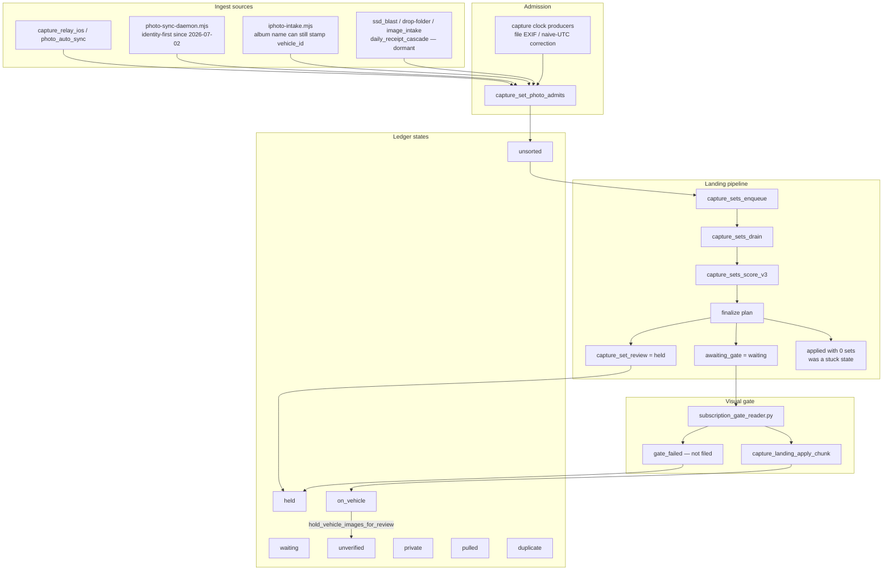

# Photo-sorting and ingestion pipeline

Technical documentation of how Nuke's photo library is ingested, admitted, scored, gated, held, and repaired. Written 10 November 2026 for Skylar Williams after he asked that the continuous sorting work be documented technically.

Times in this document are **America/St_Barthelemy (AST, UTC−4)** unless a timestamp says otherwise. Capture-set **days** and the ledger RPC are computed in **America/Los_Angeles**, because that is the timezone the landing planner uses for shop and library days. Those two clocks must not be mixed.

This document is grounded in `/workspace/sortrun` operators' notes and scripts, the `sss97133/nuke` repository (migrations, producers, `docs/receipt-work-contract.md`, and the named pull requests), and a live read-only ledger query. Anything not independently re-verified in this writing is marked as such. No secrets are included.

## 1. Purpose and how to read this

The job is not finished until every photo in the library is sorted. Success is the **unsorted** ledger count reaching zero — not the number of review holds, and not the number of photos already sitting on a vehicle.

Two kinds of work run side by side:

- **Filing work** moves unsorted photos into a later ledger state (usually `held` or `waiting`, and only onto a vehicle after a visual gate pass). This is what shrinks the backlog.
- **Gallery hygiene** takes already-filed photos that do not belong on a vehicle off the public gallery, through a reversible review hold. That work does not reduce unsorted, but it keeps confirmed sets from poisoning later visual tests.

Repairs are always a versioned producer or a sanctioned RPC, never a hand-patched row. Each write is signed by a run id (and, for producers, a commit). Every write has a documented revert.

## 2. Success metric and operating stance

Skylar is nontechnical. The operator decides with checks and rollback rather than asking him to choose a SQL path. Releases that pass CI and the contract tests are pre-approved to apply. Work happens in verified batches of about 50 photos. Nothing is deleted without an explicit yes. Vehicles are never deleted. Personal and private photos are skipped. The 276 live privacy-hold rows are left untouched and are excluded from every analysis share; the local 449/452-id privacy backup union is a superset of them and is the exclusion list used when the live hold set is not re-queried.

Skylar's labels, when they exist, are a held-out answer key, never model inputs. No paid API keys are used. Visual judgments use his existing Claude subscription (Claude Code on the Mac, or `claude -p` on the box with OAuth). Codex image analysis, when used, is the same rule: signed, revertible, no paid key.

## 3. Architecture and data flow



A photo enters `vehicle_images`. If it is admitted (library source plus a real camera clock in `exif_data`), the landing planner can put it in a **capture set** for a calendar day. The drain runs the official scorer. Finalize either:

- marks a **clear** set and leaves the chunk `awaiting_gate` (ledger: `waiting`),
- writes an open `capture_set_review` row (ledger: `held`),
- or, historically, could mark the plan `applied` with zero sets, which left eligible photos unsorted until `capture_sets_arm_empty_applied` made those days re-armable.

Only the visual gate may file a clear set onto a vehicle. The gate reader builds a contact sheet (reference photos on top, samples below), records `correct` / `wrong` / `unclear` verdicts, and calls the official gate check. A pass applies the chunk (`on_vehicle`). A fail leaves the photos unfiled (`held` or still unsorted leftovers). Sensitive and personal samples cause the reader to skip the chunk untouched.

Already-filed public photos that do not belong on a vehicle are not deleted and are not hand-updated. They go through `hold_vehicle_images_for_review`, which sets `vision_gate_status = review_needed`. The ledger maps that to **`unverified`**, not `held`. `held` means an open capture-set review, not a vision-gate hold.

## 4. Ledger states

`capture_ledger_states(p_uid, p_tz, p_from, p_to)` is the official counter. The operator script is `/workspace/sortrun/ledger_now.py`. The live body after PR #3299 (migration `20261115180000`, applied 10 Nov ~13:11 AST) assigns one state per `vehicle_images` row for the user. A copy's own `rejected_*` or filed state still wins over `duplicate`.

| State | Meaning |
|---|---|
| `private` | `vision_gate_status = rejected_personal` |
| `pulled` | `vision_gate_status = rejected_misattributed` |
| `on_vehicle` | `vehicle_id` is set and `vision_gate_status = approved` |
| `unverified` | `vehicle_id` is set but the gate is not `approved` (including `review_needed` holds) |
| `failed` | `capture_upload_status.stage = failed` (rare in these counts) |
| `duplicate` | unfiled `is_duplicate` whose original is filed, held (open `capture_set_review`), `rejected_personal`, or `rejected_misattributed`. A missing original does not count. Reasons: `copy_of_filed`, `copy_of_held`, `copy_of_private`, `copy_of_pulled` |
| `waiting` | photo sits on a **clear** set whose chunk is `awaiting_gate` |
| `held` | photo sits on an **open** `capture_set_review` row |
| `unsorted` | none of the above (reason is usually `not_scored`) |

There is no ledger state for "document / typ=other / non-vehicle." `typ` lives at `ai_scan_metadata#>>'{classification,image_type}'` and is used by planning (typ `other` / `receipt_document` stay out of clear sets) but does not terminate a row by itself.

`privacy_promote_v1` (PR #3300, migration `20261115181000`, applied 10 Nov ~13:10 AST) moved already-classified `is_sensitive` unfiled rows to `rejected_personal`, so they now count as `private`. It does not make new judgments, does not touch photo content, and hard-skips empty `image_url` (the 276 privacy-hold class) plus IDs in `capture_privacy_promote_exclude` (the 452-id local backup union, loaded at run time, not committed in the repo). Revert a run with `capture_privacy_promote_revert_v1('<user>', '<run>')`.

Days are `(COALESCE(taken_at, created_at) AT TIME ZONE p_tz)::date` with `p_tz = America/Los_Angeles`.

## 5. Ingest sources

| Source | What it is | Identity at ingest | Status as of 10 Nov 2026 |
|---|---|---|---|
| `photo-sync-daemon.mjs` / `photo_auto_sync` | Live library sync. LaunchAgent `ag.nuke.photo-sync` every 15 minutes. | **Identity-first** since 2026-07-02: `vehicle_id` omitted; `ingest_image_identity_first`; the server pipeline files later | Default live path |
| `capture_relay_ios` | Phone / app relay, including some metadata-only rows | Varies; empty `image_url` rows include the privacy-hold class | Live uploads; last phone photo observed 4 Nov 2026 02:20 AST (warn Skylar if newer photos have not landed) |
| `iphoto` / `iphoto-intake.mjs` | Photos-library album dump | **Still able to stamp `vehicle_id` from the album name / `--vehicle-id`**, with no visual identity. Storage path `%/iphoto/%` (excluding daemon `users/.../photo-sync/`) | Rarely used but still live. Last non-daemon stamp observed 2026-10-30. `iphoto-overnight.sh` crontab is commented out. Draft PR #3280 routes new inserts through identity-first ingest (script only, nothing to apply in Postgres) |
| `ssd_blast` | Bulk SSD ingest | Stamped `vehicle_id` at ingest | Last write 2026-04-11; not scheduled |
| `drop-folder` | Folder intake | Stamped `vehicle_id` at ingest. `derive-image-exif` historically stored naive DateTimeOriginal as UTC (7–8 hours early vs Los Angeles) | Last write 2026-03-27; not scheduled. Clock correction shipped in migration `20261114120000` |
| `image_intake` | Older intake | Some stamps; 4 residual rows had a real file DateTimeOriginal but no Make — admitted 10 Nov by #3298 (DTO stamped, `taken_at` unchanged) | Last write 2026-05-30; not scheduled |
| `daily_receipt` / `daily_receipt_cascade` | `process-photo.mjs` / cascade, sometimes with `--vehicle-id` | Could auto-bless (`vision_gate_status=approved`). After the 2026-05-30 privacy incident, current `process-photo.mjs` sets `review_needed` and does not auto-bless | Last cascade write 2026-05-29; 0 daily_receipt rows created on or after 2026-05-30 |
| `direct_pull_2026_05_23` | One-off pull | 4 unadmitted rows, outside the clock-apply `SOURCES` list | Dormant; needs a separate admission policy |
| `user_upload` | Uploads that are not in the library-admission source list unless they have DateTimeOriginal | 242 still unadmitted (no file camera clock / no DTO in `exif_data`) | Still present in the unsorted leftover |

**Gallery pollution from stamped ingest.** A read-only audit on 10 Nov 2026 (~07:09–07:15 AST) counted approved, non-sensitive, non-superseded photos whose `vehicle_id` was stamped at ingest and `user_confirmed_vehicle` is false:

| Source | Approved stamped | Without capture-set or user confirm |
|---| ---:|---|
| iphoto-intake (album path) | 9,410 | 9,273 (137 have unreverted `capture_set_links`) |
| ssd_blast | 3,220 | capture-set join not finished (query timed out into the 07:15 outage) |
| drop-folder | 299 | capture-set join not finished |
| image_intake | 5 | vehicle grouping not finished |
| daily_receipt_cascade | 2 | vehicle grouping not finished |
| **five-source total** | **12,936** | |

Top iphoto-album vehicles included the 1973 Charger 318 (2,025), 1983 K2500 (1,276), 1977 Blazer (946), and 1966 Mustang 10A (812). This is the class `visual_identity_recheck_v1` is designed to re-check. That producer is **proposed, not shipped**. Do not use other stamped-at-ingest approved photos as the gold set for a vehicle.

Post-July daemon rows are not this class: 1,494 daemon iphoto rows were counted, 1,103 still null/`pending`, 391 approved with a vehicle, and no approved post-July daemon rows carried Bathroom/Toilet/Restroom Apple labels.

## 6. Admission, clocks, and the landing pipeline

### 6.1 Admission

`capture_set_photo_admits` is false until the photo is an admitted source **and** carries a DateTimeOriginal in `exif_data`. A `taken_at` value alone is not enough. Inventing a DateTimeOriginal from `taken_at` when the file has no camera clock is forbidden.

### 6.2 Clock producers (versioned, signed, revertible)

**`capture_clock_from_file` / `capture_clock_backfill_apply`** (migration `20261113121000`, PR #3245, applied live 9 Nov ~23:58 AST). Recovers DateTimeOriginal from the stored file. Writable only for camera originals (`source = file_exif` **and**, in the live apply body, Make present). XMP dates are not written (screenshots and edited graphics). Personal / sensitive / already-filed rows are skipped. Runs were signed `c10c0000-2026-4b09-a000-000000000001` … `0005` (218 rows, 27 `taken_at` fixes). Revert a run with `capture_clock_backfill_revert(run, false)`, then the migration revert SQL if rolling back the function.

**`capture_clock_backfill_apply` without Make** (migration `20261115121000`, PR #3298 against main, applied 10 Nov ~12:59 AST after db-contracts was green). Admits a file-EXIF DateTimeOriginal even when Make is absent. Still requires `source=file_exif`, still rejects XMP / guessed clocks, still skips personal / sensitive / already-filed / already-clocked. Signed run `b1c72d54-501f-4747-832e-a22f0155c007` wrote the 4 `image_intake` rows with `p_set_taken_at=false`; all four now admit, `taken_at` unchanged. Revert: `select capture_clock_backfill_revert('b1c72d54-501f-4747-832e-a22f0155c007', false);` then `supabase/sql/revert_20261115121000_capture_clock_backfill_exif_dto_without_make.sql`. The 238 with no camera clock in the file, 14 XMP, and 4 `direct_pull` were not stamped and still need a separate policy. Never invent a DTO from `taken_at` or from a neighbouring file.

Those two days (2024-06-22 and 2024-06-25, America/Los_Angeles) were re-armed at 13:16 AST on 10 Nov via the sanctioned `capture_sets_enqueue` onto `capture_set_rescore_queue` with reason `clock_admit=b1c72d54-…`. Live `capture_sets_landing_run` only proposes and enqueues the visual gate; apply waits for `capture_landing_apply_chunk` after the gate passes. The drain waits 10 minutes after `requested_at` (`capture-sets-drain` cron `1-59/5`). 2024-06-25 is a real vehicle day (the two stamp rows are typ `vehicle_exterior` among other admitted exteriors/interiors). 2024-06-22's two stamp rows are typ `other`, so typ coverage will keep them out of clear sets; three admitted `engine_bay` frames on that day can still go to the gate.

**`capture_clock_naive_utc_apply` / `_revert`** (migration `20261114120000`, PR #3263, applied live 10 Nov ~01:57 AST after db-contracts was green). Corrects drop-folder rows whose naive DateTimeOriginal was stored as UTC. `derive-image-exif` now reads `OffsetTimeOriginal`, falling back to America/Los_Angeles, never UTC. 136 eligible rows were rewritten in signed runs `c14c0000-2026-4114-8000-000000000001`…`0003`. Sample 6/6 matched (118 PDT −07:00, 18 PST −08:00). Producer sha `c8157bff8`. Revert: `select capture_clock_naive_utc_revert('<run>', false);` then `supabase/sql/revert_20261114120000_capture_clock_naive_utc.sql`.

### 6.3 Landing: enqueue, drain, score, finalize

Official entry point for a day is `capture_sets_enqueue(p_user, p_day, p_reason)`. The drain loop (`/workspace/sortrun/drain_loop.py`) calls `capture_sets_drain({p_max: 3})`. It is intentionally **proposals and gate samples only — it does not file**. `capture_sets_drain` waits until `requested_at < now() - 10 minutes`, so a just-enqueued wave looks idle for about ten minutes. That delay is expected, not a hang.

Scoring is `capture_sets_score_v3`. It already excludes `is_sensitive`. A set may be **clear** (candidate for the gate) or **review** (reasons such as `no_clear_lead`, `score_below_threshold`, `priors_only`). Finalize writes `capture_set_review` for review sets and leaves clear sets in an `awaiting_gate` chunk.

A historical bug: finalize could mark a plan `applied` when `n_clear = 0` even if `sets = 0`. `arm_new` only fires on new arrivals, so those days never re-armed. On 10 Nov this was 1,153 photos / 361 days (eligible pool after privacy/dup/empty-url filters: **915 photos / 341 days**). Migration `20261114120100` (`capture_sets_arm_empty_applied`, PR #3264) made empty-applied days re-armable, with an epoch table so the same day does not loop. Applied live 10 Nov ~01:57 AST. Rollback: `supabase/sql/revert_20261114120100_capture_replan_empty_applied.sql`.

Related earlier landing fixes, also live-applied (some still draft / unmerged):

- `20261113120600` / #3236 — rearm-since function
- `20261113120700` / #3237 — admit predicate / tick / unfiled_exists / arm_new
- `20261113120800` / #3240 — `replan_state` ignores dry chunks
- `20261113120900` / #3243 — unseen admitted photos since a refused run count as new evidence (loop-proof via `capture_set_admission_epochs`)

The hourly cron `capture-review-sweep` (`17 * * * *`, migration `20261111140000`) can enqueue days with reason `new_anchors` after a gate pass. On 10 Nov at 03:17 AST it enqueued 141 days after the Mustang filings. That was a one-shot re-score, not the empty-applied auto-arm looping. 139 days went back to review (0 new links); 2 went `awaiting_gate` and the gate then refused both (look-alike R3500, and a Mustang sheet with error_rate 0.67).

**All-unclear gates** (PR #3296, migration `20261115170000`, applied 10 Nov ~12:58 AST): `capture_landing_gate_extend_v1` queues unused clear-set photos for another reader pass (never shrinks `required_n`); `capture_landing_gate_expire_all_unclear_v1` moves a fully sampled all-unclear chunk to review (`gate_undecided`), never to file. Extend run `7dbe86ed-…` queued 13 samples on chunk `ae2816b8`. Expire run `2db98281-…` expired 18 chunks (21 open reviews). The live reader then marked the 13 (11 correct / 2 unclear); the gate passed and apply filed 0 (`sets_refused=1`). Revert: `capture_landing_gate_extend_revert_v1` / `capture_landing_gate_expire_all_unclear_revert_v1`. Do not call `capture_landing_gate_check` as a dry-run (it writes and can halt landing).

Apply of a passed chunk is `capture_landing_apply_chunk`. Revert a filed chunk with `capture_sets_revert('<chunk_run>', '<user_id>')`.

## 7. The gate reader

Code: `/workspace/sortrun/gate_reader.py` (unattended). The live tuned reader lives on draft PR #3246 (`feat/gate-reader-tuning`, sha `46476d0ad` when re-enabled). Contract path: `capture_landing_finalize_plan` → `auto_filing_audit_queue(pre_gate)` → `filing_gate_eval` / `gate_check` → apply.

The reader uses the owner's Claude subscription (`claude -p`, OAuth). It does not set `ANTHROPIC_API_KEY`. It builds a contact sheet: green `REFn` tiles are approved references of the target vehicle; orange `Sn` tiles are samples. For each sample it must answer `correct`, `wrong`, or `unclear`. A different color, body style, or make is `wrong`. Chunks with any sensitive or personal sample are skipped untouched.

**Calibration bar (must pass on a held-out set labeled before the reader runs):** agreement ≥ 85% and false accepts (reader `correct` where the hand label is `wrong`) ≤ 2%. Skylar's labels are not used as inputs. The first calibration set (`a4055d31`, 170 samples) was an earlier Grok Bot hand audit and was treated as **dev**, not official.

| Set | n | Result | Consequence |
|---|---|---|---|
| gate2 (labels frozen before the pass) | 124 | agreement 0.911, FA 4/62 = 6.5% — **FAIL** | Four FAs were same-generation red crew-cab trucks treated as a "mark". Post-hoc relabel was rejected. Reader stayed off. |
| gate3 (new held-out, excluded all gate2 images, frozen 02:02 AST 10 Nov, before any pass) | 94 | agreement 81/94 = 0.862, FA 1/54 = 0.0185 — **PASS** | Official score after remapping hand "same" → contract "correct" on the same reads. The one FA is qid 2016 (gold door-jamb plate; hand wrong / reader correct). |

After gate3 passed, the live reader was started 02:18 AST 10 Nov (`--state-dir /workspace/sortrun/gate3`, not `--calibrate-only`, pid 2452903). Tightened mark rule: competing same-generation-and-colour owned vehicles are shown as LOOKALIKE tiles; generation/colour/body/make text alone is parsed as unclear.

**Live filings:** 87 photos, all onto 1966 Ford Mustang `83f6f033` (the black 10A), in two applied runs:

- `2b9e499d-a3a8-4008-8b7a-c66fd47feb29` (2026-08-31, 85 photos)
- `edacb1c2-13b2-478b-bfed-4d3df8ad83df` (2026-08-20, 2 photos)

First official spot-check at 87 filings (seed 20261110, random 10 of the 87, plus the two 2026-08-20 frames): **10/10 correct**, no wrong-vehicle filing. Next official spot-check was planned at ~137 filings (every ~50). No further filings occurred, so that second check was never reached. Later ticks either saw no new chunks or failed look-alike / high-error sheets (R3500 10/10 wrong; 2026-08-30 Mustang error_rate 0.67).

If a later sample is wrong: stop the reader, then `select capture_sets_revert('<chunk_run>', '0b9f107a-d124-49de-9ded-94698f63c1c4');` for the bad run. #3246 remains draft / unmerged. A supervisor (`supervise.sh`) restarts the reader unless a `halt` event is logged.

Computed pass rule used in the 10:08 AST dry characterization (without calling the writing RPCs): `(correct+wrong+unclear) >= required_n AND (correct+wrong) > 0 AND error_rate <= 0.05`. `capture_landing_gate_check` and `filing_gate_eval` both write, so they were not invoked in that dry pass.

## 8. The empty-applied sorter and drain

`/workspace/sortrun/emptyplan/build_pool.py` builds the eligible pool from the unsorted breakdown, skipping sensitive, rejected, duplicate/superseded, empty `image_url` (privacy-hold class), already-filed, and undated rows. Batches of about 50 photos are in `batches.json`, keeping a single large day in its own batch.

`run_batch.py` records ledger states for the batch's days, enqueues each day with reason `empty_applied_retry`, waits until every queue row has `done_at` (40-minute cap), then measures `unsorted_moved`. Exit 3 (wave stop) if `moved == 0` or `max_plan_s > 180`. `--measure-only` re-measures a drained batch; do not treat its `unsorted_moved` formula as proof of a new filing (it once reported movement on already-empty days).

`drive.sh` runs waves of four batches. Resume from the failed wave if a wave stops.

**Result, 10 Nov 2026:** batches 0–19 (915 eligible photos / 341 days). Batches 1–19 planned 879 and **moved 798**. Wave 0 moved 30 of 36 earlier the same morning. After batch 19 there are **no more batches** in `batches.json`. Do not rebuild and re-arm the same 341 days: they now have review sets and have left the empty-applied pool. Leftover unsorted on those days stays unsorted until a scorer or another producer can form a set.

## 9. Sanctioned review holds

The only sanctioned path to take a public gallery photo off a vehicle without deleting it is:

```text
backup vehicle_images rows
→ hold_vehicle_images_for_review(..., p_apply => false)   -- dry-run
→ hold_vehicle_images_for_review(..., p_apply => true)    -- signed run, cap 50 in operating procedure
→ verify vision_gate_status = review_needed and the count moved
```

Function contract: migration `20261020001000_vehicle_image_review_holds.sql`, test `supabase/sql/test_vehicle_image_review_holds.sql`.

- Service-role only. `p_items = [{image_id, signals}]`. Method, reason, and run are required.
- Moves named images of **that** vehicle that are currently public (`approved` or null) to `review_needed`. Owner and uploader still see them; the public read policy hides them.
- Not a final verdict. File hash, URL, vehicle, and other columns are unchanged. The cover is recomputed so a held frame is never the cover.
- Images of other vehicles, already hidden images, and unknown ids are skipped and counted.
- Audit rows go to `vehicle_image_gate_changes` (run, method, reason, actor, before/after, signals).
- Revert: `select revert_vehicle_image_review_hold('<run>', null, true);` (dry-run if the third argument is `false`). Restores the recorded before status, reasoning, and clock, marks the audit rows reverted, and recomputes covers.
- Operating cap is **50 per signed run** (the SQL function allows up to 2,000 items; the operator cap is 50).
- Skip `is_sensitive`, rejected_personal / misattributed, and the 276 / 452 privacy sets. Do not mark personal frames private from this path; log them for a later privacy pass. Never delete.

Draft PR #3206 (`image_cover_rank`) is a **view-type ranker, not an identity gate**. It reorders already-eligible covers (exterior first). It does not check whether the frame is the right vehicle, and it does not fix a gallery whose remaining approved frames are all wrong-vehicle or non-exterior close-ups (the 1979 C10 Ford-crank / oil-pan hero is the worked example).

## 10. Image-analysis stack and measured limits

No fingerprint or visual-gate producer was shipped from this stack. The ship bar used for auto-filing identity was **98% precision at a useful recall** on an honest **day-held-out** split (same-day siblings held out of the gallery, so the score is image data alone). That bar was not met.

### 10.1 Local CLIP pass — `local_image_analysis_v1`

Draft PR #3224, script `scripts/photo-pipeline/local_image_analysis.py`. Free local CPU: OpenCLIP ViT-B-32-quickgelu/openai embeddings (512-d, L2-normalized) plus ViT-L/14 zero-shot view labels. Writes one signed `image_observations` row per photo (`observed_by = local_image_analysis_v1`; `confidence_basis` carries agent, commit, models, run_id). `vehicle_id` stays null — no vehicle claim. Sensitive and privacy-hold rows are skipped before download. Revert: `python scripts/photo-pipeline/local_image_analysis.py --revert <run_id>` (deactivates rows, deletes nothing). Also `revert_codex_image_analysis_batch` for the Codex ingest path.

Run `192ec5d8-e570-4ca6-80dd-9559ce71adc7` finished 9 Nov 17:39 AST: **14,556** active observations. Operator box job: `/workspace/sortrun/analysis_supervise.sh`.

A first CLIP kNN fingerprint (k=5 mean cosine, seed 20261110, privacy excluded, no DB writes) on high-trust embeddings:

- Leaky photo split (same-day siblings still in the gallery): argmax acc 0.675. Margin ≥ 0.06: precision 1.000, recall 0.190. This is not a clean identity result (466/499 probes still had a same-day sibling).
- Honest day-held-out split: argmax acc 0.389. Precision 0.98 was only hit at a margin that barely recalls anything (margin ≥ 0.12: P=1.000, R=0.019). R3500 acc 0.0 on 4 probes. Held dry-run at the honest margin proposed only 2 photos, both disagreeing with the current review candidate.

CLIP ViT-B/32 global similarity is too coarse for look-alike trucks. No producer, no PR, no live fingerprint writes.

### 10.2 DINOv2 embed job

`/workspace/sortrun/fingerprint/embed_job.py`, local Facebook `dinov2-base` ViT-B/14 (768-d CLS + mean; 3×3 and 4×4 pooled patches; full 256 patch tokens kept only for focus vehicles). Also fills missing CLIP B/32 vectors and view labels. No DB writes. Privacy: 1,593 rows excluded, never downloaded. Self-stops if free disk drops below 10.5 GB. Checkpoint: `done_ids.txt` + `shard_*.npz`.

Manifest: 16,080 photos (16,075 confirmed filed + 5 held-missing with a usable storage object). Finished 10 Nov 09:49:17 AST (patched after the outage; see §16). Shard-backed embeddings 16,052. 28 ids are intended permanent skips (20 HTTP 400, 7 `UnidentifiedImageError`, 1 leftover `842cd16c` marked done during a process kill and not retried). Fetch timeouts / 5xx / 522 are retried and **never** marked done. 400/415/422 and 401/403/404/410 are permanent skips.

### 10.3 LightGlue re-ranker

CPU SuperPoint + LightGlue + RANSAC, local weights, no DB writes. Fused score `0.4*dino_cls + 0.3*clip + 0.3*log1p(inliers)/log1p(50)`. Artifact: `/workspace/sortrun/fingerprint/rerank_cal.json`. On the comparable 117-probe day-held-out split (3-vehicle mix, including two 1966 Mustangs), 98% precision appeared only at recall ≤ 0.068. 10A ↔ other-66 confusion stayed high (other-66 DINO acc 0.20). A later 580-probe split looked numerically better because it was 10A-dominated (other-66 acc 0.00–0.10). That is an imbalance artifact, not a look-alike result.

### 10.4 Look-alike calibration (fair split)

`/workspace/sortrun/fingerprint/calibrate_lookalike.py` and `lookalike_cal.json`. Honest day-held-out, cap 40 probes per vehicle so 10A cannot dominate, 10A neighbors restricted to the same paint era (`mustang_10a_eras.json`), held work-truck excluded. 821 probes / 7,898 gallery / 36 vehicles. DINO only in this run.

**Argmax accuracy 0.231–0.238.** No threshold hits 98% at a useful recall (`dino_mean_era` reaches P=1.0 only at threshold 0.2 with recall 0.017). Per-vehicle argmax (`dino_cls_era`): 10A 0.925, 1977 Blazer Cheyenne 0.875, 1983 K2500 Sierra Classic 0.775, 1983 K1500 0.40, R3500 0.325, 1974 K5 0.125, 1987 Suburban 0.075, 1985 Suburban 0.03, other 1966 Mustang 0.0. Top confusion is other trucks (and the 1974 K5) predicted as the 1983 K2500. Investment in the global DINO look-alike scorer stopped here.

Turquoise 10A frames are the **same car before its repaint**, not pollution. Era file: pre-repaint turquoise through 2022-09 (plus forced `1af03015`); bodywork/primer 2022-10-01–2023-06-16; post-repaint black from 2023-06-17. The other 1966 Mustang `67127bcb` is a different VIN and a gold car with a black vinyl roof; do not merge.

### 10.5 Local Claude Code visual pilot

40 day-held-out probes on the Mac (`/Users/skylar/lookalike40`, `ask_match.py`, owner's Claude subscription, no paid key). Vehicles A–H with G (1979 C10) dropped before asking because its confirmed set was heavily polluted. Artifact: `/workspace/sortrun/lookalike_pilot/score_final.json`.

| Slice | Precision when Claude commits | Coverage |
|---|---|---|
| Raw | 23/33 = **69.7%** | 33/40 = 82.5% |
| Exclude 3 mislabeled F golds (p11–p13) | 23/30 = 76.7% | 81.1% |
| Also exclude 3 more viewed gold-pollution frames | 23/27 = **85.2%** | 79.4% |

7 `cannot_tell`, 0 parse failures. Clue types on the 23 correct commits (a probe can have several): paint/color 23, body/trim 21, year/body-style 20, emblem/badge 17, mods/equipment 12, same-shop context 11, interior 7, rust/condition 6, wheels/tires 4.

A simulated next-pilot design (±30-day candidate window, two concrete identity clues required, shop-floor context alone does not count) would have lifted the honest slice from 23/27 = 85.2% to **23/25 = 92.0%**, coverage 25/34 = 73.5%. The two remaining misses are the red/cream 1985 Chevy vs 1987 GMC Suburbans that share the window. **92% is not a ship bar.** No producer was proposed.

### 10.6 Same-scene monopile dry-run (not shipped)

`/workspace/sortrun/held/same_scene_dryrun.py`. On days where every already-filed approved photo sits on exactly one vehicle, a naive tight-time / session / GPS rule would have proposed 150 held photos, almost all on the look-alike truck fleet. After a look-alike veto (1966 Mustangs and same-gen GM trucks/SUVs cannot be proposed from time/GPS/session alone) plus excluding reviews that already point at a different vehicle, documents, and `other_vehicle`: **would_propose = 0**. `monopile_same_scene_v1` was not shipped. A same-day monopile is often a mixed shop day where only one vehicle has been filed so far.

### 10.7 Codex batch (incidental observations)

Run `f0cd17b9-ce11-4ac4-9597-5b28fff5e3a7` (PR #3250, merged). 50 `image_observations`, `observed_by=codex_image_analysis_v1`, role incidental, `vehicle_id` null, signed in `layer_version` and `confidence_basis`. Overlap with the 276 privacy holds and the 452-id union: 0. Revert: `select * from revert_codex_image_analysis_batch('<run>', null);`.

## 11. Gross-mismatch ranker

Local, free, no writes until a confirmed hold. Scripts and artifacts: `/workspace/sortrun/garage/gross_mismatch_v1/` (`rank.py`, `rerank_isolation.py`, `fetch_review_sheets.py`, `ranked.jsonl`, review sheets, confirmations, backups).

**Method (isolation-first v2):** CLIP and DINO CLS embeddings. Same-vehicle 5th-nearest CLIP neighbor isolation `isol = 1 - nn5`, so engine and detail close-ups that have same-vehicle neighbors are not treated as mismatches. Plus other-vehicle centroid pull, CLIP text probes (bathroom, screenshot, document, packaging, person, wrong body), and observations where present. Singleton vehicles are not given a fake isolation score. A first centroid-distance pass was dominated by close-ups and noisy category labels and was not used.

Universe scored: 13,866 locally embedded filed/on_vehicle rows from the embed-job manifest (privacy already excluded). The exact 12,936 ingest-stamped unconfirmed ids were not persisted and could not be re-queried during the outage.

Uncalibrated candidate counts (before viewing):

| Set | n scored | score ≥ 0.8 | score ≥ 1.0 |
|---| ---:| ---:| ---:|
| Charger / K2500 / Blazer / Mustang 10A | 7,428 | 210 | 83 |
| All filed+embedded | 13,866 | 856 | 340 |

**Viewed precision (10 Nov, no writes from the view itself):**

- Top 30 (score band that starts at 1.12–1.64 per vehicle): **30/30 (100%)** gross (catalogs, screenshots, packaging, invoices, wrong vehicles, non-vehicle scenes). 19 of 30 were still approved gold.
- Random 30 on the four priority vehicles only: **2/30 = 6.7%** (Wilson 95% CI ~2–21%). That sample is not the full 13,866.
- Mid-band `0.8 ≤ score < 1.0`, top 30 on the four: 18/28 approved confirmed gross with a concrete clue; 10/28 host-like. Band yield 64% — **not** an automatic-hold band.

**Operating rule:** walk the per-vehicle ranked list from the top. Hold only with a concrete clue (document, screenshot, packaging, non-vehicle scene, or wrong make/body) after a second look. Stop if confirmation precision of holds drops below ~95% or a batch moves nothing. Do not auto-hold the 0.8–1.0 band.

**Holds applied 10 Nov 2026** (all `method = visual_identity_gate:grok-bot`, backups on disk, revertible):

| Wave | When (AST) | Held | Notes |
|---|---| ---:|---|
| 1979 C10 leftovers | 09:13 | 7 | Run `grok-garage-g1979c10-leftovers-202611100715` (after the earlier 50-hold `grok-garage-g1979c10-202611100703` at 07:03). New cover was an oil-drain pan — still a poor hero; not changed. |
| Four priority vehicles, score ≥ 1.0 | 09:22–09:23 | 62 | Charger 15, K2500 23, Blazer 3, Mustang 10A 21. 2 personal/minor Mustang frames skipped, not held, not deleted. Confirmation of holds 62/62 after a 64/64 approved second look (the two skips were the only approved leftovers in the band). |
| Remaining vehicles, score ≥ 1.0 | 09:55–09:56 | 54 | 23 signed runs. 145 approved second-looked; 86 left host-like; 5 personal skipped. Hold confirmation 54/54. Band yield 54/145 = 37% (isolated host details score high against an exterior-heavy centroid; yield did not trigger a stop). |
| Four vehicles, 0.8–1.0 confirmed-gross from the top-30 sample | 10:02–10:03 | 18 | Runs `…-k2500-20261110b` (10), `…-mustang10a-20261110b` (2), `…-charger-20261110b` (6). Backups exist under `/workspace/sortrun/garage/backups/`. This documentation session verified the audit rows, backups, and the ledger delta (−18 `on_vehicle` / +18 `unverified` vs 09:58). It did not repeat the contact-sheet second look (that look is recorded in the 09:50 session as 18/18). |

Earlier same-day holds also include the 10A work-truck `grok-10a-other-vehicle-20261110a01` (1 frame) and the 1979 C10 cap-50 hold of 50 frames. Combined with the 7 leftovers, those 57 C10 holds are the 06:54 → 09:15 `on_vehicle` −57 / `unverified` +57.

Two covers still look off after the remaining-vehicle wave (report only, not changed): quarantine Sierra Classic `14447ecd` cover is a silver hot rod (wrong vehicle); 1967 Porsche 912 cover is a badge close-up (`4f457c85`).

## 12. Receipt-work judgments and eligibility

Contract: [`docs/receipt-work-contract.md`](./receipt-work-contract.md). Producer: `scripts/receipt-work/reconcile-receipt-work.mjs`. Department PR #3168 (feat, still draft; the reconciliation migration was applied live earlier). The producer makes no model call; it reads and writes the database over the service-role API.

Three separate concepts, never collapsed into ownership or installation proof:

1. **Proposed context** — `evidence.relationship` (`status: proposed`, `kind: receipt_time_context`). A receipt line and photos share a time window. Explicitly `not_asserted` as corroboration, installation, payment, or an owner Sign.
2. **Document testimony** — what the paper prints (`line_date`, `hours`, `performer`), attributed to the document.
3. **Source custody / lineage** — who holds the receipt and where it came from.

Frame eligibility (`receipt_work_frame_eligible`): EXIF-dated, `vision_gate_status = approved`, not sensitive, `redaction_level` none, not duplicate, not superseded, not paperwork, and scene not `product_screenshot`, `cross_reference`, `receipt_document`, or `hand_drawn_diagram`. Privacy-hold and personal frames are never cited.

A question's `question_context` is stored in `params.context` and is part of `question_hash`. Claims and answers recompute it and compare. `evidence_judgment_ineligibility` must be empty or the claim/answer is refused. A real context change invalidates a receipt-work claim — there is no “close enough” tolerance, except the one shipped change below.

**#3279** (draft, **applied live** 10 Nov 06:47 AST after the contract test and CI were green): `candidate_image_ids` are compared as a sorted unique **set**. Array order alone is not `context_changed`. Membership changes still invalidate. `zone_photos_total` and every other key stay exact (no ±1 tolerance). Rollback SQL is in the PR. Live backup note: `/workspace/sortrun/receipt_order_fix/LIVE_BACKUP_20261110_063846AST.md`.

Lifecycle (each transition is appended to `lifecycle`): raise → `pending` → `claimed` (`claim_evidence_judgments`; a claim older than the stale window is re-claimable) → `answered` (`answer_evidence_judgment`, holder only, schema-checked, frames still eligible). Producer retire / reopen / rollback functions are documented in the contract. Undo answers: `reopen_evidence_judgment_answers` for that `answer_version`. Undo a producer run: `rollback_garage_derivation_run` and `rollback_evidence_judgment_run`.

**Firebird worked example (1973 Firebird `20d21fb0`, kind `receipt_part_visible`):**

- 9 Nov write `f1b0d000-2026-4b09-a000-000000000047` (producer `1f01f76a6b45:scripts/receipt-work/reconcile-receipt-work.mjs`) left 47 pending questions. By morning they were all ineligible (`context_changed`), mostly `zone_photos_total` and candidate membership/order — caused by later `vehicle_images` / zone restamps, not a receipt or link change. No answers were submitted against ineligible questions.
- 10 Nov 06:07 write `f1b0d000-2026-4b10-a000-000000000047` (same producer): 115 pending, all eligible at write time. Claimed as `injestion/claude-code-20261110`.
- Answers were produced on the Mac by `python3 -u ask.py` (Claude Code 2.1.289, claude.ai Max, no `ANTHROPIC_API_KEY`), then submitted only while still eligible, as `answer_version receipt_part_visible/claude-code/20261110a`, agent `injestion/claude-code`, model `claude-code-cli`, bboxes nulled.
- All **115/115 submitted**, 0 refused. A mid-morning rate-limit stopped the Mac loop; it was resumed after the limit cleared and Postgres returned. Spot-check of three yes/yes frames (Shaker hood, rear bumper, Trans Am decal) agreed.

## 13. Ownership rules

Standing invariants: **never delete vehicles**; **`granted_by` must be non-null**; **the owner role requires title verification**; do not merge duplicate vehicles (profiles dissolve on their own when no independent evidence supports them — draft PR #3221, not applied live). Ownership testimony, photo contribution, and receipt custody stay separate. Receipt-work does not touch vehicle ownership or roles.

Producer: `rederive_vehicle_ownership_roles` (migration `20261109070000`, script `scripts/ownership/rederive-ownership-roles.mjs`). Dry-run unless `--apply`. Signed with `<git sha12>:scripts/ownership/rederive-ownership-roles.mjs`. Rollback: `rollback_ownership_role_rederivation(run_id, reason, dry_run)`.

Admission rule (shared predicate `current_title_verification_ids`): a current approved `ownership_verifications` row with `verification_category = title_document`, an `https://` title document URL, and no expired clock.

- `vehicle_user_permissions` rows with role `owner` / `co_owner` and no current title are demoted to **`contributor`** if the account photographed the vehicle, otherwise **retracted** (`is_active=false`). **`granted_by` is kept.**
- `vehicle_ownerships` periods that claim `legal_title` without a current title verification, a proof event, or a completed transfer become **`claimed_unverified`**. The period and its dates stay; only the title claim is withdrawn. Nothing deletes a row or a vehicle.

Draft PR #3221 (`vehicle_support_run`) would mark a profile `derived_status = dissolved` when 100% of its support is exact copies of evidence that backs a stronger same-car profile. Dry-run by default, cap 50, signed, revertible, never deletes. Site-wide dry replay with the identity check: 11 would dissolve, 0 in the owner garage. **Not applied live.** A related cleanup item, also not touched: 12 misfiled listing events on stronger profiles.

Look-alikes must remain separable by hard image clues (body lines, trim, rust, dents, wear, paint). Time, GPS, or a shared shop floor is not enough.

## 14. Safety invariants

- **Backup before every write.** Keep the backup on disk. Do not apply if the backup select fails or times out (the 1979 C10 leftover hold was stopped at 07:15 for this reason, then applied at 09:13 after a successful backup).
- **Dry-run first.** Official RPCs take `p_apply` / `p_dry_run`. Would-hold / would-write must match the intended set.
- **Cap 50** per signed operator run (even when the SQL function allows more).
- **Signed runs.** A run id, and for producers a commit (`producer_version = <sha>:<script>`). Rows carry that signature.
- **Revert functions**, not inverse hand patches. Prefer the official revert RPC, then a migration revert if the function itself must go back.
- **No hand-patched rows.** Data problems are ingestion problems: fix the producer, then re-run or revert.
- **No deletes** without Skylar's explicit yes. Review holds are not deletes. Vehicles are never deleted.
- **Privacy exclusions** on every analysis share and every hold: `is_sensitive`, `rejected_personal`, empty-url privacy-hold rows, the live 276, and the 449/452-id local union. “Held photos” are not authorization to include excluded rows.
- **Labels are a held-out answer key**, never inputs. A new held-out set is required after fitting to a previous set's false accepts (gate3, not reused gate2).
- **No paid API keys.** Use existing Claude / Codex subscriptions.
- **Tune code, don't hard-code** vehicle ids or one-off clocks into producers.
- **Don't merge** look-alike or duplicate vehicles by hand.
- **Don't send emails.**
- **Never print secrets** (`~/.claude_oauth_token`, `SUPABASE_SECRET_KEY`, `GITHUB_TOKEN_WORKFLOW`).
- **Disk:** do not delete large folders that may belong to other bots. The Hugging Face cache holds the embed-job model. The embed job self-stops below 10.5 GB free.
- **Stop rules:** moved == 0; plan time > 180s; confirmation precision of holds below ~95%; a privacy row about to be touched; an invented clock; a context-changed receipt-work claim.

## 15. Operating procedure (batch-of-50 loop)

1. Measure the live ledger (`capture_ledger_states` / `ledger_now.py`). Record counts, including private and n, so a missing row cannot hide.
2. Define a **versioned** pool (eligible ids, exclusions, reason). Write it to disk.
3. Take a backup of the rows that will change.
4. Dry-run the official RPC. Check `would_hold` / written counts against the plan. Overlap with privacy sets must be 0.
5. Apply at most 50 in one signed run.
6. **Verify the counts moved** — the after-ledger (or after-status) must match the apply result exactly. If it does not, stop and revert.
7. Spot-check a sample when the action files onto a vehicle (gate: every ~50 filings).
8. Record the run id, backup path, and revert command in `/workspace/sortrun/progress.md`.
9. Stop if a stop rule trips. Do not start the next wave until the current wave finishes cleanly.

Empty-applied filing used this loop at day-batch granularity. Review holds use it at photo-batch granularity. Clock backfills used signed runs of 50, compared to a frozen replay (`differ_from_replay = 0`).

## 16. Runbook, including the 10 November 2026 outage

### 16.1 Healthy loop

- Drain supervisor / loop: `/workspace/sortrun/drain_loop.py` (pid was 1198178 this run). Idle on `queue_empty_idle`, poll 600s.
- Gate reader: pid 2452903 this run, 600s sleep when idle, state dir `/workspace/sortrun/gate3`.
- Embed job: only when a new manifest needs vectors; restart from `done_ids.txt` with the **patched** script. Do not `kill -CONT` a process that still has old code in memory.
- Mac Claude loops (Firebird `ask.py`, look-alike `ask_match.py`): one at a time if they share the same subscription; SIGSTOP/SIGCONT rather than killing mid-answer when switching.

### 16.2 When the Data API fails (HTTP 522, statement timeouts, connection timeouts)

This is the recovery that was actually used on 10 Nov 2026.

**Cause (from ClickHouse logs and the health advisor; `pg_stat_activity` could not be read while down):** Postgres itself stopped accepting connections around 07:14–07:26 AST, after a morning of lock contention, slow cron/API statements, PostgREST request timeouts, a :14 cron burst, and Storage connections held for many minutes (the embed job was fetching images). This was **not** a global status.supabase.com incident, and **not** the 06:50 AST schema-cache reload after #3279 (that reload succeeded, ~24 minutes earlier). No single operator query could be identified as the runaway. Other agents' cron backends were not canceled.

**What to do:**

1. Stop adding load. SIGSTOP the drain and the reader (they retry with long HTTP timeouts and can occupy a 50-connection PostgREST pool). SIGSTOP the embed job immediately if fetch failures are being marked done — then **fix `done_ids` before any restart**.
2. Do not hammer REST. Do not change settings, cron, or other agents' queries. Do not `pg_cancel_backend` / `pg_terminate_backend` without `pg_stat_activity`.
3. Do not apply a hold without a backup, even if the plan is already viewed.
4. Do not invent a database restart. Supabase MCP has no restart tool (only pause/restore, which was avoided). A restart is Skylar's call if Postgres stays down.
5. When `select now()` works again: read `pg_stat_activity` first. Cancel (not terminate) only a backend that is clearly ours. Then `kill -CONT` the reader and drain, one at a time, and recheck lock waits / idle-in-transaction.
6. Restart (do not CONT) a patched embed job. Remove any done-without-shard ids first. Confirm a new shard appears before leaving it.
7. Then resume human-queued work in order: pending signed submits, backup+hold plans, review-sheet views, Mac loops if the rate limit has cleared.

**What actually happened this morning:**

- ~07:14 AST: Postgres logs stop. Embed starts skipping on 522s and marking those ids done.
- 07:35 AST: embed SIGSTOP'd. 855 done-without-shard ids later removed from `done_ids` (backup taken). Fetch-retry patch: timeouts/5xx never marked done; 400/415/422 later added as permanent skips.
- 08:07 AST: reader and drain SIGSTOP'd. Still no `pg_stat_activity`.
- ~09:09 AST: Postgres accepted connections again (no restart). 73 backends, 0 idle-in-transaction, 0 lock waits.
- 09:10–09:13 AST: CONT reader and drain; killed the old embed; started the patched job; submitted 10 pending Firebird answers; backed up and applied the 7-frame C10 leftover hold; viewed the 30+30 mismatch sheets (no writes from the view); resumed the Mac Firebird loop.
- 09:49 AST: embed finished. 09:18–09:58 AST: remaining Firebird answers submitted (115/115); 62 + 54 gross-mismatch holds applied. 10:02–10:03 AST: 18 mid-band confirmed-gross holds applied.

## 17. Rollback commands

Replace run ids as needed. Dry-run by passing `false` / omitting apply where the function supports it.

```sql
-- Vision-gate review hold (gallery hygiene)
select revert_vehicle_image_review_hold('<run>', null, true);

-- Filed capture-set chunk
select capture_sets_revert('<chunk_run>', '0b9f107a-d124-49de-9ded-94698f63c1c4');

-- Clock backfill (file EXIF, including the no-Make DTO stamp)
select capture_clock_backfill_revert('<run>', false);

-- Privacy promote (is_sensitive -> rejected_personal)
select capture_privacy_promote_revert_v1('<user>', '<run>');

-- All-unclear gate extend / expire
select capture_landing_gate_extend_revert_v1('<run>');
select capture_landing_gate_expire_all_unclear_revert_v1('<run>');

-- Ledger dupmap (definition only; restores the filed-original-only body)
-- supabase/sql/revert_20261115180000_capture_ledger_copy_of_held.sql

-- Drop-folder naive-UTC clock
select capture_clock_naive_utc_revert('<run>', false);

-- Receipt-work producer run
select * from rollback_garage_derivation_run('<run>', '<reason>', false);
select * from rollback_evidence_judgment_run('<run>', '<reason>', false);

-- Receipt-work answers
-- reopen_evidence_judgment_answers for answer_version
--   'receipt_part_visible/claude-code/20261110a'

-- Ownership rederive
select * from rollback_ownership_role_rederivation('<run>', '<reason>', false);

-- Codex / local analysis observations
select * from revert_codex_image_analysis_batch('<run>', null);
-- or: python scripts/photo-pipeline/local_image_analysis.py --revert <run>
```

Named review-hold runs from 10 Nov 2026 (all `null, true` on revert) include:

- `grok-10a-other-vehicle-20261110a01`
- `grok-garage-g1979c10-202611100703`
- `grok-garage-g1979c10-leftovers-202611100715`
- `grok-gross-mismatch-charger-20261110a` / `…-k2500-20261110a` / `…-blazer-20261110a` / `…-mustang10a-20261110a`
- `grok-gross-mismatch-charger-20261110b` / `…-k2500-20261110b` / `…-mustang10a-20261110b`
- Per-vehicle remaining-vehicle runs `grok-gross-mismatch-<slug>-20261110a` (23 runs; see `progress.md` 09:50 session)

Migration rollbacks live under `supabase/sql/revert_*.sql` and `rollback_*.sql` next to the migration that added the function.

## 18. Current ledger (live)

Read-only `capture_ledger_states` on project `qkgaybvrernstplzjaam`, user `0b9f107a-d124-49de-9ded-94698f63c1c4`, 10 Nov 2026 at **13:12 AST** (America/St_Barthelemy; day grouping for the breakdown uses America/Los_Angeles, the landing convention):

| State | Count |
|---| ---:|
| on_vehicle | 13,973 |
| held | 8,719 |
| unverified | 1,990 |
| pulled | 2,126 |
| private | 1,228 |
| **unsorted** | **926** |
| duplicate | 787 |
| waiting | 0 |
| **n** | **29,749** |

`on_vehicle` is unchanged since the morning — 0 photos filed in the 12:40-13:12 producers. Net from 12:57 AST: waiting -84 / held +84 (18 all-unclear chunks expired to review, then `ae2816b8` gate-passed and applied with 0 filed); private +435 (`privacy_promote_v1`); unsorted -817 (418 privacy + 399 dupmap); duplicate +382 (-17 privacy-promoted copies of filed originals + 399 newly counted copies of held originals).

Fresh unsorted breakdown at 13:13 AST, n = 926 (mutually exclusive `why`, then typ as a cross-cut):

| Why | Count | Notes |
|---| ---:|---|
| empty_url | 275 | All `capture_relay_ios`. The live privacy-hold class is 276 empty-url rows; 275 of them are still unsorted. Left untouched |
| source_not_admitted | 258 | 242 `user_upload` with no file DTO, 12 `image_intake`, 4 `direct_pull_2026_05_23`. The 4 stamp-DTO rows have left this bucket |
| planned_but_left_out | 154 | Including typ `other` 117 and `receipt_document` 16 |
| plan_refused | 124 | Including typ `other` 29 and `receipt_document` 1 |
| duplicate_of_unfiled | 71 | Copies whose original is still unsorted (or missing); the ledger correctly does not count them as `duplicate` |
| superseded | 38 | |
| no_date | 6 | |
| gate_pending_left_out / never_planned | 0 | |

Non-sensitive typ `other` = 180 and typ `receipt_document` = 17 overall (they sit inside the rows above, not a separate why).

## 19. Known gaps and next work

Filing work (the path that can move unsorted):

1. **The 4 newly admitted stamp-DTO rows** — days 2024-06-22 and 2024-06-25 were re-armed on the rescore queue at 13:16 AST; wait for `capture-sets-drain` (>=10 minutes after enqueue) and the visual gate. Do not call `capture_landing_gate_check` as a dry-run.
2. **238 (plus 14 XMP and 4 `direct_pull`) with no file camera clock** — no existing session-anchoring admits policy. The 242 `user_upload` rows are UUID-named web uploads from two import waves (8 on 2025-11-07, 234 on 2025-12-07) that sit next to many clocked and already-filed neighbors in the same 15-minute window, but copying a neighbor's clock or inventing a DTO from `taken_at` is forbidden. A future admits-by-import-session rule (no DTO write) would be a new policy. Never batch a clock invent.
3. **plan_refused (124)** and **planned_but_left_out leftovers (154)** — new producer work, not a re-arm of the 341 empty-applied days. typ `other` / `receipt_document` in these buckets have no terminal ledger state (see below).
4. **`capture_documents_land_by_vin`** — dry-run 10 Nov (`d0c00000-...000000000001`) returned 0 candidates. Every VIN page was skipped (`no_unique_vehicle`, `vehicle_not_held_by_user`, or `check_digit_failed`). Do not apply a signed run until a unique vehicle the user holds is actually found. The 10-minute tick is already scheduled and will no-op on the same skips.
5. **typ `other` / `receipt_document` (180 + 17 non-sensitive)** — the ledger has no `document` or `non_vehicle` state. Product "documents" land *onto a vehicle* by VIN (`capture_documents_land_by_vin`) or feed receipt-work questions (`receipt_work_frame_eligible` actually *excludes* `receipt_document` / paperwork). typ `other` is mixed (passports, invitations, titles) and is not a safe auto-terminal by itself. A minimal correct producer, if wanted, would be a signed, cap-50, revertible hold/review to a new reviewed `non_vehicle` (or `document`) ledger state after a human or gate confirmation — not typ-alone, and never a new privacy judgment.
6. **empty_url (275 unsorted / 276 live)** — leave alone. iOS `SyncEngine` retries failed uploads locally (`failed(retry:)` stays queued on the device; `BackgroundUploader`). The server has almost no retry signal: 3 of 276 have `capture_upload_status.stage=uploaded`, 0 failed. 42 carry `on_device_vision.is_personal` (intentional metadata-only alibi rows). **0 are newer than 4 Nov 2026**; created 19 Jun-29 Oct 2026, latest `taken_at` 28 Oct. This class does not explain a post-Nov-4 upload stall.
7. **Gate reader** — #3246 is draft. Do not re-arm the 2019-09-24 reader cursor (`9cf5b7a4` stays in `done_chunks`).
8. **Drop-folder / other dormant stampers** are not scheduled, but `iphoto-intake.mjs` is still able to stamp `vehicle_id` until #3280 lands.

Gallery hygiene and identity (does not shrink unsorted, but unblocks later visual tests):

7. Pilot **`visual_identity_recheck_v1`** on polluted galleries, using clean exemplars only (user-confirmed, capture-set, or already-reviewed — never other stamped golds). Cap 50, sanctioned hold path.
8. **1966 C10 (F):** 40 approved remain from the 9 Nov clean; 34 were not downloaded as of the 07:09 session and were not re-held.
9. Remaining **0.8–1.0** flags, if acted on at all, need the same concrete-clue second look; do not auto-hold the band.
10. Privacy pass for the approved personal / person-primary frames logged and skipped (2 on Mustang 10A, 5 on other vehicles, plus earlier workshop selfies). Do not mark them private from the mismatch path.
11. Poor covers: 1979 C10 oil-pan, quarantine hot rod, Porsche 912 badge. #3206 is not an identity fix.
12. **12 misfiled listing pairs** (listed in #3221). Fix the events, not the profiles.
13. Merge the many draft PRs after CI / contract review (#3212 was on the earlier operator backlog; status not re-checked in this writing).

## 20. Related pull requests

| PR | Title | State (as read 10 Nov 2026) | In this pipeline |
|---|---|---|---|
| [#3168](https://github.com/sss97133/nuke/pull/3168) | feat(receipt-work): receipt-to-work reconciliation department | Draft, open | Contract and producer. Migration was applied live earlier |
| [#3206](https://github.com/sss97133/nuke/pull/3206) | cover chooser: whole-vehicle exterior first | Draft, open, **not applied live** | View-type ranker only |
| [#3221](https://github.com/sss97133/nuke/pull/3221) | Vehicle support producer: derived dissolve | Draft, open, **not applied live**, never run non-dry | Dissolve, not merge |
| [#3224](https://github.com/sss97133/nuke/pull/3224) | feat(photo-pipeline): free local image analysis pass | Draft, open | CLIP pass; run 192ec5d8 already wrote observations |
| [#3243](https://github.com/sss97133/nuke/pull/3243) / [#3245](https://github.com/sss97133/nuke/pull/3245) / [#3246](https://github.com/sss97133/nuke/pull/3246) / [#3263](https://github.com/sss97133/nuke/pull/3263) / [#3264](https://github.com/sss97133/nuke/pull/3264) | unseen admitted, clock backfill, gate-reader tuning, naive-UTC clock, empty-applied arm | Several were applied live while still draft / unmerged — confirm current merge state before treating GitHub "open" as "not live" | Landing and clock |
| [#3250](https://github.com/sss97133/nuke/pull/3250) | Codex image analysis batch | Merged | 50 incidental observations |
| [#3279](https://github.com/sss97133/nuke/pull/3279) | fix(receipts): compare candidate_image_ids as a set | Draft, open, **applied live** 06:47 AST | Eligibility binding |
| [#3280](https://github.com/sss97133/nuke/pull/3280) | fix(photos): route iphoto album intake through identity-first ingest | Draft, open, script only, **nothing to apply live** | Root-cause intake fix |
| [#3287](https://github.com/sss97133/nuke/pull/3287) | typ other / receipt_document out of clear sets | Draft; typ coverage is live | Planning |
| [#3296](https://github.com/sss97133/nuke/pull/3296) | extend or expire all-unclear landing gates | Draft, **applied live** 12:58 AST | Gate |
| [#3298](https://github.com/sss97133/nuke/pull/3298) | admit a file EXIF DateTimeOriginal without Make | Draft, **applied live** 12:59 AST | Clock / admission |
| [#3299](https://github.com/sss97133/nuke/pull/3299) | count copies of held or private originals as dups | Draft, **applied live** 13:11 AST | Ledger definition only |
| [#3300](https://github.com/sss97133/nuke/pull/3300) | signed privacy_promote_v1 | Draft, **applied live** 13:10 AST | Privacy terminal state |

## 21. Unverified or out of scope in this writing

- The live `capture_ledger_states` body was re-read on 10 Nov afternoon; `duplicate` is defined as of #3299 (filed / held / private / pulled originals). A missing original still does not count.
- Visual confirmation of the 18 `20261110b` holds was not repeated here; runs, backups, and the ledger delta were verified.
- `#3212` and the full set of open draft PRs were not re-surveyed.
- Capture-set joins for ssd_blast / drop-folder / image_intake / cascade in the pollution audit were not finished (timeout / UNION type mismatch into the outage).
- `visual_identity_recheck_v1` is still a design, not a shipped producer. Stamp-DTO-without-Make (#3298) is now live for the 4 rows.
- Whether every remaining-vehicle cover with `zone=null` is still the same exterior checked at 09:56 was not re-opened.
- Mac online/offline state and reader/drain pids were not re-checked at 10:11 AST; last known healthy pids are in the 09:58 progress note.
- The exact Postgres `granted_by` column constraint was not re-read in this writing; keeping it non-null is a standing operating rule, and the ownership rederive producer keeps the existing value.

## 22. Sources

- Operator log: `/workspace/sortrun/progress.md` (9–10 Nov 2026)
- Scripts and artifacts under `/workspace/sortrun`: `gate_reader.py`, `drain_loop.py`, `ledger_now.py`, `emptyplan/*`, `fingerprint/*`, `lookalike_pilot/*`, `garage/gallery_pollution_audit.md`, `garage/visual_identity_recheck_v1.md`, `garage/gross_mismatch_v1/*`, `held/same_scene_dryrun.py`, `ingest_audit/`, `unsorted/breakdown.json`, `unsorted/fresh_20261110/*`, `stamp_dto_pr/BRIEF.md`, `receipt_order_fix/`, `ledger_live_def.txt`
- Repository: `github.com/sss97133/nuke` — especially `docs/receipt-work-contract.md`, `supabase/migrations/20261020001000_vehicle_image_review_holds.sql`, `supabase/migrations/20261109070000_rederive_ownership_roles.sql`, `scripts/ownership/rederive-ownership-roles.mjs`, `scripts/receipt-work/reconcile-receipt-work.mjs`, `scripts/photo-pipeline/local_image_analysis.py`, `scripts/iphoto-intake.mjs`, and the PRs in §20
- Live read-only ledger and producer verifies on Supabase project `qkgaybvrernstplzjaam` (10 Nov 2026, last pass ~13:16 AST)
